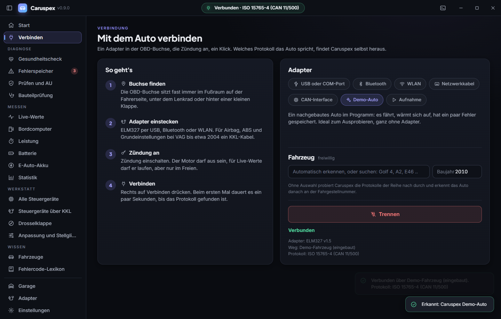
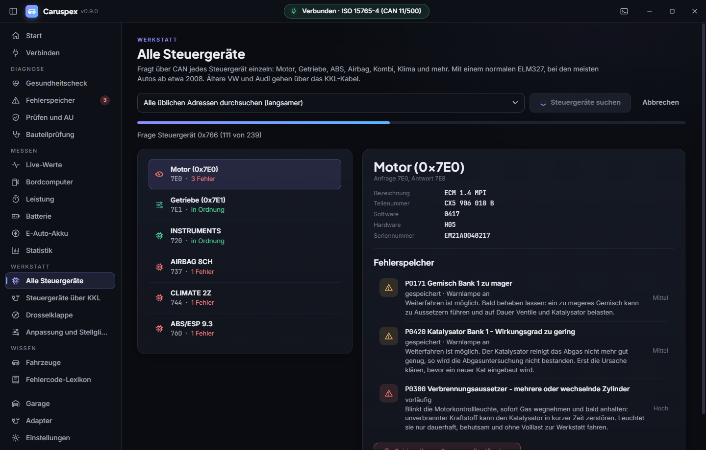
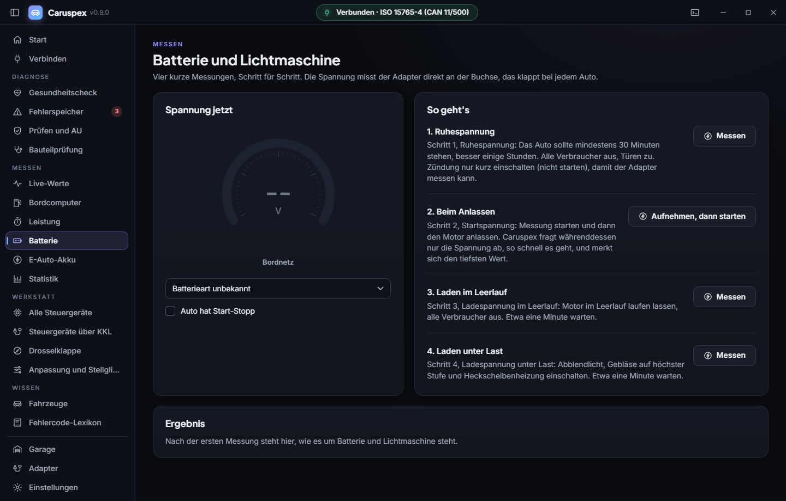

# Caruspex

<!-- languages -->
[English](README.md) · **Deutsch** · [Español](README.es.md) · [Français](README.fr.md) · [Português](README.pt.md) · [Italiano](README.it.md) · [Nederlands](README.nl.md) · [Polski](README.pl.md) · [Čeština](README.cs.md) · [Русский](README.ru.md) · [Українська](README.uk.md) · [Türkçe](README.tr.md) · [العربية](README.ar.md) · [中文](README.zh.md) · [日本語](README.ja.md) · [한국어](README.ko.md) · [हिन्दी](README.hi.md) · [Bahasa Indonesia](README.id.md)
<!-- /languages -->

Freie Fahrzeugdiagnose für Windows, Linux und macOS, geschrieben in Rust mit einer Tauri-2-Oberfläche. Ein Kabel oder Dongle, eine Software, in 18 Sprachen.

Der Name kommt vom Haruspex, dem antiken Deuter, der aus den Innereien las. Hier eben aus denen des Autos.


## Was es kann

**Das Auto erkennen**
- Nach dem Verbinden liest Caruspex die Fahrgestellnummer und sagt, welches Auto da hängt: Marke, Modell, Generation, Baujahr
- Katalog mit über 2.100 Modellgenerationen von 94 Marken, von 1980 bis heute, auch die, die es nicht mehr gibt
- Zu jeder Generation: welcher Diagnosestecker, wo er sitzt, welches Protokoll, und ob OBD-II, KKL oder nur die Herstellerdiagnose geht
- VIN-Prüfer für jede Fahrgestellnummer: Hersteller, Land, Modelljahr, Prüfziffer, Modellcode
- Garage: jedes Auto wird an seiner VIN wiedererkannt, mit Verlauf aller Prüfungen und Kilometerstände


**Gesundheitscheck mit einem Knopf**
- Liest Fehlerspeicher, Bereitschaftstests und Bauteilprüfung, beobachtet dann eine halbe Minute lang Gemisch, Temperatur, Lambdasonden und Ladespannung
- Punktzahl von 0 bis 100, jeder Abzug wird in einfachen Worten erklärt, mit dem nächsten Schritt
- Bereit für die AU? Welcher Test noch offen ist und wie man ihn fährt
- Prüfbericht als PDF zum Ausdrucken oder für die Werkstatt


**Fehlerspeicher**
- Gespeicherte, sporadische und dauerhafte Fehlercodes, bei mehreren Steuergeräten mit Absender (Motor, Getriebe)
- Rund 1.400 Normcodes (P, C, B, U) plus Herstellercodes für VAG, Ford, GM, Toyota, Honda, Nissan, Hyundai/Kia, Subaru und weitere; die Bedeutung eines P1-Codes richtet sich nach der erkannten Marke
- Je Code eine Ampel und die Frage, die alle zuerst haben: darf ich weiterfahren?
- Typische Ursachen, was man selbst prüfen kann, grobe Kostenklasse
- Das Auto in Durchsicht zeigt, wo das betroffene Bauteil sitzt
- Löschen mit klarer Warnung und automatischer Gegenprobe, Export als CSV


**Live-Werte**
- Alle Messwerte nach SAE J1979 bis PID C4, 145 PIDs mit über 300 Einzelwerten, nach Bereichen sortiert und durchsuchbar
- Darunter Kilometerstand, Gang, Öltemperatur, Kraftstoffdurchfluss, Drehmoment, Ladedruck, Abgastemperatur, Partikelfilter, AdBlue, NOx und Hybridakku, soweit das Auto sie liefert
- Mitlaufendes Diagramm, Aufzeichnung als CSV


**Messen**
- Bordcomputer: Verbrauch live und im Schnitt, Kosten, CO₂, Strecke und eine sanfte Bewertung des Fahrstils, auch bei Autos ohne eigenen Bordcomputer
- Leistung: 0 bis 100, 80 bis 120, Viertelmeile und Bremsweg aus dem Tachosignal (nur auf abgesperrter Strecke)
- Batterie und Lichtmaschine: Ruhespannung, Einbruch beim Anlassen, Ladespannung mit und ohne Last, geführt in vier Schritten

**Prüfen**
- Bereitschaftstests mit Klartext, Freeze Frame, Fahrgestellnummer
- Bauteilprüfung aus Modus 06 mit Messwert und Grenzen, Zündaussetzer je Zylinder
- Steuergerätenamen, Kalibrierung und Prüfsummen aus Modus 09 je Steuergerät
- Adapter direkt ansprechen für ELM327-Rohbefehle

**Adaptertest**
- Echter ELM327 oder Nachbau? Fragt die Befehle der einzelnen Versionen ab, misst die Antwortzeit und sagt ehrlich, was daraus folgt
- Erkennt OBDLink und andere STN-Adapter
- Schreibt nichts in den Adapter


**Jedes Kabel, jeder Weg ins Auto**

Caruspex erkennt selbst, was angesteckt ist und was das Auto spricht.

| Schnittstelle | Beispiele | Wie |
|---|---|---|
| ELM327 über USB, Bluetooth, Bluetooth LE, WLAN | günstige ELM327, Vgate, vLinker, Veepeak | serieller Anschluss, gekoppelt oder direkt per BLE, TCP |
| STN-Chips | OBDLink SX, EX, MX+, CX | wie ELM327, mit schnellerer Taktung |
| SAE J2534 PassThru | Tactrix OpenPort 2.0, Mongoose, VCX Nano, Scanmatik, Godiag, VAS 5054A im J2534-Modus | 64-Bit-Treiber des Herstellers, CAN mit ISO-TP in Caruspex |
| SLCAN / Lawicel | CANable, USBtin, CANUSB | serieller Anschluss, die automatische Suche findet sie |
| SocketCAN (Linux) | PEAK PCAN-USB, Kvaser, CANable mit candleLight, CAN-Aufsätze für den Raspberry Pi | can0 und Co. |
| KKL-Kabel (VAG 409.1) | Kabel mit FTDI oder CP2102 | K-Line, KWP1281 und KWP2000 |
| ENET-Kabel | BMW und Mini ab F-Baureihe | HSFZ über Ethernet |
| DoIP-Kabel | viele Autos ab etwa 2016 | ISO 13400 über Ethernet |

Über alle laufen dieselben Funktionen: OBD-II und OBD über UDS, alle Steuergeräte über UDS, BMW-Adressierung, Mithören von Rundfunkwerten (Tesla), Aufzeichnen und Abspielen.



**Alle Steuergeräte über CAN (UDS)**
- Mit einem normalen ELM327 fragt Caruspex jedes Steuergerät einzeln: Motor, Getriebe, ABS, Airbag, Kombi, Klima und mehr, bei den meisten Autos ab etwa 2008
- Fehlerspeicher je Steuergerät mit Fehlerart (Kurzschluss, Unterbrechung, unplausibel ...), Teilenummer, Software- und Hardwarestand
- Adresslisten für VAG, BMW und Mini, Ford, Mazda, GM, Toyota, Nissan, Hyundai/Kia, Renault und PSA, für alle anderen ein Suchlauf über die üblichen Adressen
- BMW und Mini ab der F-Baureihe mit der BMW-eigenen Adressierung über 6F1, dazu ein Suchlauf über alle 128 Diagnoseadressen; Fehlercodes im BMW-Format wie in ISTA (z.B. 480A10)
- Löschen je Steuergerät mit Warnung



**VW und Audi über KKL-Kabel (KWP1281 und KWP2000)**
- Drosselklappe anlernen: echte Grundeinstellung im Messwertblock 060 oder 098
- Alle Steuergeräte durchsuchen, auch ABS, Airbag, Kombi und Komfort, mit Prüfbericht
- Anpassungskanäle lesen und Stellglieddiagnose, bewusst nur lesend

**Herstellerwerte und eigene Werte**
- Akku von E-Autos: Akkugesundheit, Ladestand, Zellspannungen mit Spreizung, Temperaturen, für Hyundai Kona und Ioniq, Kia e-Niro, Renault Zoe, Nissan Leaf und Tesla Model 3 und Y (per Mithören am CAN-Bus); jeder Wert mit belegter Quelle
- Eigene Messwerte im verbreiteten Torque-CSV-Format laden, mit vollständigem Rechner für die Torque-Gleichungen



**Aufzeichnen und Abspielen**
- Eine Sitzung mit dem Auto in eine Datei aufzeichnen und später ohne Auto abspielen, hilfreich bei der Fehlersuche

**Ohne Auto und ohne Adapter**
- Eingebautes Demo-Auto: es fährt, wärmt sich auf, hat ein paar Fehler gespeichert und spricht wie ein echter ELM327 über CAN
- Fehlercode-Lexikon mit allen Codes, filterbar nach Marke

**Bedienung**
- Neue Oberfläche im Stil von Odysync: ruhig, dunkel, mit weichen Übergängen
- Verbinden Schritt für Schritt, mit automatischer Suche über alle Anschlüsse
- 18 Sprachen für Oberfläche und alle Fehlertexte: Deutsch, Englisch, Spanisch, Französisch, Portugiesisch, Italienisch, Niederländisch, Polnisch, Tschechisch, Russisch, Ukrainisch, Türkisch, Arabisch (von rechts nach links), Chinesisch, Japanisch, Koreanisch, Hindi und Indonesisch. Folgt der Systemsprache, umschaltbar in den Einstellungen, Einstellungen wirken sofort
- Meldet neue Versionen: beim Start fragt die App nur GitHub nach dem neuesten Release, sonst nichts (keine Daten über dich oder das Auto), abschaltbar in den Einstellungen

## Welche Autos

Jedes Fahrzeug mit OBD-II oder EOBD, in Europa also Benziner ab Baujahr 2001 und Diesel ab 2004, in den USA ab 1996. Dazu ältere VW, Audi, Seat und Skoda ab etwa 1990 über das KKL-Kabel. Welcher Weg bei einem bestimmten Auto geht, steht auf der Seite Fahrzeuge.

| Epoche | Bus | Beispiele |
|---|---|---|
| bis etwa 1995 | herstellereigen | VAG mit KKL über die 2x2-Stecker, sonst nur Werkstattgeräte |
| 1996 bis etwa 2003 | K-Line (ISO 9141-2, KWP2000) | Audi A2, Golf IV, Toyota, Renault |
| ab etwa 2004 | CAN (ISO 15765-4) | Audi A4 B7, Golf V, moderne Japaner |
| USA bis etwa 2005 | J1850 PWM und VPW | Ford, Chevrolet |
| neueste Autos | OBD über UDS (SAE J1979-2) | in den USA ab Modelljahr 2027 Pflicht, bei manchen neueren Autos schon jetzt; wird erkannt und automatisch übersetzt |
| BMW und Mini ab F-Baureihe | ENET (HSFZ über Ethernet) oder D-CAN mit 6F1-Adressierung | alle Steuergeräte |
| viele Autos ab etwa 2016 | DoIP (ISO 13400) mit DoIP-Kabel | OBD über Ethernet, automatisch gefunden |
| Tesla Model 3 und Y | kein OBD: CAN-Rundfunk | Akku, Zellen, Temperaturen, Tempo, Kilometerstand per Mithören (Adapterkabel an die Diagnosebuchse) |

Reine Elektroautos müssen kein OBD-II für die Abgasüberwachung anbieten. Manche antworten trotzdem teilweise; bei Autos ganz ohne Antwort, aber mit Verkehr auf dem Bus, verbindet sich Caruspex zum Mithören und liest, was die eingebauten Pakete kennen (bisher Tesla Model 3 und Y).

## Welcher Adapter kann was

Unterstützt wird jeder **ELM327**-kompatible Adapter (USB, klassisches Bluetooth nach dem Koppeln direkt über RFCOMM unter Windows und Linux oder über seinen COM-Port, **Bluetooth LE** wie Vgate iCar Pro BLE, vLinker, OBDLink CX oder Veepeak BLE ohne Koppeln, oder WLAN), ein **ENET-Kabel** für BMW und Mini ab der F-Baureihe (Caruspex findet das Auto im Netzwerk und liest alle Steuergeräte über Ethernet, ohne Adapterchip; Codieren und Flashen bleiben bei E-Sys, ISTA oder den Tuning-Werkzeugen) sowie jedes **KKL-Kabel nach VAG 409.1**. Adapter mit FTDI- oder CP2102-Chip sind auf der K-Line deutlich zuverlässiger als die ganz billigen Klone, für KWP1281 sollte es ein echter FTDI FT232RL sein.

Nicht kompatibel sind herstellereigene Interfaces wie Delphi DS150E, Autocom oder VAS 5054A. Die sprechen kein ELM327, sondern ihr eigenes Protokoll.

Was womit geht, ist der Punkt, an dem die meisten Diagnoseprogramme schwammig werden, deshalb hier deutlich:

| Funktion | ELM327 | KKL 409.1 |
|---|---|---|
| Motorfehler lesen und löschen | ja | ja |
| Live-Werte, Freeze Frame, Bereitschaftstests | ja | ja |
| ABS, Airbag, Kombi, Komfort | **nein** | ja |
| Messwertblöcke der Herstellerdiagnose | **nein** | ja |
| **Drosselklappe anlernen** | **nein** | ja |

Der Grund ist kein Softwareproblem: KWP1281 ist ein Blockprotokoll, bei dem jedes einzelne Byte von der Gegenstelle mit seinem Einerkomplement quittiert wird. Die Firmware eines ELM327 kennt nur ganze Anfragen und Antworten und kann diesen Takt nicht abbilden. Ein KKL-Kabel reicht die K-Leitung roh durch, dort spricht Caruspex das Protokoll selbst, inklusive der 5-Baud-Weckadresse, die Bit für Bit von Hand getaktet wird.

### Zwei VAG-Protokolle, automatisch erkannt

Auf der K-Leitung sprechen VAG-Steuergeräte je nach Baujahr zwei verschiedene Sprachen. Der Audi A2 liegt genau auf der Grenze:

| Protokoll | Typisch für | Grundeinstellung |
|---|---|---|
| KWP1281, Blockprotokoll | 1.4 mit Saugrohreinspritzung | eigener Befehl (Block 0x28) |
| KWP2000, ISO 14230 | 1.6 FSI mit Bosch MED | eigene Sitzungsart, dann Block lesen |

Welches gefahren wird, verrät das Steuergerät nach der Weckadresse über seine beiden Schlüsselbytes. Caruspex liest sie und richtet sich danach, ohne dass man etwas einstellen muss. Anpassungskanäle und Stellglieddiagnose gibt es bisher nur auf dem KWP1281-Weg; auf dem anderen sagt die Software das offen, statt still zu scheitern.

Getestet ist das gegen nachgebaute Steuergeräte in `crates/caruspex-protocols/tests/common/`, die den byteweisen Takt echt nachspielen.

Noch nicht gebaut: herstellerspezifische Diagnose über CAN mit TP 2.0 für Fahrzeuge ab etwa 2004.

## Herunterladen

Fertige Pakete liegen auf der [Release-Seite](https://github.com/SenseiIssei/Caruspex/releases):

| System | Datei | Hinweis |
|---|---|---|
| Windows 10 und 11, 64 Bit | `Caruspex-<version>-windows-x64-setup.exe` | Installiert ohne Administratorrechte und kann `caruspex_cli` in den Suchpfad legen. Eine installierte 0.8 wird an Ort und Stelle aktualisiert, die WebView2-Laufzeit kommt nur dazu, wenn sie fehlt |
| Windows 10 und 11, 64 Bit | `Caruspex-<version>-windows-x64.zip` | Zum Entpacken ohne Installation. Braucht die WebView2-Laufzeit, die Windows 10 und 11 schon mitbringen |
| macOS ab 13, Apple Silicon | `Caruspex-<version>-macos.dmg` | App in den Programme-Ordner ziehen |
| Linux, x86_64 | `Caruspex-<version>-linux-x86_64.AppImage` | `chmod +x` und starten |
| Debian und Ubuntu, 64 Bit | `Caruspex-<version>-linux-amd64.deb` | Installieren mit `sudo apt install ./Caruspex-<version>-linux-amd64.deb` |
| Nur das Konsolenwerkzeug | `caruspex_cli-<version>-windows-x64.zip`, `caruspex_cli-<version>-linux-x86_64.tar.gz`, `caruspex_cli-<version>-macos.tar.gz` | Für Skripte und Server, ohne Oberfläche |

Die Pakete sind noch nicht signiert. Windows SmartScreen fragt beim ersten Start nach („Weitere Informationen“, „Trotzdem ausführen“), unter macOS die App beim ersten Mal mit Rechtsklick und „Öffnen“ starten.

## Was gebaut wird

Aus derselben Quelle entstehen auf jedem System zwei Programme:

| Ergebnis | Was es ist |
|---|---|
| `target/release/caruspex` bzw. `caruspex.exe` | die Anwendung mit der Tauri-Oberfläche (`tauri build` schreibt auch Installer und Bündel nach `target/release/bundle/`) |
| `target/release/caruspex_cli` bzw. `caruspex_cli.exe` | Konsolenwerkzeug auf demselben Kern, skriptbar |

Das Konsolenwerkzeug spricht Englisch. Verbunden wird mit `--demo` (das eingebaute Demo-Auto), `--tcp HOST[:PORT]`, `--port NAME [--baud N]`, `--enet HOST|auto`, `--can SPEC` oder `--replay DATEI`:

| Befehl | Was er tut |
|---|---|
| `read` | Fehlerlampe, Bereitschaft und Fehlercodes, mit der Bedeutung für die Marke, wenn die VIN sie verrät |
| `vin` | VIN, was sie sagt (Hersteller, Land, Modelljahr, Prüfziffer), und das passende Auto aus dem Katalog |
| `freeze` | Alle Freeze Frames, einer je gespeichertem Fehler |
| `health` | Gesundheitscheck: Fehler, Bereitschaft, Modus 06 und eine Messreihe (`--seconds N`, sonst 15) |
| `probe` | Adaptertest: was der ELM327 wirklich ist, welche Befehle er kennt, Antwortzeiten |
| `uds` | UDS über CAN: Kennung und Fehlerspeicher jedes Steuergeräts (`--ids A,B,...` für eigene Adressen) |
| `custom` | Hersteller- und eigene Werte aus einem eingebauten Paket (`--pack NAME`) oder einer Torque-CSV (`--csv DATEI`), einmal |
| `live`, `info`, `clear`, `ecus`, `ports`, `kklcheck` | Live-Werte, VIN und erster Freeze Frame, Löschen, alles je Steuergerät, serielle Ports, Selbsttest des KKL-Kabels |
| `enet`, `interfaces` | Sucht BMW, Mini und DoIP-Autos im Netzwerk; listet die CAN-Schnittstellen dieses Rechners (J2534-Treiber, SocketCAN) |
| `version`, `help` | Version des Programms, die vollständige Liste der Befehle und Optionen |

Mit `--json` geben `read`, `vin`, `health`, `probe`, `freeze`, `uds` und `custom` JSON für Skripte aus, `--record DATEI` zeichnet die ganze Sitzung mit dem Adapter für `--replay` auf, `--fast-timing` schaltet den Adapter auf aggressive adaptive Taktung, `-v` schreibt jeden Adapterbefehl mit (zusammen mit `--json` nach stderr). `caruspex_cli help` zeigt alles.

```bash
target/release/caruspex_cli health --demo --json > health.json
```

## Pakete und Releases

`bash tools/package.sh` schreibt die Pakete des eigenen Systems nach `dist/`: unter Windows Installer und zwei Zips (der Installer braucht [Inno Setup 6](https://jrsoftware.org/isinfo.php)), unter macOS das dmg und das Archiv des Konsolenwerkzeugs, unter Linux das AppImage, das `.deb` und das Archiv des Konsolenwerkzeugs. `bash tools/smoke_test.sh` installiert oder öffnet sie danach wie ein Nutzer, startet beide Programme und entfernt sie wieder. Die CI macht beides bei jedem Lauf.

Ein Release entsteht aus einem Tag. `bash tools/release.sh <version>` bereitet es auf einem eigenen Zweig vor, ohne etwas zu pushen: Es setzt die Version in `Cargo.toml` und `app/package.json`, legt `changelog/<version>.md` an (Deutsch und Englisch), lässt Prüfungen, Tests, Pakete und Rauchtest laufen und erneuert die Bildschirmfotos der README (`tools/screenshots.sh de` und `tools/screenshots.sh en`). Nach dem Merge des Pull Requests `v<version>` taggen und den Tag pushen. Die CI baut alle drei Systeme und veröffentlicht das Release mit den Paketen und der Änderungsliste.

Die CI (`.github/workflows/build.yml`) prüft zuerst unter Linux Formatierung, erzeugte Tabellen, Übersetzungen, Oberflächen-Build und clippy und testet, paketiert und rauchtestet dann Windows, Linux und macOS. Ein zweiter Ablauf (`.github/workflows/data-check.yml`) sucht einmal im Monat nach neuen VIN-Codes, Fahrzeugen und DBC-Dateien an der Quelle und eröffnet ein Issue mit dem Neuen.

## Selbst bauen

Vorausgesetzt: die stabile Rust-Toolchain (Edition 2024, Rust 1.85 oder neuer), Node 24 mit npm und Python 3 für die Generatoren und die Übersetzungsprüfung. Unter Linux kommen die Systempakete dazu, die Oberfläche und Adapteranbindung brauchen (Namen für Debian und Ubuntu):

```bash
sudo apt-get install libwebkit2gtk-4.1-dev librsvg2-dev libdbus-1-dev libudev-dev pkg-config
```

Windows braucht die WebView2-Laufzeit (Teil von Windows 10 und 11), macOS nichts Zusätzliches.

Die Abhängigkeiten der Oberfläche einmal holen, dann das Konsolenwerkzeug und die Anwendung bauen:

```bash
npm --prefix app ci
```

```bash
cargo build --release -p caruspex-cli
```

```bash
npm --prefix app run tauri -- build
```

`npm --prefix app run tauri -- dev` startet die Anwendung mit Live-Neuladen zum Entwickeln. Die Oberfläche allein, ohne das Tauri-Fenster, läuft in einem normalen Browser mit dem eingebauten Demo-Auto:

```bash
npm --prefix app run dev
```

`http://localhost:5287/?demo` verbindet gleich mit dem Demo-Auto. Mit `?lang=de` wählt man die Sprache, mit `?theme=light` das helle Erscheinungsbild, zum Beispiel `?demo&lang=de&theme=light`. Ohne die Tauri-Hülle gibt es keinen Adapterzugriff, die Browser-Fassung kennt also nur das Demo-Auto.

### Serielle Rechte unter Linux

Damit der Adapter ohne `sudo` erreichbar ist:

```bash
sudo usermod -aG dialout $USER
```

Danach einmal ab- und wieder anmelden.

## Tests

```bash
cargo test --workspace
```

Rund 370 Tests laufen in wenigen Sekunden, alle ohne Auto. Sie decken Antwort-Parser, Fehlercode-Dekodierung, Messwert-Umrechnung, Fahrzeugprofile und VIN-Decoder ab, die EOBD- und UDS-Dienste gegen das Demo-Auto, vollständige KWP1281- und KWP2000-Sitzungen gegen nachgebaute Steuergeräte, ENET (HSFZ) und DoIP gegen nachgebaute Gateways, SLCAN und den J2534-Weg gegen einen nachgebauten Treiber, Aufzeichnen und Abspielen sowie die Auswertung (Gesundheitscheck, Batterietest, Bordcomputer, Leistungsmessung). Die Tests des Konsolenwerkzeugs starten das gebaute `caruspex_cli` und vergleichen die Ausgabe mit den Vergleichsdateien in `crates/caruspex-cli/tests/golden/`. Die enthalten, was die frühere C++-Fassung für dieselben Befehle ausgegeben hat, jeder Unterschied zum alten Werkzeug fällt also auf.

Was die CI außer den Tests prüft:

```bash
cargo fmt --all --check
```

```bash
cargo clippy --workspace --all-targets -- -D warnings
```

```bash
python tools/i18n_rust.py --strict
```

```bash
npm --prefix app run build
```

Die ersten beiden sind Formatierung und Lints. `tools/i18n_rust.py --strict` schlägt fehl, wenn ein Text des Kerns in den Übersetzungsdateien fehlt oder eine Übersetzung in einer der 18 Sprachen; der Oberflächen-Build prüft seine eigenen Texte genauso, wenn `I18N_STRICT=1` gesetzt ist. Die erzeugten Tabellen erneuern `python tools/gen_dtc.py`, `gen_vehicles.py`, `gen_ecus.py` und `gen_pids.py`; die CI schlägt fehl, wenn sie vom Eingecheckten abweichen.

## Ohne Auto ausprobieren

Am einfachsten über das eingebaute Demo-Auto: auf der Seite Verbinden "Demo-Auto" wählen, oder gleich so starten:

```bash
target/release/caruspex --demo
```

`caruspex --help` listet alle Optionen der Anwendung: `--tcp`, `--port`, `--bluetooth`, `--enet`, `--can`, `--replay`, `--report`, `--language`, `--theme`, `--page`, `--shot` und `--size`.

Der Python-Simulator spielt wahlweise den Audi A2 auf der K-Line oder ein CAN-Auto mit Motor und Getriebe:

```bash
python tools/mock_elm327.py --can
```

```bash
target/release/caruspex --tcp 127.0.0.1:35000
```

Das Konsolenwerkzeug läuft ebenso gegen den Simulator:

```bash
target/release/caruspex_cli read --tcp 127.0.0.1:35000
```

Für Bildschirmfotos und Dokumentation: `--page faults --shot bild.png --size 1440x920` öffnet eine Seite, macht nach ein paar Sekunden ein Bild des Fensters und beendet sich (`tools/screenshots.sh` macht den ganzen Satz).

## Aufbau

```
crates/caruspex-i18n/       Sprachen: Deutsch und Englisch im Code, die anderen 16 aus translations/
crates/caruspex-vehicles/   VIN-Decoder und Fahrzeugkatalog (Marken, Modelle, Generationen, Stecker, Busse)
crates/caruspex-data/       Fehlercodes, Messwerte, Steuergeräteadressen, Zuordnung Code zu Bauteil
crates/caruspex-link/       Wege zum Adapter (seriell, TCP, Bluetooth LE), ELM327-Treiber, Adaptertest
crates/caruspex-protocols/  EOBD, UDS, KWP2000 und KWP1281 (K-Line, Byte für Byte)
crates/caruspex-net/        BMW ENET (HSFZ), DoIP, SLCAN, SocketCAN, J2534 PassThru
crates/caruspex-record/     Aufzeichnen und Abspielen, eigene Werte (Torque-CSV, PID-Pakete), JSON-Schreiber
crates/caruspex-analysis/   Gesundheitscheck, Fahrzyklus-Hilfe, Bordcomputer, Leistung, Batterietest
crates/caruspex-demo/       Das eingebaute Demo-Auto: ein ELM327 mit simulierten Steuergeräten
crates/caruspex-cli/        Das Konsolenwerkzeug, mit seinen Vergleichsdatei-Tests
app/src/                    Die Oberfläche: React 19 und TypeScript (Seiten, Rahmen, Zustand, Bericht, i18n)
app/src-tauri/              Die Tauri-Anwendung: Fenster, Befehle, Update-Prüfung, Kommandozeilenoptionen
translations/               Gemeinsame Übersetzungsdateien für Kern und Oberfläche, 18 Sprachen
data/                       Fahrzeugkatalog als CSV, von Hand gepflegt, dazu Quellen für Steuergeräte und PIDs
tools/                      Generatoren, Übersetzungsprüfung, Paket-, Release- und Bildschirmfoto-Skripte, Simulator
docs/                       Bildschirmfotos der README
packaging/                  Installer-Skript für Windows, Desktop-Datei für Linux, Info.plist für macOS
changelog/                  Änderungslisten je Version, Deutsch und Englisch
```

Der Kern kennt die Oberfläche nicht: Anwendung und Konsolenwerkzeug laufen auf genau demselben Code, betriebssystemabhängig sind nur die Anschlüsse in `caruspex-link` und `caruspex-net`.

Die Fehlercode-Datenbank wird erzeugt, nicht abgetippt. Viele EOBD-Codes folgen festen Familien, etwa pro Zylinder oder pro Lambdasonde. `tools/gen_dtc.py` rechnet die aus, nimmt die gepflegten Listen aus `tools/dtc/` dazu und schreibt `crates/caruspex-data/src/generated/*.rs`. Nach Änderungen an den Daten einmal laufen lassen:

```bash
python tools/gen_dtc.py
```

Genauso der Fahrzeugkatalog: die CSV-Dateien in `data/vehicles/` bearbeiten, dann

```bash
python tools/gen_vehicles.py
```

Für Steuergeräteadressen und PID-Pakete gibt es `tools/gen_ecus.py` und `tools/gen_pids.py`. Übersetzt wird nach [translations/TRANSLATING.md](translations/TRANSLATING.md); nach einem neuen Text im Code zeigt `python tools/i18n_rust.py`, was noch fehlt. Alle 18 Sprachen für Kern und Oberfläche liegen in denselben Dateien.

## Löschen: was dabei passiert

Modus 04 löscht Fehlerspeicher, Freeze Frame und die Bereitschaftstests. Direkt danach fällt eine Abgasuntersuchung durch, bis das Auto wieder ein paar vollständige Fahrzyklen gelaufen ist. Ein Code, dessen Ursache noch da ist, steht nach kurzer Fahrt wieder drin. Löschen ersetzt keine Reparatur.

## Lizenz

MIT, siehe [LICENSE](LICENSE). Die mitgelieferten Schriften stehen unter der SIL Open Font License 1.1: JetBrains Mono ([OFL.txt](resources/fonts/OFL.txt)), Inter ([OFL-Inter.txt](resources/fonts/OFL-Inter.txt)) und Plus Jakarta Sans ([OFL-PlusJakartaSans.txt](resources/fonts/OFL-PlusJakartaSans.txt)).
