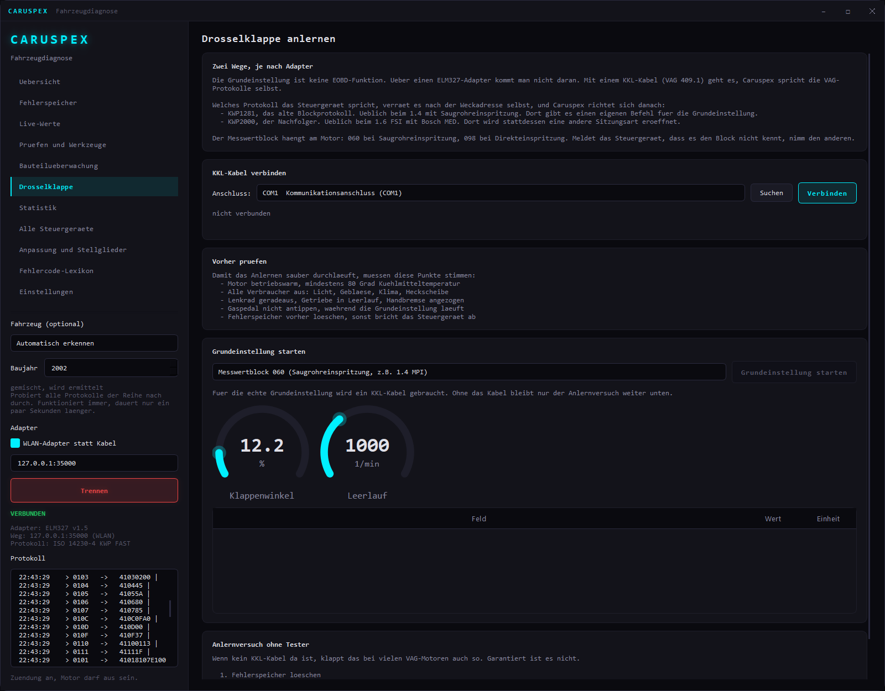
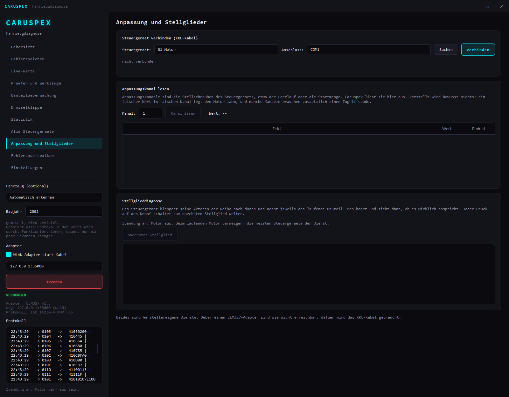
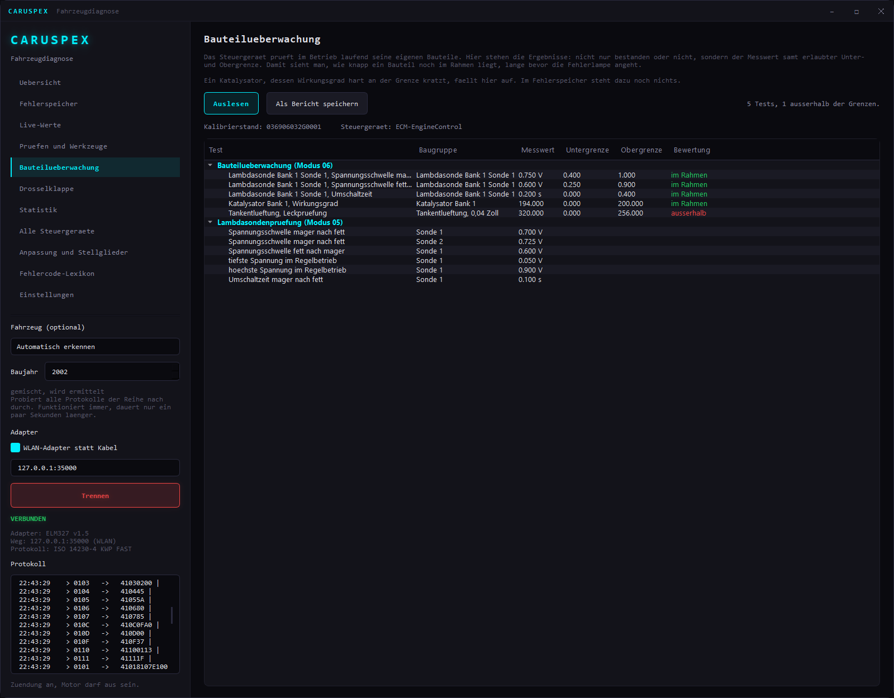
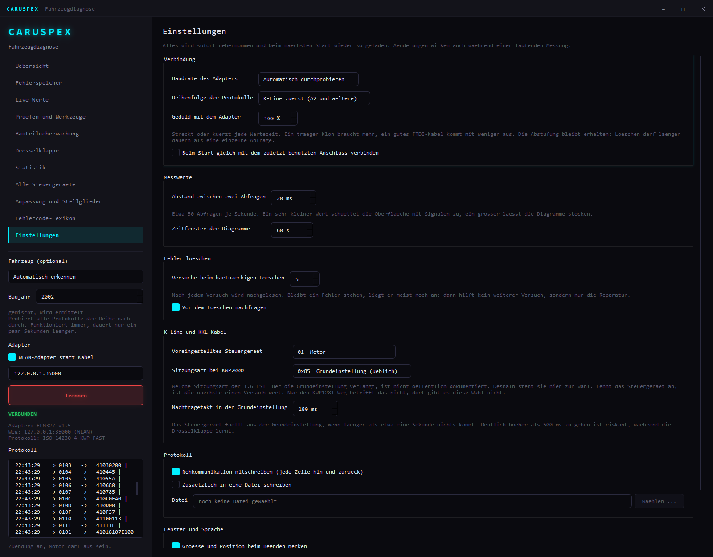
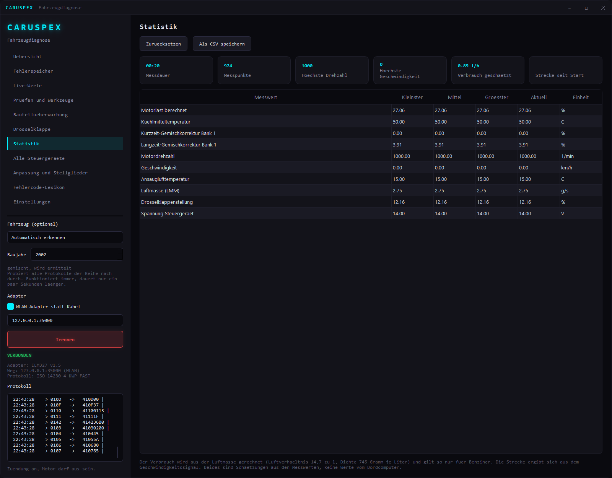

# Caruspex

Freie Fahrzeugdiagnose für Windows, Linux und macOS. Ein Kabel oder Dongle, eine Software, auf Deutsch oder Englisch.

[English version of this page](README.md)

Der Name kommt vom Haruspex, dem antiken Deuter, der aus den Innereien las. Hier eben aus denen des Autos.


## Was es kann

**Fehlerspeicher**
- Gespeicherte, sporadische und dauerhafte Fehlercodes
- Rund 1.400 generische SAE-Codes (P, C, B, U) plus Herstellercodes für VAG, Ford, GM, Toyota, Honda, Nissan,
  Hyundai/Kia, Subaru und weitere, auf Deutsch und Englisch; die Bedeutung eines P1-Codes richtet sich nach der Marke
- Für die häufigen Fehler: darf ich weiterfahren, typische Ursachen, einfache Prüfungen und eine grobe Kostenklasse
- Unbekannte Codes fallen auf die Bedeutung ihrer Gruppe zurück statt leer zu bleiben
- Löschen mit klarer Warnung und automatischer Gegenprobe
- Export als CSV

**Live-Werte**
- Rund 80 Messwerte, in verständliche Einheiten umgerechnet
- Mitlaufendes Diagramm mit mehreren Kurven und rollendem 90-Sekunden-Fenster
- Animierte Rundanzeigen für Drehzahl, Tempo, Kühlmittel, Last, Drosselklappe, Bordspannung
- Aufzeichnung als CSV für die spätere Auswertung

**Prüfen**
- Bereitschaftstests mit Klartext, ob es für die Abgasuntersuchung reicht
- Freeze Frame: die Umgebungsdaten aus dem Moment, in dem der Fehler auftrat
- Fahrgestellnummer
- Adapter direkt ansprechen für ELM327-Rohbefehle

**Wo kommt der Fehler her**
- Schematisches Fahrzeug, das die betroffene Baugruppe hervorhebt, je nach Fehlercode
- Klartext dazu, wo man konkret nachsieht


**Drosselklappe anlernen (KWP1281 über KKL-Kabel)**
- Echte Grundeinstellung im Messwertblock 060 oder 098
- Verbindung zu jedem Steuergerät, nicht nur zum Motor: ABS, Airbag, Kombi, Komfort
- Fehlerspeicher und Messwertblöcke der herstellereigenen Diagnose
- Checkliste der Voraussetzungen, damit das Steuergerät nicht abbricht


**Alle Steuergeraete durchsuchen (KKL)**
- Klappert der Reihe nach jedes bekannte Steuergeraet ab
- Zeigt, welche das Fahrzeug hat, welche fehlen und wo etwas im Speicher steht
- Fehler mit Klartext, aufklappbar je Steuergeraet
- Prüfbericht als Textdatei zum Ausdrucken

**Anpassung und Stellglieder (KKL)**
- Anpassungskanaele lesen: der eingestellte Wert plus die Anzeigefelder des Steuergeraets
- Stellglieddiagnose: das Steuergeraet klappert seine Aktoren durch und nennt das laufende Bauteil
- Bewusst nur lesend, ein falscher Wert im falschen Kanal legt den Motor lahm


**Bauteilüberwachung (Modus 06 und 05)**
- Der ausführlichste Teil von EOBD: zu jedem internen Selbsttest der Messwert samt erlaubter Unter- und Obergrenze
- Damit sieht man, wie knapp ein Bauteil noch im Rahmen liegt, lange bevor die Fehlerlampe angeht
- Lambdasondenprüfung mit Schwellspannungen und Umschaltzeiten
- Kalibrierstand, Prüfsumme und Name des Steuergeräts aus Modus 09
- Prüfbericht als Textdatei


**Einstellungen**
- Baudrate, Protokollreihenfolge und ein Faktor fuer alle Zeitlimits, falls der Adapter traege ist
- Abfragetakt und Zeitfenster der Diagramme
- Versuche beim hartnaeckigen Loeschen, Nachfrage vor dem Loeschen abschaltbar
- Sitzungsart und Nachfragetakt fuer die Grundeinstellung
- Rohkommunikation mitschreiben, wahlweise zusaetzlich in eine Datei
- Sprache: wie das System, Deutsch oder Englisch (wirkt beim nächsten Start)
- Alles wird gespeichert und wirkt sofort, auch waehrend einer laufenden Messung


**Statistik**
- Kleinster, mittlerer, groesster und aktueller Wert je Messgroesse
- Messdauer, Anzahl Messpunkte, Hoechstdrehzahl, Hoechstgeschwindigkeit
- Verbrauch aus der Luftmasse geschaetzt, Strecke aus dem Geschwindigkeitssignal
- Export als CSV


**Nachschlagen**
- Durchsuchbares Fehlercode-Lexikon, funktioniert offline und ohne Auto

## Welche Autos

Jedes Fahrzeug mit EOBD, in Europa also Benziner ab Baujahr 2001 und Diesel ab 2004, in den USA ab 1996. Für über 40 Marken sind Profile hinterlegt, damit das richtige Protokoll zuerst probiert wird statt sich durch alle neun durchzutasten.

| Epoche | Bus | Beispiele |
|---|---|---|
| 1996 bis etwa 2003 | K-Line (ISO 9141-2, KWP2000) | Audi A2, alte Golf, Toyota, Renault |
| ab etwa 2004 | CAN (ISO 15765-4) | Audi A4 B7, Golf 5, moderne Japaner |
| USA bis etwa 2005 | J1850 PWM und VPW | Ford, Chevrolet |

## Welcher Adapter kann was

Unterstützt wird jeder **ELM327**-kompatible Adapter (USB, Bluetooth als COM-Port oder WLAN) sowie jedes **KKL-Kabel nach VAG 409.1**. Adapter mit FTDI- oder CP2102-Chip sind auf der K-Line deutlich zuverlässiger als die ganz billigen Klone, für KWP1281 sollte es ein echter FTDI FT232RL sein.

Nicht kompatibel sind herstellereigene Interfaces wie Delphi DS150E, Autocom oder VAS 5054A. Die sprechen kein ELM327, sondern ihr eigenes Protokoll.

Was womit geht, ist der Punkt, an dem die meisten Diagnoseprogramme schwammig werden, deshalb hier deutlich:

| Funktion | ELM327 | KKL 409.1 |
|---|---|---|
| Motorfehler lesen und löschen | ja | ja |
| Live-Werte, Freeze Frame, Bereitschaftstests | ja | ja |
| ABS, Airbag, Kombi, Komfort | **nein** | ja |
| Messwertblöcke der Herstellerdiagnose | **nein** | ja |
| **Drosselklappe anlernen** | **nein** | ja |

Der Grund ist kein Softwareproblem: KWP1281 ist ein Blockprotokoll, bei dem jedes einzelne Byte von der Gegenstelle mit seinem Einerkomplement quittiert wird. Die Firmware eines ELM327 kennt nur ganze Anfragen und Antworten und kann diesen Takt nicht abbilden. Ein KKL-Kabel reicht die K-Leitung roh durch, dort spricht Caruspex das Protokoll selbst, inklusive der 5-Baud-Weckadresse, die Bit für Bit von Hand getaktet wird.

### Zwei VAG-Protokolle, automatisch erkannt

Auf der K-Leitung sprechen VAG-Steuergeräte je nach Baujahr zwei verschiedene Sprachen. Der Audi A2 liegt genau auf der Grenze:

| Protokoll | Typisch für | Grundeinstellung |
|---|---|---|
| KWP1281, Blockprotokoll | 1.4 mit Saugrohreinspritzung | eigener Befehl (Block 0x28) |
| KWP2000, ISO 14230 | 1.6 FSI mit Bosch MED | eigene Sitzungsart, dann Block lesen |

Welches gefahren wird, verrät das Steuergerät nach der Weckadresse über seine beiden Schlüsselbytes. Caruspex liest sie und richtet sich danach, ohne dass man etwas einstellen muss. Anpassungskanäle und Stellglieddiagnose gibt es bisher nur auf dem KWP1281-Weg; auf dem anderen sagt die Software das offen, statt still zu scheitern.

Getestet ist das gegen ein nachgebautes Steuergerät in `tests/FakeEcu.cpp`, das den byteweisen Takt echt nachspielt.

Noch nicht gebaut: herstellerspezifische Diagnose über CAN mit TP 2.0 für Fahrzeuge ab etwa 2004.

## Was gebaut wird

Aus derselben Quelle entstehen auf jedem System zwei Programme:

| Ergebnis | Was es ist |
|---|---|
| `caruspex` bzw. `caruspex.exe` bzw. `Caruspex.app` | die Anwendung mit Oberfläche |
| `caruspex_cli` bzw. `caruspex_cli.exe` | Konsolenwerkzeug auf demselben Kern, skriptbar |

## Selbst bauen

Vorausgesetzt: ein C++20-Compiler (MSVC 2022, GCC 12 oder Clang 15 aufwärts), CMake 3.21, Python 3 und Qt 6.5 oder neuer mit dem Modul Charts.

Qt holt man am schnellsten über `aqtinstall`. Über Conan würde Qt aus den Quellen gebaut, und das dauert Stunden:

```bash
pip install aqtinstall conan
```

Windows:

```bash
python -m aqt install-qt windows desktop 6.8.3 win64_msvc2022_64 -m qtcharts -O C:/Qt
```

Linux:

```bash
python -m aqt install-qt linux desktop 6.8.3 linux_gcc_64 -m qtcharts -O ~/Qt
```

macOS:

```bash
python -m aqt install-qt mac desktop 6.8.3 clang_64 -m qtcharts -O ~/Qt
```

Dann die übrigen Abhängigkeiten und der Build, überall gleich:

```bash
conan profile detect --force
```

```bash
conan install . --output-folder=build/conan --build=missing -s compiler.cppstd=20
```

```bash
cmake -S . -B build -DCMAKE_BUILD_TYPE=Release -DCMAKE_TOOLCHAIN_FILE=build/conan/conan_toolchain.cmake -DCMAKE_PREFIX_PATH=C:/Qt/6.8.3/msvc2022_64
```

```bash
cmake --build build --config Release
```

`cmake` muss im PATH liegen, sonst kann Conan seine Pakete nicht bauen.

Zum Schluss die Qt-Bibliotheken danebenlegen, unter Windows mit `windeployqt`, unter macOS mit `macdeployqt`.

### Serielle Rechte unter Linux

Damit der Adapter ohne `sudo` erreichbar ist:

```bash
sudo usermod -aG dialout $USER
```

Danach einmal ab- und wieder anmelden.

## Tests

```bash
cmake -S . -B build -A x64 -DCARUSPEX_TESTS=ON -DCMAKE_TOOLCHAIN_FILE=build/conan/conan_toolchain.cmake
cmake --build build --config Release
ctest --test-dir build -C Release --output-on-failure
```

Geprüft werden Antwort-Parser, Fehlercode-Dekodierung, Messwert-Umrechnung und die Fahrzeugprofile. Alles ohne Auto.

## Ohne Auto ausprobieren

Der mitgelieferte Simulator spielt ein Steuergerät mit Drosselklappenfehlern nach:

```bash
python tools/mock_elm327.py
```

```bash
build/bin/Release/caruspex.exe --tcp 127.0.0.1:35000
```

## Aufbau

```
src/core/     Transport, ELM327-Treiber, EOBD-Dienste, KWP1281. Kein Qt, gut testbar.
              Serial_win.cpp und Serial_posix.cpp, CMake wählt die passende.
src/data/     Fehlercodes, Messwerte, Fahrzeugprofile, Zuordnung Code zu Bauteil
src/app/      Oberfläche (Qt 6 Widgets und Charts)
src/cli_main.cpp  Konsolenwerkzeug auf demselben Kern
tools/        Fehlercode-Generator und Simulator
tests/        Catch2-Tests
```

Betriebssystemabhängig ist nur die serielle Schnittstelle. Alles darüber, also Protokoll, Parser und Dienste, ist reines C++20 mit `std::chrono` statt Plattform-APIs.

Die Fehlercode-Datenbank wird erzeugt, nicht abgetippt. Viele EOBD-Codes folgen festen Familien, etwa pro Zylinder oder pro Lambdasonde. `tools/gen_dtc.py` rechnet die aus, nimmt die gepflegten Listen aus `tools/dtc/` dazu und schreibt `src/data/*.gen.cpp`. Nach Änderungen an den Daten einmal laufen lassen:

```bash
python tools/gen_dtc.py
```

## Löschen: was dabei passiert

Modus 04 löscht Fehlerspeicher, Freeze Frame und die Bereitschaftstests. Direkt danach fällt eine Abgasuntersuchung durch, bis das Auto wieder ein paar vollständige Fahrzyklen gelaufen ist. Ein Code, dessen Ursache noch da ist, steht nach kurzer Fahrt wieder drin. Löschen ersetzt keine Reparatur.

## Lizenz

MIT, siehe [LICENSE](LICENSE). Die mitgelieferte Schrift JetBrains Mono steht unter der SIL Open Font License 1.1 ([OFL.txt](resources/fonts/OFL.txt)).
