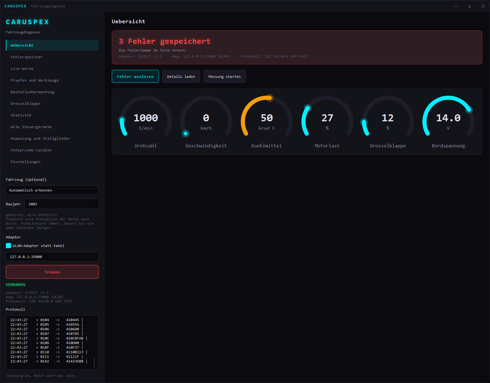
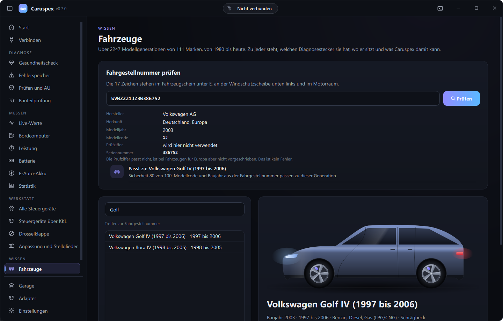
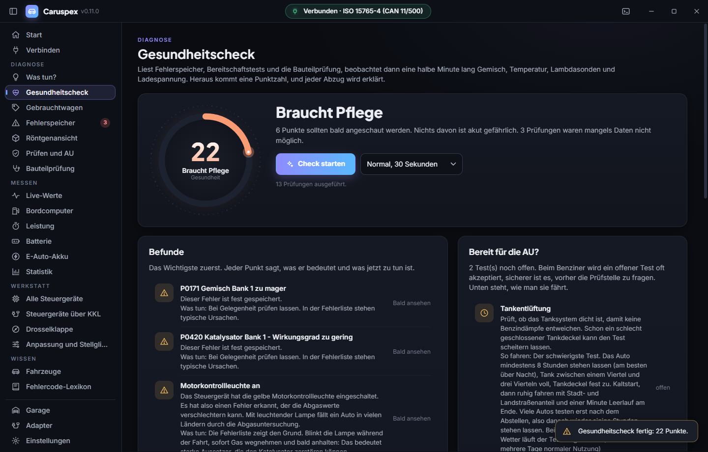
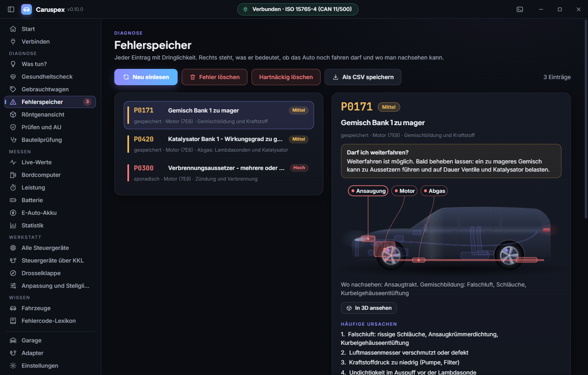
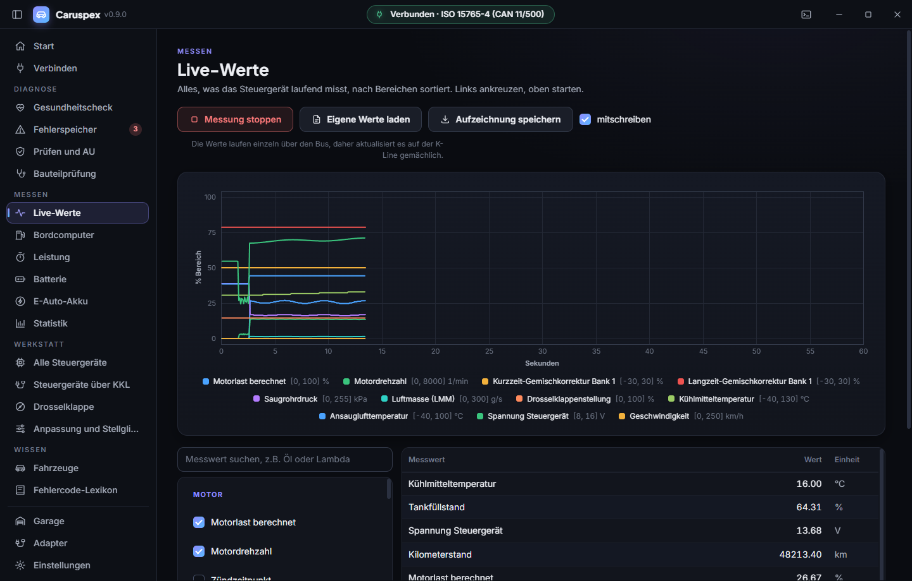
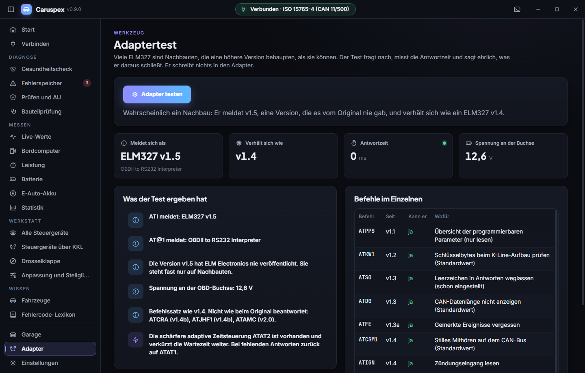

# Caruspex

Freie Fahrzeugdiagnose für Windows, Linux und macOS. Ein Kabel oder Dongle, eine Software, auf Deutsch oder Englisch.

[English version of this page](README.md)

Der Name kommt vom Haruspex, dem antiken Deuter, der aus den Innereien las. Hier eben aus denen des Autos.



## Was es kann

**Das Auto erkennen**
- Nach dem Verbinden liest Caruspex die Fahrgestellnummer und sagt, welches Auto da hängt: Marke, Modell, Generation, Baujahr
- Katalog mit über 2.100 Modellgenerationen von 94 Marken, von 1980 bis heute, auch die, die es nicht mehr gibt
- Zu jeder Generation: welcher Diagnosestecker, wo er sitzt, welches Protokoll, und ob OBD-II, KKL oder nur die Herstellerdiagnose geht
- VIN-Prüfer für jede Fahrgestellnummer: Hersteller, Land, Modelljahr, Prüfziffer, Modellcode
- Garage: jedes Auto wird an seiner VIN wiedererkannt, mit Verlauf aller Prüfungen und Kilometerstände


**Gesundheitscheck mit einem Knopf**
- Liest Fehlerspeicher, Bereitschaftstests und Bauteilprüfung, beobachtet dann eine halbe Minute lang Gemisch, Temperatur, Lambdasonden und Ladespannung
- Punktzahl von 0 bis 100, jeder Abzug wird in einfachen Worten erklärt, mit dem nächsten Schritt
- Bereit für die AU? Welcher Test noch offen ist und wie man ihn fährt
- Prüfbericht als PDF zum Ausdrucken oder für die Werkstatt


**Fehlerspeicher**
- Gespeicherte, sporadische und dauerhafte Fehlercodes, bei mehreren Steuergeräten mit Absender (Motor, Getriebe)
- Rund 1.400 Normcodes (P, C, B, U) plus Herstellercodes für VAG, Ford, GM, Toyota, Honda, Nissan, Hyundai/Kia, Subaru und weitere; die Bedeutung eines P1-Codes richtet sich nach der erkannten Marke
- Je Code eine Ampel und die Frage, die alle zuerst haben: darf ich weiterfahren?
- Typische Ursachen, was man selbst prüfen kann, grobe Kostenklasse
- Das Auto in Durchsicht zeigt, wo das betroffene Bauteil sitzt
- Löschen mit klarer Warnung und automatischer Gegenprobe, Export als CSV


**Live-Werte**
- Alle Messwerte nach SAE J1979 bis PID C4, 145 PIDs mit über 300 Einzelwerten, nach Bereichen sortiert und durchsuchbar
- Darunter Kilometerstand, Gang, Öltemperatur, Kraftstoffdurchfluss, Drehmoment, Ladedruck, Abgastemperatur, Partikelfilter, AdBlue, NOx und Hybridakku, soweit das Auto sie liefert
- Mitlaufendes Diagramm, Aufzeichnung als CSV


**Messen**
- Bordcomputer: Verbrauch live und im Schnitt, Kosten, CO₂, Strecke und eine sanfte Bewertung des Fahrstils, auch bei Autos ohne eigenen Bordcomputer
- Leistung: 0 bis 100, 80 bis 120, Viertelmeile und Bremsweg aus dem Tachosignal (nur auf abgesperrter Strecke)
- Batterie und Lichtmaschine: Ruhespannung, Einbruch beim Anlassen, Ladespannung mit und ohne Last, geführt in vier Schritten

**Prüfen**
- Bereitschaftstests mit Klartext, Freeze Frame, Fahrgestellnummer
- Bauteilprüfung aus Modus 06 mit Messwert und Grenzen, Zündaussetzer je Zylinder
- Steuergerätenamen, Kalibrierung und Prüfsummen aus Modus 09 je Steuergerät
- Adapter direkt ansprechen für ELM327-Rohbefehle

**Adaptertest**
- Echter ELM327 oder Nachbau? Fragt die Befehle der einzelnen Versionen ab, misst die Antwortzeit und sagt ehrlich, was daraus folgt
- Erkennt OBDLink und andere STN-Adapter
- Schreibt nichts in den Adapter


**VW und Audi über KKL-Kabel (KWP1281 und KWP2000)**
- Drosselklappe anlernen: echte Grundeinstellung im Messwertblock 060 oder 098
- Alle Steuergeräte durchsuchen, auch ABS, Airbag, Kombi und Komfort, mit Prüfbericht
- Anpassungskanäle lesen und Stellglieddiagnose, bewusst nur lesend

**Ohne Auto und ohne Adapter**
- Eingebautes Demo-Auto: es fährt, wärmt sich auf, hat ein paar Fehler gespeichert und spricht wie ein echter ELM327 über CAN
- Fehlercode-Lexikon mit allen Codes, filterbar nach Marke

**Bedienung**
- Neue Oberfläche im Stil von Odysync: ruhig, dunkel, mit weichen Übergängen
- Verbinden Schritt für Schritt, mit automatischer Suche über alle Anschlüsse
- Deutsch und Englisch, Einstellungen wirken sofort

## Welche Autos

Jedes Fahrzeug mit OBD-II oder EOBD, in Europa also Benziner ab Baujahr 2001 und Diesel ab 2004, in den USA ab 1996. Dazu ältere VW, Audi, Seat und Skoda ab etwa 1990 über das KKL-Kabel. Welcher Weg bei einem bestimmten Auto geht, steht auf der Seite Fahrzeuge.

| Epoche | Bus | Beispiele |
|---|---|---|
| bis etwa 1995 | herstellereigen | VAG mit KKL über die 2x2-Stecker, sonst nur Werkstattgeräte |
| 1996 bis etwa 2003 | K-Line (ISO 9141-2, KWP2000) | Audi A2, Golf IV, Toyota, Renault |
| ab etwa 2004 | CAN (ISO 15765-4) | Audi A4 B7, Golf V, moderne Japaner |
| USA bis etwa 2005 | J1850 PWM und VPW | Ford, Chevrolet |

Reine Elektroautos müssen kein OBD-II für die Abgasüberwachung anbieten. Manche antworten trotzdem teilweise, Tesla gar nicht über den Standardweg. Caruspex sagt das, statt es zu versuchen.

## Welcher Adapter kann was

Unterstützt wird jeder **ELM327**-kompatible Adapter (USB, Bluetooth als COM-Port oder WLAN) sowie jedes **KKL-Kabel nach VAG 409.1**. Adapter mit FTDI- oder CP2102-Chip sind auf der K-Line deutlich zuverlässiger als die ganz billigen Klone, für KWP1281 sollte es ein echter FTDI FT232RL sein.

Nicht kompatibel sind herstellereigene Interfaces wie Delphi DS150E, Autocom oder VAS 5054A. Die sprechen kein ELM327, sondern ihr eigenes Protokoll.

Was womit geht, ist der Punkt, an dem die meisten Diagnoseprogramme schwammig werden, deshalb hier deutlich:

| Funktion | ELM327 | KKL 409.1 |
|---|---|---|
| Motorfehler lesen und löschen | ja | ja |
| Live-Werte, Freeze Frame, Bereitschaftstests | ja | ja |
| ABS, Airbag, Kombi, Komfort | **nein** | ja |
| Messwertblöcke der Herstellerdiagnose | **nein** | ja |
| **Drosselklappe anlernen** | **nein** | ja |

Der Grund ist kein Softwareproblem: KWP1281 ist ein Blockprotokoll, bei dem jedes einzelne Byte von der Gegenstelle mit seinem Einerkomplement quittiert wird. Die Firmware eines ELM327 kennt nur ganze Anfragen und Antworten und kann diesen Takt nicht abbilden. Ein KKL-Kabel reicht die K-Leitung roh durch, dort spricht Caruspex das Protokoll selbst, inklusive der 5-Baud-Weckadresse, die Bit für Bit von Hand getaktet wird.

### Zwei VAG-Protokolle, automatisch erkannt

Auf der K-Leitung sprechen VAG-Steuergeräte je nach Baujahr zwei verschiedene Sprachen. Der Audi A2 liegt genau auf der Grenze:

| Protokoll | Typisch für | Grundeinstellung |
|---|---|---|
| KWP1281, Blockprotokoll | 1.4 mit Saugrohreinspritzung | eigener Befehl (Block 0x28) |
| KWP2000, ISO 14230 | 1.6 FSI mit Bosch MED | eigene Sitzungsart, dann Block lesen |

Welches gefahren wird, verrät das Steuergerät nach der Weckadresse über seine beiden Schlüsselbytes. Caruspex liest sie und richtet sich danach, ohne dass man etwas einstellen muss. Anpassungskanäle und Stellglieddiagnose gibt es bisher nur auf dem KWP1281-Weg; auf dem anderen sagt die Software das offen, statt still zu scheitern.

Getestet ist das gegen ein nachgebautes Steuergerät in `tests/FakeEcu.cpp`, das den byteweisen Takt echt nachspielt.

Noch nicht gebaut: herstellerspezifische Diagnose über CAN mit TP 2.0 für Fahrzeuge ab etwa 2004.

## Was gebaut wird

Aus derselben Quelle entstehen auf jedem System zwei Programme:

| Ergebnis | Was es ist |
|---|---|
| `caruspex` bzw. `caruspex.exe` bzw. `Caruspex.app` | die Anwendung mit Oberfläche |
| `caruspex_cli` bzw. `caruspex_cli.exe` | Konsolenwerkzeug auf demselben Kern, skriptbar |

Das Konsolenwerkzeug spricht Englisch. Verbunden wird mit `--demo` (das eingebaute Demo-Auto), `--tcp HOST[:PORT]` oder `--port NAME [--baud N]`:

| Befehl | Was er tut |
|---|---|
| `read` | Fehlerlampe, Bereitschaft und Fehlercodes, mit der Bedeutung für die Marke, wenn die VIN sie verrät |
| `vin` | VIN, was sie sagt (Hersteller, Land, Modelljahr, Prüfziffer), und das passende Auto aus dem Katalog |
| `freeze` | Alle Freeze Frames, einer je gespeichertem Fehler |
| `health` | Gesundheitscheck: Fehler, Bereitschaft, Modus 06 und eine Messreihe (`--seconds N`, sonst 15) |
| `probe` | Adaptertest: was der ELM327 wirklich ist, welche Befehle er kennt, Antwortzeiten |
| `live`, `info`, `clear`, `ecus`, `ports`, `kklcheck` | Live-Werte, VIN und erster Freeze Frame, Löschen, alles je Steuergerät, serielle Ports, Selbsttest des KKL-Kabels |

Mit `--json` geben `read`, `vin`, `health`, `probe` und `freeze` JSON für Skripte aus, `-v` schreibt jeden Adapterbefehl mit (zusammen mit `--json` nach stderr). `caruspex_cli help` zeigt alles.

```bash
build/bin/Release/caruspex_cli.exe health --demo --json > health.json
```

## Selbst bauen

Vorausgesetzt: ein C++20-Compiler (MSVC 2022, GCC 12 oder Clang 15 aufwärts), CMake 3.21, Python 3 und Qt 6.5 oder neuer mit dem Modul Charts.

Qt holt man am schnellsten über `aqtinstall`. Über Conan würde Qt aus den Quellen gebaut, und das dauert Stunden:

```bash
pip install aqtinstall conan
```

Windows:

```bash
python -m aqt install-qt windows desktop 6.8.3 win64_msvc2022_64 -m qtcharts -O C:/Qt
```

Linux:

```bash
python -m aqt install-qt linux desktop 6.8.3 linux_gcc_64 -m qtcharts -O ~/Qt
```

macOS:

```bash
python -m aqt install-qt mac desktop 6.8.3 clang_64 -m qtcharts -O ~/Qt
```

Dann die übrigen Abhängigkeiten und der Build, überall gleich:

```bash
conan profile detect --force
```

```bash
conan install . --output-folder=build/conan --build=missing -s compiler.cppstd=20
```

```bash
cmake -S . -B build -DCMAKE_BUILD_TYPE=Release -DCMAKE_TOOLCHAIN_FILE=build/conan/conan_toolchain.cmake -DCMAKE_PREFIX_PATH=C:/Qt/6.8.3/msvc2022_64
```

```bash
cmake --build build --config Release
```

`cmake` muss im PATH liegen, sonst kann Conan seine Pakete nicht bauen.

Zum Schluss die Qt-Bibliotheken danebenlegen, unter Windows mit `windeployqt`, unter macOS mit `macdeployqt`.

### Serielle Rechte unter Linux

Damit der Adapter ohne `sudo` erreichbar ist:

```bash
sudo usermod -aG dialout $USER
```

Danach einmal ab- und wieder anmelden.

## Tests

```bash
cmake -S . -B build -A x64 -DCARUSPEX_TESTS=ON -DCMAKE_TOOLCHAIN_FILE=build/conan/conan_toolchain.cmake
cmake --build build --config Release
ctest --test-dir build -C Release --output-on-failure
```

Geprüft werden Antwort-Parser, Fehlercode-Dekodierung, Messwert-Umrechnung und die Fahrzeugprofile. Alles ohne Auto.

## Ohne Auto ausprobieren

Am einfachsten über das eingebaute Demo-Auto: auf der Seite Verbinden "Demo-Auto" wählen, oder gleich so starten:

```bash
build/bin/Release/caruspex.exe --demo
```

Der Python-Simulator spielt wahlweise den Audi A2 auf der K-Line oder ein CAN-Auto mit Motor und Getriebe:

```bash
python tools/mock_elm327.py --can
```

```bash
build/bin/Release/caruspex.exe --tcp 127.0.0.1:35000
```

Für Bildschirmfotos und Dokumentation: `--page faults --shot bild.png --size 1440x920` öffnet eine Seite, macht nach ein paar Sekunden ein Bild des Fensters und beendet sich.

## Aufbau

```
src/core/            Transport, ELM327-Treiber, EOBD-Dienste, KWP1281/2000, Demo-Auto, Adaptertest. Kein Qt.
src/core/analysis/   Gesundheitscheck, Fahrzyklus-Hilfe, Bordcomputer, Leistung, Batterie
src/data/            Fehlercodes, Messwerte, VIN-Decoder, Fahrzeugkatalog, Zuordnung Code zu Bauteil
src/app/             Oberfläche (Qt 6 Widgets, Charts, Svg, PrintSupport)
src/cli_main.cpp     Konsolenwerkzeug auf demselben Kern
data/vehicles/       Fahrzeugkatalog als CSV, von Hand gepflegt
tools/               Generatoren für Fehlercodes und Katalog, Simulator
tests/               Catch2-Tests
```

Betriebssystemabhängig ist nur die serielle Schnittstelle. Alles darüber, also Protokoll, Parser und Dienste, ist reines C++20 mit `std::chrono` statt Plattform-APIs.

Die Fehlercode-Datenbank wird erzeugt, nicht abgetippt. Viele EOBD-Codes folgen festen Familien, etwa pro Zylinder oder pro Lambdasonde. `tools/gen_dtc.py` rechnet die aus, nimmt die gepflegten Listen aus `tools/dtc/` dazu und schreibt `src/data/*.gen.cpp`. Nach Änderungen an den Daten einmal laufen lassen:

```bash
python tools/gen_dtc.py
```

Genauso der Fahrzeugkatalog: die CSV-Dateien in `data/vehicles/` bearbeiten, dann

```bash
python tools/gen_vehicles.py
```

## Löschen: was dabei passiert

Modus 04 löscht Fehlerspeicher, Freeze Frame und die Bereitschaftstests. Direkt danach fällt eine Abgasuntersuchung durch, bis das Auto wieder ein paar vollständige Fahrzyklen gelaufen ist. Ein Code, dessen Ursache noch da ist, steht nach kurzer Fahrt wieder drin. Löschen ersetzt keine Reparatur.

## Lizenz

MIT, siehe [LICENSE](LICENSE). Die mitgelieferten Schriften stehen unter der SIL Open Font License 1.1: JetBrains Mono ([OFL.txt](resources/fonts/OFL.txt)), Inter ([OFL-Inter.txt](resources/fonts/OFL-Inter.txt)) und Plus Jakarta Sans ([OFL-PlusJakartaSans.txt](resources/fonts/OFL-PlusJakartaSans.txt)).
