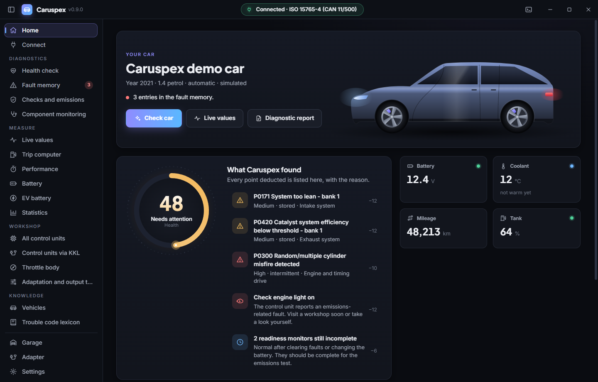
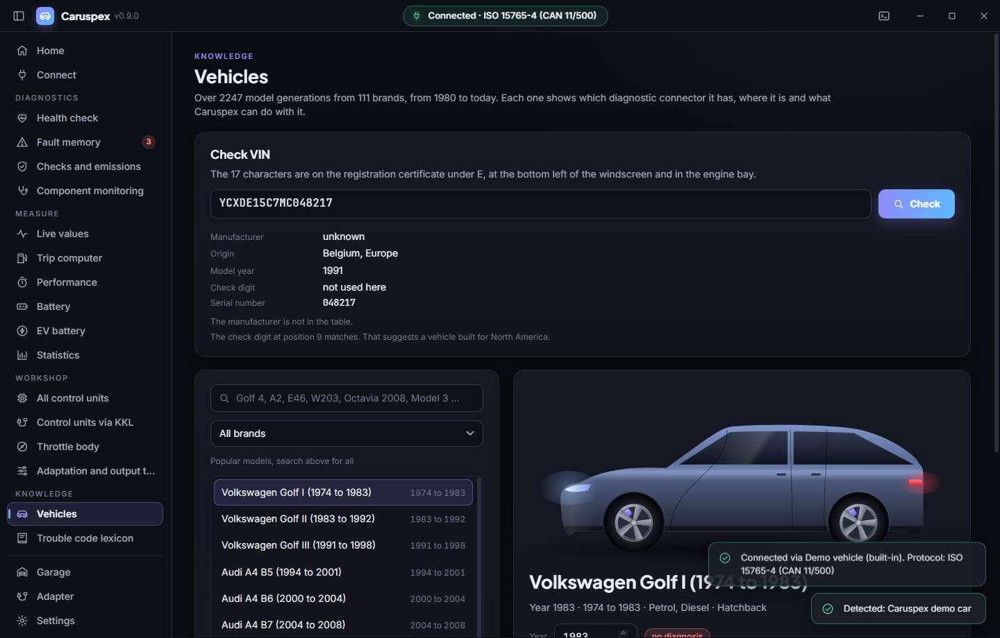
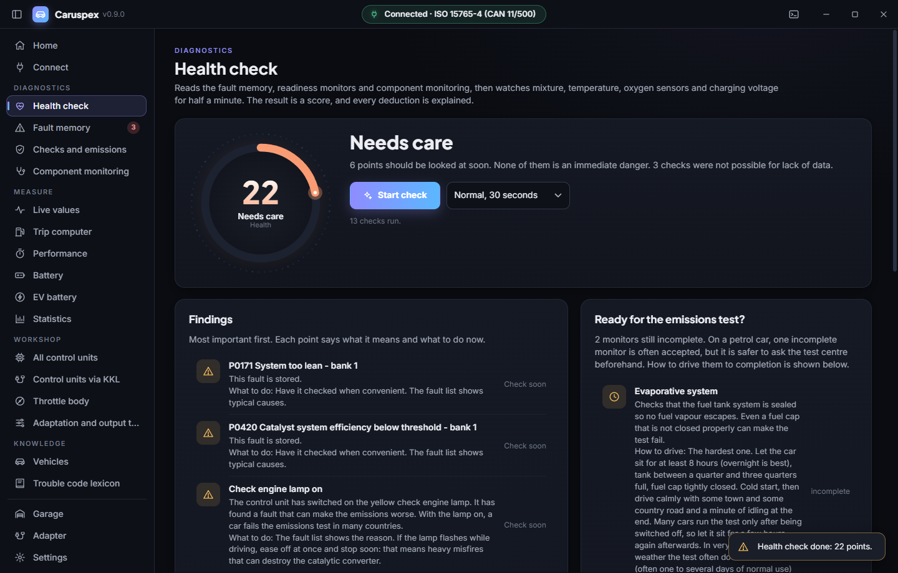
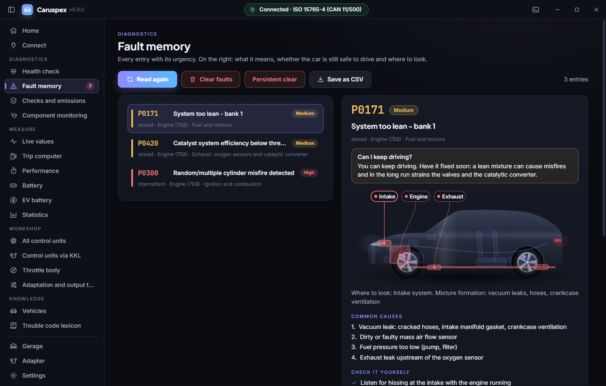
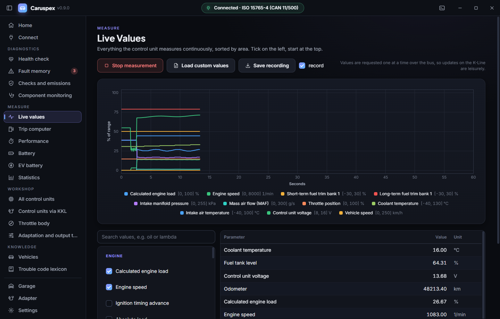
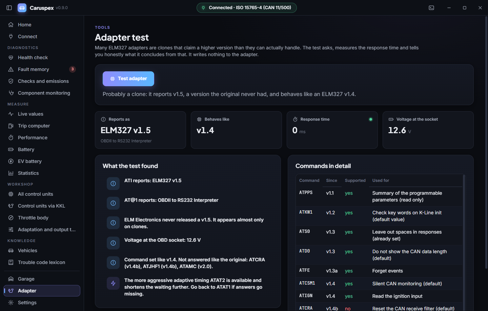
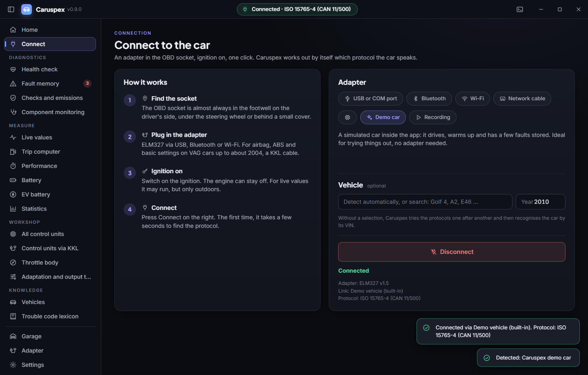
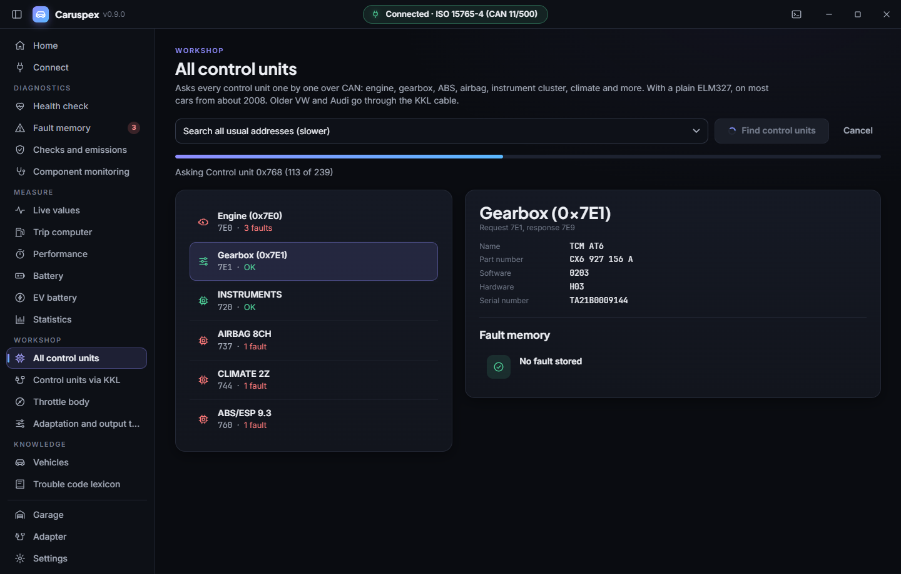
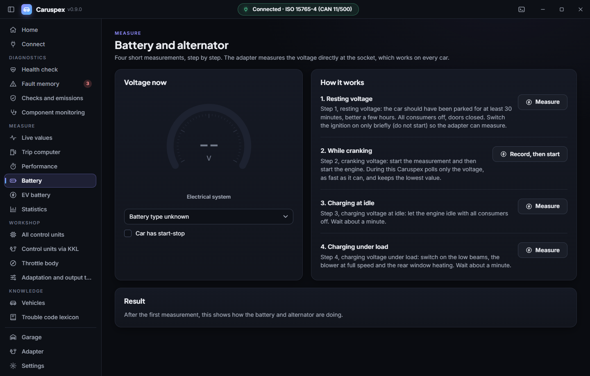

# Caruspex

<!-- languages -->
[English](README.md) · [Deutsch](README.de.md) · [Español](README.es.md) · [Français](README.fr.md) · [Português](README.pt.md) · [Italiano](README.it.md) · [Nederlands](README.nl.md) · [Polski](README.pl.md) · [Čeština](README.cs.md) · [Русский](README.ru.md) · [Українська](README.uk.md) · [Türkçe](README.tr.md) · [العربية](README.ar.md) · [中文](README.zh.md) · **日本語** · [한국어](README.ko.md) · [हिन्दी](README.hi.md) · [Bahasa Indonesia](README.id.md)
<!-- /languages -->

[](https://github.com/SenseiIssei/Caruspex/actions/workflows/build.yml)


[](LICENSE)

Windows、Linux、macOS で使えるオープンソースの車両診断ソフトです。Rust で書かれ、画面は Tauri 2 で作られています。
ケーブルかドングルが 1 つ、アプリも 1 つ。故障コードの読み取りと消去、センサーのライブデータの確認、
排出ガス検査の準備状況のチェックに加えて、K-Line ケーブル経由で VW/Audi のコントロールユニットとバイト単位で通信できます。

名前は *haruspex* に由来します。内臓から前兆を読み取った古代ローマの占い師です。Caruspex は車の内臓を読みます。

アプリは 18 の言語に対応しています。画面も、すべての故障コードの文章も同じです。英語、ドイツ語、スペイン語、
フランス語、ポルトガル語、イタリア語、オランダ語、ポーランド語、チェコ語、ロシア語、ウクライナ語、トルコ語、アラビア語（右から左）、中国語、
日本語、韓国語、ヒンディー語、インドネシア語。システムの言語に合わせて表示され、設定で切り替えられます。
`--language fr` のように、起動のたびに指定することもできます。翻訳の作り方と確認の方法は
[translations/TRANSLATING.md](translations/TRANSLATING.md) にあります。



## 特長

- **完全な診断スタックが 2 つ**：任意の ELM327 アダプター経由の標準 OBD-II/EOBD と、素の KKL K-Line ケーブル経由の VW/Audi
  メーカー診断（KWP1281 と KWP2000）。
- **プロトコルをすべてゼロから実装**：KWP1281 は 1 バイトごとにその補数で応答します。
  これは ELM327 のファームウェアにはできないことです。Caruspex は K-Line を自分で駆動します。5 ボーの起動
  アドレスも、シリアルのブレーク信号を切り替えて 1 ビットずつ送り、期限ベースのタイミングで制御するので、OS の
  スケジューリングのゆらぎが 10 ビットの間に積み重なりません。
- **プロトコルの自動検出**：起動のあと、ECU が返す 2 つのキーバイトから
  KWP1281 か KWP2000（ISO 14230）かが分かり、Caruspex はそれに合わせて切り替えます。
- **モジュール式の Rust ワークスペース**：分野ごとに 1 つの crate（アダプター接続、プロトコル、ネットワークと CAN、車両、データ、
  記録、分析、デモカー、コマンドラインツール）があり、その上に Tauri アプリが載ります。コアは画面のことを何も知らないので、
  アプリとコマンドラインツールはまったく同じコードで動きます。
- **車なしでテスト**：模擬 ECU（`crates/caruspex-protocols/tests/common/`）が
  バイト単位のハンドシェイクを再現し、偽のゲートウェイが ENET と DoIP の代わりをし、偽の J2534 ドライバーが PassThru の経路をカバーし、
  Python の ELM327 シミュレーターでアプリのエンドツーエンドの実行ができます。
- **翻訳は 1 セット**：コアと画面は `translations/<code>/` にある同じ翻訳ファイルを共有します。
  18 言語分です。コアは英語の文章をキーに文章を探し、画面は
  同じファイルから自分のカタログを作ります。
- **どんな車も認識**：365 のメーカーコードを持つ VIN デコーダーと、1980 年以降の
  2,100 を超えるモデル世代のカタログが、どの車がつながっているか、何が使えるかを教えてくれます。
- **内蔵のデモカー**：プロセス内の ELM327 で、CAN 上にエンジンとギアボックスがあり、
  ハードウェアなしですべてを試せます。
- **手入力ではなく生成されたデータ**：約 1,700 の故障コード。その多くは `tools/gen_dtc.py` が規則的なコード群
  （シリンダーごと、バンクごと、酸素センサーごと）から計算して作ります。

## 機能

### 車を知っている
- 接続すると、Caruspex は VIN を読み取り、どの車かを教えます。メーカー、モデル、世代、年式です。
- 94 ブランド、2,100 を超えるモデル世代のカタログで、1980 年から現在まで、すでに存在しないブランドも含みます。
- 世代ごとに、どの診断コネクターか、どこにあるか、どのプロトコルか、そして OBD-II、KKL ケーブル、メーカー専用ツールのどれで使えるかが分かります。
- 任意の VIN を確認する VIN チェッカー：メーカー、国、年式、チェックディジット、モデルコード。
- ガレージは VIN でどの車も見分け、点検の履歴とオドメーターの読み取り値を保存します。



### ワンボタンの状態チェック
- 故障メモリー、レディネスモニター、コンポーネントテストを読み取り、そのあと 30 秒間、混合気、温度、酸素センサー、充電電圧を監視します。
- 0 から 100 のスコアで、減点のひとつひとつを分かりやすい言葉で説明し、次の一手を示します。
- 排出ガス検査の準備はできていますか。どのモニターがまだ未完了か、完了させるにはどう走ればよいか。
- PDF の診断レポート。印刷用にも整備工場に渡す用にも使えます。



### 故障メモリー
- 記憶済み、保留中、永続のコード。コントロールユニットが複数ある場合は、各コードをどのユニットが報告したか（エンジン、ギアボックス）が表示されます。
- 約 1,400 の標準コード（P、C、B、U）に加えて、VAG、フォード、GM、トヨタ、ホンダ、日産、ヒュンダイ/起亜、スバルなどのメーカーコード。P1 コードは、検出したブランドでの意味で読まれます。
- コードごとの信号機と、誰もが最初に知りたい疑問：このまま走り続けられますか。
- よくある原因、自分で確認できること、おおよその費用の目安。
- 透視ビューの車が、該当する部品の位置を示します。
- 明確な警告つきの消去と、自動の再読み取り。CSV エクスポート。



### ライブデータ
- SAE J1979 のモード 01 のすべての値を PID C4 まで：145 の PID と 300 を超える読み取り値を、グループ分けと検索つきで。
- オドメーター、ギア、オイル温度、燃料流量、トルク、ブースト、排気温度、粒子フィルター、AdBlue、NOx、ハイブリッドバッテリー。車が報告する範囲で。
- 流れるグラフと CSV 記録。



### 測定
- トリップコンピューター：燃費をリアルタイムと平均で、費用、CO2、距離、そして穏やかな運転スタイルのスコア。トリップコンピューターのない車でも使えます。
- パフォーマンス：速度信号から 0 から 100 km/h、80 から 120、クォーターマイル、制動距離を計測（閉鎖された道路のみ）。
- バッテリーとオルタネーター：静止電圧、始動時の電圧降下、負荷あり・なしの充電電圧を、4 つのステップで案内します。

### 点検
- レディネスモニター、フリーズフレーム、VIN を分かりやすい言葉で。
- モード 06 のコンポーネント監視：値と限界値、シリンダーごとの失火カウント。
- モード 09 からの ECU 名、キャリブレーション ID、チェックサムを、コントロールユニットごとに。
- ELM327 の生のターミナル。

### アダプターのテスト
- 本物の ELM327 か、互換品か。各バージョンのコマンドを問い合わせ、応答時間を測り、そこから何が言えるかを正直に伝えます。
- OBDLink などの STN アダプターを認識します。
- アダプターには何も書き込みません。



### あらゆるケーブル、車へのあらゆる入口
Caruspex は、何がつながっていて、車がどのプロトコルで話すかを自分で調べます。

| インターフェース | 例 | 方式 |
|---|---|---|
| USB、Bluetooth、Bluetooth LE、Wi-Fi 経由の ELM327 | 安価な ELM327、Vgate、vLinker、Veepeak | シリアルポート、ペアリング済みまたは直接の BLE、TCP |
| STN チップ | OBDLink SX、EX、MX+、CX | ELM327 と同じ。より速いタイミング |
| SAE J2534 PassThru | Tactrix OpenPort 2.0、Mongoose、VCX Nano、Scanmatik、Godiag、J2534 モードの VAS 5054A | メーカーの 64 ビットドライバー。ISO-TP による CAN は Caruspex が処理 |
| SLCAN / Lawicel | CANable、USBtin、CANUSB | シリアルポート。自動ポート検索で見つかる |
| SocketCAN（Linux） | PEAK PCAN-USB、Kvaser、candleLight 搭載の CANable、Raspberry Pi の CAN HAT | can0 など |
| KKL ケーブル（VAG 409.1） | FTDI または CP2102 のケーブル | K-Line、KWP1281 と KWP2000 |
| ENET ケーブル | F シリーズ以降の BMW と Mini | イーサネット上の HSFZ |
| DoIP ケーブル | 2016 年頃以降の多くの車 | イーサネット上の ISO 13400 |

どのインターフェースでも同じ機能が使えます。OBD-II と UDS 上の OBD、UDS による全コントロールユニット、BMW の
アドレッシング、ブロードキャスト値の受信（テスラ）、記録と再生です。



### CAN 経由の全コントロールユニット（UDS）
- 普通の ELM327 でも、Caruspex は全コントロールユニットを 1 つずつ問い合わせます。エンジン、ギアボックス、ABS、エアバッグ、メーターパネル、エアコンなど。2008 年頃以降のほとんどの車で使えます。
- ユニットごとの故障メモリーに、故障の種類（ショート、断線、信頼性なし ...）、部品番号、ソフトウェアとハードウェアのバージョンが付きます。
- VAG、BMW と Mini、フォード、マツダ、GM、トヨタ、日産、ヒュンダイ/起亜、ルノー、PSA のアドレス一覧。それ以外は、よく使われるアドレスを順に探索します。
- F シリーズ以降の BMW と Mini では、6F1 による BMW 独自の拡張アドレッシングと、128 個すべての診断アドレスの探索に対応。故障コードは ISTA が表示する BMW 形式（例：480A10）です。
- ユニットごとの消去。警告つき。



### KKL ケーブルでの VW と Audi（KWP1281 と KWP2000）
- スロットルボディの適応：測定ブロック 060 または 098 での本物の基本設定。
- ABS、エアバッグ、メーターパネル、コンフォートを含む全コントロールユニットのスキャンと、印刷できるレポート。
- 適応チャンネルと出力テスト。意図的に読み取り専用です。

### メーカー値とカスタム値
- 電気自動車のバッテリー：健全性、充電量、ばらつきつきのセル電圧、温度。ヒュンダイ Kona と Ioniq、起亜 e-Niro、ルノー Zoe、日産 Leaf、テスラ Model 3 と Y（CAN バスの受信による）に対応。すべての値に文書化された出典があります。
- 広く使われている Torque の CSV 形式で独自の値を読み込めます。Torque の計算式を完全に評価できます。



### 記録と再生
- 車とのセッションをファイルに記録し、あとで車なしで再生できます。トラブルシューティングに便利です。

### 車もアダプターもなしで
- 内蔵のデモカー：走り、暖機し、いくつか故障が記憶されていて、本物の ELM327 のように CAN で話します。
- 全コードのオフライン事典。ブランドで絞り込めます。

### 見た目と使い心地
- Odysync 風の新しい画面：落ち着いたダークテーマで、なめらかな遷移。
- 全ポートの自動検索つきの、ステップごとの接続。
- 18 言語。設定はすぐに反映されます。
- 新しいバージョンが出ると知らせます。起動時に GitHub へ最新リリースを問い合わせるだけです（あなたや車に
  関するデータは送りません）。設定でオフにできます。

## 対応車両

OBD-II または EOBD を備えたすべての車両：ヨーロッパでは 2001 年以降のガソリン車と 2004 年以降のディーゼル車、アメリカでは 1996 年以降です。1990 年頃以降の古い VW、アウディ、セアト、シュコダは KKL ケーブルで使えます。車両のページで、その車にはどの方法が使えるかが分かります。

| 年代 | バス | 例 |
|---|---|---|
| 1995 年頃まで | メーカー固有 | 2x2 プラグ経由の KKL を使う VAG。それ以外は整備工場用ツールのみ |
| 1996 年から 2003 年頃 | K-Line（ISO 9141-2、KWP2000） | アウディ A2、VW ゴルフ IV、トヨタ、ルノー |
| 2004 年頃以降 | CAN（ISO 15765-4） | アウディ A4 B7、VW ゴルフ V、最近の日本車 |
| アメリカで 2005 年頃まで | SAE J1850 PWM と VPW | フォード、シボレー |
| 最新の車 | UDS 上の OBD（SAE J1979-2） | アメリカでは 2027 年モデルから義務化、一部の新しい車ではすでに採用。自動で検出して変換 |
| F シリーズ以降の BMW と Mini | ENET（イーサネット上の HSFZ）、または 6F1 アドレッシングの D-CAN | 全コントロールユニット |
| 2016 年頃以降の多くの車 | DoIP ケーブルによる DoIP（ISO 13400） | イーサネット上の OBD。自動で見つかる |
| テスラ Model 3 と Y | OBD なし：ブロードキャスト CAN フレーム | バッテリー、セル、温度、速度、オドメーターを受信で取得（診断コネクターへのアダプターケーブルが必要） |

完全な電気自動車は OBD-II の排出ガスデータを提供する必要がありません。それでも一部は応答する車があります。応答がなくてもバス上に通信がある車では、Caruspex は受信専用で接続し、内蔵パックが把握している内容を読み取ります（今のところテスラ Model 3 と Y）。

## 対応アダプター

- **ELM327** 互換のすべてのアダプター：USB、クラシック Bluetooth（Windows と Linux ではペアリング後に RFCOMM で直接、または COM ポート経由）、**Bluetooth LE**
  （Vgate iCar Pro BLE、vLinker、OBDLink CX、Veepeak BLE など、一般的な GATT サービスを持つアダプター。
  スキャンで見つかり、ペアリング不要）、または TCP 経由の Wi-Fi
- F シリーズ以降の BMW と Mini 用の **ENET ケーブル**（OBD から RJ45）：Caruspex がネットワーク上で車を見つけ
  （HSFZ、ポート 6811 と 6801）、アダプターチップを介さずにイーサネットで全コントロールユニットを読み取ります。コンピューターには
  自動アドレス（169.254.x.x）が必要です。DHCP の応答がないとき、Windows、macOS、Linux が自分で割り当てます。
  ここでも Caruspex は読み取りだけです。コーディングとフラッシュは E-Sys、ISTA、チューニングツールに任せます。
- **KKL ケーブル（VAG 409.1）** なら何でも。FTDI または CP2102 ベースのケーブルは、K-Line 上では最安の
  互換品よりずっと信頼できます。KWP1281 には本物の FTDI FT232RL をおすすめします。

Delphi DS150E、Autocom、VAS 5054A などの独自仕様のインターフェースは、ELM327 で話さないため対応していません。

| 機能 | ELM327 | KKL 409.1 |
|---|---|---|
| エンジンの故障の読み取りと消去 | はい | はい |
| ライブデータ、フリーズフレーム、レディネス | はい | はい |
| ABS、エアバッグ、メーターパネル、コンフォート | **いいえ** | はい |
| メーカーの測定ブロック | **いいえ** | はい |
| **スロットルボディの適応** | **いいえ** | はい |

これはソフトウェアではなくハードウェアの限界です。KWP1281 はブロックプロトコルで、すべてのバイトを
相手側が応答します。ELM327 のファームウェアは、リクエストとレスポンスのひと組しか扱えません。
KKL ケーブルは K-Line をそのまま通すので、Caruspex 自身がプロトコルを話せます。

### 2 つの VAG プロトコル、自動検出

| プロトコル | 典型的な対象 | 基本設定 |
|---|---|---|
| KWP1281（ブロックプロトコル） | 1.4 MPI エンジン | 専用コマンド（ブロック 0x28） |
| KWP2000（ISO 14230） | ボッシュ MED の 1.6 FSI | 専用の診断セッションのあと、ブロックを読む |

適応チャンネルと出力テストは、現在は KWP1281 の経路で実装されています。KWP2000 では、
アプリは黙って失敗せず、その旨を伝えます。

未実装：CAN 上の VW TP 2.0 によるメーカー診断（2004 年頃以降の車両）。

## 技術スタック

| 分野 | 技術 |
|---|---|
| 言語 | Rust（edition 2024） |
| 画面 | Tauri 2、React 19、TypeScript、ビルドは Vite |
| ライブラリ | `serialport`（シリアルポート）、`btleplug`（Bluetooth LE）、`libloading`（J2534 ドライバー） |
| ローカライズ | コアと画面で共通の JSON ファイル一式を `translations/` に配置、18 言語 |
| ビルド | Cargo ワークスペース、画面は npm |
| テスト | 模擬 ECU、偽のゲートウェイ、偽の J2534 ドライバーに対する `cargo test` |
| ツール | Python 3（コードと表のジェネレーター、翻訳チェック、ELM327 シミュレーター） |
| プラットフォーム | Windows 10 と 11、Linux、macOS |

## ダウンロード

ビルド済みのパッケージは [リリースページ](https://github.com/SenseiIssei/Caruspex/releases) にあります。

| システム | ファイル | 備考 |
|---|---|---|
| Windows 10 と 11、64 ビット | `Caruspex-<version>-windows-x64-setup.exe` | 管理者権限なしでインストールでき、`caruspex_cli` を検索パスに追加できます。インストール済みの 0.8 はその場で更新し、WebView2 ランタイムは足りないときだけインストールします |
| Windows 10 と 11、64 ビット | `Caruspex-<version>-windows-x64.zip` | ポータブル版。展開して起動するだけ。WebView2 ランタイムが必要ですが、Windows 10 と 11 には最初から入っています |
| macOS 13 以降、Apple Silicon | `Caruspex-<version>-macos.dmg` | アプリを「アプリケーション」へドラッグ |
| Linux、x86_64 | `Caruspex-<version>-linux-x86_64.AppImage` | `chmod +x` してから起動 |
| Debian と Ubuntu、64 ビット | `Caruspex-<version>-linux-amd64.deb` | `sudo apt install ./Caruspex-<version>-linux-amd64.deb` でインストール |
| コマンドラインツールのみ | `caruspex_cli-<version>-windows-x64.zip`、`caruspex_cli-<version>-linux-x86_64.tar.gz`、`caruspex_cli-<version>-macos.tar.gz` | スクリプトとサーバー用。画面なし |

パッケージにはまだ署名がありません。Windows SmartScreen は最初の起動時に確認してきます（「詳細情報」、「実行」）。macOS では
初回のみ、右クリックして「開く」を選んでアプリを開いてください。

## ビルド

必要なもの：安定版の Rust ツールチェーン（edition 2024、Rust 1.85 以降）、npm つきの Node 24、そしてジェネレーターと翻訳チェック用の
Python 3。Linux では、画面とアダプター接続に必要なシステムパッケージも必要です
（Debian と Ubuntu での名前）。

```bash
sudo apt-get install libwebkit2gtk-4.1-dev librsvg2-dev libdbus-1-dev libudev-dev pkg-config
```

Windows には WebView2 ランタイムが必要です（Windows 10 と 11 には含まれています）。macOS は追加のものは要りません。

画面の依存関係を最初に一度インストールしてから、コマンドラインツールとアプリをビルドします。

```bash
npm --prefix app ci
```

```bash
cargo build --release -p caruspex-cli
```

```bash
npm --prefix app run tauri -- build
```

`npm --prefix app run tauri -- dev` は、開発中にライブリロードつきでアプリを起動します。Tauri のウィンドウなしの
画面だけなら、内蔵のデモカーを使って普通のブラウザーで動かせます。

```bash
npm --prefix app run dev
```

`http://localhost:5287/?demo` を開くと、すぐにデモカーに接続します。`?lang=de` で言語を、
`?theme=light` でライトテーマを選べます。たとえば `?demo&lang=de&theme=light` です。Tauri のシェルがないとアダプターには
アクセスできないので、ブラウザー版が知っているのはデモカーだけです。

### Linux でのシリアルポートの権限

`sudo` なしでアダプターにアクセスするには：

```bash
sudo usermod -aG dialout $USER
```

そのあと、いったんログアウトしてから再びログインしてください。

## ビルドの成果物

| 成果物 | 説明 |
|---|---|
| `target/release/caruspex` / `caruspex.exe` | Tauri の画面つきのアプリ（`tauri build` はインストーラーとバンドルも `target/release/bundle/` に出力します） |
| `target/release/caruspex_cli` / `caruspex_cli.exe` | 同じコアで動く、スクリプトから使えるコマンドラインツール。[コマンドラインツール](#コマンドラインツール) を参照 |

### パッケージとリリース

`bash tools/package.sh` は、現在のシステム用のパッケージを `dist/` に作ります。Windows ではインストーラーと
2 つの zip（インストーラーには [Inno Setup 6](https://jrsoftware.org/isinfo.php) が必要）、macOS では dmg とコマンドラインのアーカイブ、
Linux では AppImage、`.deb`、コマンドラインのアーカイブです。そのあと `bash tools/smoke_test.sh` が、ユーザーと同じようにインストールするか
開き、両方のプログラムを起動して、また取り除きます。CI は毎回この両方を実行します。

リリースはタグから作られます。`bash tools/release.sh <version>` は、何もプッシュせずに専用のブランチで準備します。
`Cargo.toml` と `app/package.json` のバージョンを設定し、`changelog/<version>.md`（ドイツ語と英語）を作り、
チェック、テスト、パッケージ作成、スモークテストを実行し、README のスクリーンショット（`tools/screenshots.sh de` と
`tools/screenshots.sh en`）を更新します。プルリクエストがマージされたら、タグ `v<version>` を付けてタグをプッシュします。CI は 3 つの
システムすべてをビルドし、パッケージと変更一覧つきでリリースを公開します。

CI（`.github/workflows/build.yml`）はまず Linux でフォーマット、生成された表のチェック、翻訳チェック、
画面のビルド、clippy を実行し、そのあと Windows、Linux、macOS でテスト、パッケージ作成、スモークテストを行います。
2 つ目のワークフロー（`.github/workflows/data-check.yml`）は、月に一度、上流に新しい VIN コード、車両、DBC ファイルがないか調べ、
新しい内容をまとめた issue を作ります。

## テスト

```bash
cargo test --workspace
```

約 370 のテストが数秒で実行され、すべて車なしで動きます。ELM327 の応答パーサー、故障コードの
デコード、PID の変換、車両プロファイルと VIN デコーダー、デモカーに対する OBD-II と UDS のサービス、
模擬コントロールユニットに対する KWP1281 と KWP2000 の完全なセッション、偽のゲートウェイに対する ENET（HSFZ）と DoIP、
偽のドライバーに対する SLCAN と J2534 の経路、記録と再生、そして分析（状態チェック、バッテリーテスト、
トリップコンピューター、パフォーマンスタイマー）を対象にしています。コマンドラインのテストはビルドした `caruspex_cli` を実行し、その出力を
`crates/caruspex-cli/tests/golden/` のゴールデンファイルと比較します。このファイルには、以前の C++ 版が同じ
コマンドで出力した内容が入っているので、古いツールとの違いがあればすぐ分かります。

CI がテスト以外に実行するチェック：

```bash
cargo fmt --all --check
```

```bash
cargo clippy --workspace --all-targets -- -D warnings
```

```bash
python tools/i18n_rust.py --strict
```

```bash
npm --prefix app run build
```

最初の 2 つはフォーマットとリントです。`tools/i18n_rust.py --strict` は、コアの文章が翻訳ファイルにないとき、
または 18 言語のどれかで翻訳が欠けているときに失敗します。画面のビルドは、`I18N_STRICT=1` を設定すると自分の
文章を同じ方法で確認します。生成された表を更新するには、`python tools/gen_dtc.py`、`gen_vehicles.py`、`gen_ecus.py`、
`gen_pids.py` を実行してください。コミット済みの内容と異なると CI は失敗します。

## 車なしで試す

いちばん手軽なのは内蔵のデモカーです。接続ページで「デモカー」を選ぶか、次のように起動します。

```bash
target/release/caruspex --demo --language en
```

`caruspex --help` はアプリのすべてのオプションを一覧表示します：`--tcp`、`--port`、`--bluetooth`、`--enet`、`--can`、
`--replay`、`--report`、`--language`、`--theme`、`--page`、`--shot`、`--size`。

Python のシミュレーターは、K-Line 上のアウディ A2 のエンジンを再現するか、`--can` を付けると、エンジンと
ギアボックスを持つ CAN の車を再現します（ヘッダー、ISO-TP、コントロールユニットごとのモード 06 と 09）。

```bash
python tools/mock_elm327.py --can
```

そのあとアプリを接続します（Windows ではバイナリは `target/release/caruspex.exe` です）。

```bash
target/release/caruspex --tcp 127.0.0.1:35000 --language en
```

コマンドラインツールもシミュレーターに対して使えます。

```bash
target/release/caruspex_cli read --tcp 127.0.0.1:35000
```

### コマンドラインツール

`caruspex_cli <command>`。`--demo`、`--tcp HOST[:PORT]`、`--port NAME [--baud N]`、`--enet HOST|auto`、
`--can SPEC`、`--replay FILE` と組み合わせます。

| コマンド | 機能 |
|---|---|
| `read` | 警告灯、レディネス、故障コード。VIN からメーカーが分かる場合は、そのメーカーでの意味つき |
| `vin` | VIN、その内容（メーカー、国、年式、チェックディジット）、カタログの該当車 |
| `freeze` | すべてのフリーズフレーム。記憶された故障ごとに 1 つ |
| `health` | 状態チェック：故障、レディネス、モード 06、ライブの計測系列（`--seconds N`、既定は 15） |
| `probe` | アダプターのテスト：ELM327 の正体、知っているコマンド、往復時間 |
| `uds` | CAN 上の UDS：全コントロールユニットの識別情報と故障メモリー（独自のアドレスには `--ids A,B,...`） |
| `custom` | 内蔵パック（`--pack NAME`）または Torque の CSV（`--csv FILE`）にあるメーカー値とカスタム値を、1 回 |
| `live`、`info`、`clear`、`ecus`、`ports`、`kklcheck` | ライブ値、VIN と最初のフリーズフレーム、消去（いずれもコントロールユニットごと）、シリアルポート、KKL ケーブルの自己診断 |
| `enet`、`interfaces` | ネットワーク上の BMW と Mini の車、DoIP の車を探す。このコンピューターの CAN インターフェース（J2534 ドライバー、SocketCAN）を一覧表示 |
| `version`、`help` | プログラムのバージョン、コマンドとオプションの完全な一覧 |

`--json` は `read`、`vin`、`health`、`probe`、`freeze`、`uds`、`custom` をスクリプト向けに JSON で出力します。`--record FILE`
はアダプターとのセッション全体を `--replay` 用に保存します。`--fast-timing` はアダプターを積極的な適応
タイミングに切り替えます。`-v` はアダプターへのコマンドをすべて記録します（`--json` と一緒のときは stderr に出力）。`caruspex_cli help` ですべて確認できます。

```bash
target/release/caruspex_cli health --demo --json > health.json
```

このページのスクリーンショットはデモカーのもので、アプリ自身が撮影しています。
`--demo --page faults --shot shot.png --size 1440x920` はページを開き、数秒後にウィンドウの画像を保存して
終了します（`tools/screenshots.sh` は一式を撮影します）。

## プロジェクト構成

```
crates/caruspex-i18n/       言語：ドイツ語と英語はコード内、残りの 16 言語は translations/ から
crates/caruspex-vehicles/   VIN デコーダーと車両カタログ（ブランド、モデル、世代、コネクター、バス）
crates/caruspex-data/       故障コード、PID、コントロールユニットのアドレス、コードと部品の対応
crates/caruspex-link/       アダプターへの経路（シリアル、TCP、Bluetooth LE）、ELM327 ドライバー、アダプターのテスト
crates/caruspex-protocols/  OBD-II、UDS、KWP2000、KWP1281（K-Line、バイト単位）
crates/caruspex-net/        BMW ENET（HSFZ）、DoIP、SLCAN、SocketCAN、J2534 PassThru
crates/caruspex-record/     記録と再生、カスタム値（Torque CSV、PID パック）、JSON ライター
crates/caruspex-analysis/   状態チェック、ドライブサイクルのガイド、トリップコンピューター、パフォーマンスタイマー、バッテリーテスト
crates/caruspex-demo/       内蔵のデモカー：模擬コントロールユニットを持つ ELM327
crates/caruspex-cli/        コマンドラインツールとゴールデンファイルのテスト
app/src/                    画面：React 19 と TypeScript（ページ、シェル、状態、レポート、i18n）
app/src-tauri/              Tauri アプリ：ウィンドウ、コマンド、更新チェック、コマンドラインオプション
translations/               コアと画面で共通の翻訳ファイル、18 言語
data/                       手作業で管理する CSV の車両カタログ、コントロールユニットと PID のソース
tools/                      ジェネレーター、翻訳チェック、パッケージ作成、リリースとスクリーンショットのスクリプト、ELM327 シミュレーター
docs/                       README のスクリーンショット
packaging/                  Windows のインストーラースクリプト、Linux の desktop ファイル、macOS の Info.plist
changelog/                  バージョンごとのリリースノート、ドイツ語と英語
```

故障コードのデータベースは生成されます。`tools/gen_dtc.py` が、規則的な EOBD のコード群と
`tools/dtc/` にある選りすぐりのリストを `crates/caruspex-data/src/generated/*.rs` に展開します。データを変更したら再実行してください。

```bash
python tools/gen_dtc.py
```

車両カタログも同じ仕組みです。`data/vehicles/` の CSV ファイルを編集してから、次を実行します。

```bash
python tools/gen_vehicles.py
```

コントロールユニットのアドレスと PID パックには `tools/gen_ecus.py` と `tools/gen_pids.py` があります。翻訳については
[translations/TRANSLATING.md](translations/TRANSLATING.md) に説明があります。コードに文章を追加したあとは、
`python tools/i18n_rust.py` で、まだ翻訳が必要なものが一覧表示されます。

## コードの消去についての注意

OBD のモード 04 は、故障メモリー、フリーズフレーム、レディネスモニターを消去します。その直後は、
車は完全なドライブサイクルを数回終えるまで排出ガス検査に通りません。また、原因がまだ残っているコードは、
少し走ればまた戻ってきます。消去は修理ではありません。

## 免責事項

Caruspex は趣味のプロジェクトであり、無保証で提供されます。自己責任で、作業してよい車両にのみ、
そして運転中には絶対に使わないでください。すべての製品名とブランド名は、それぞれの
所有者の商標です。Caruspex は、どの自動車メーカーとも提携しておらず、承認も受けていません。

## ライセンス

MIT。[LICENSE](LICENSE) を参照してください。同梱のフォントは SIL Open Font License 1.1 でライセンスされています。
JetBrains Mono（[OFL.txt](resources/fonts/OFL.txt)）、Inter（[OFL-Inter.txt](resources/fonts/OFL-Inter.txt)）、
Plus Jakarta Sans（[OFL-PlusJakartaSans.txt](resources/fonts/OFL-PlusJakartaSans.txt)）。
