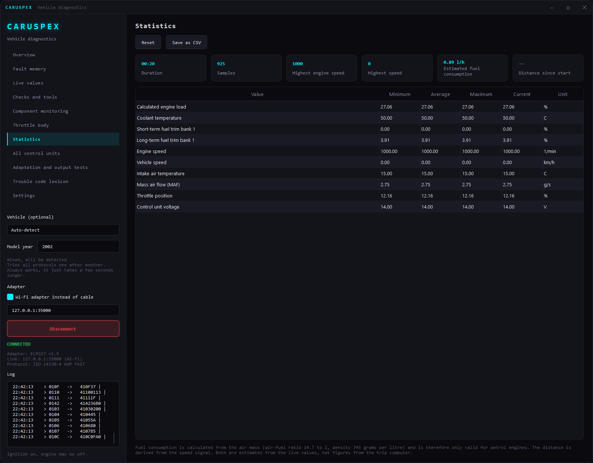
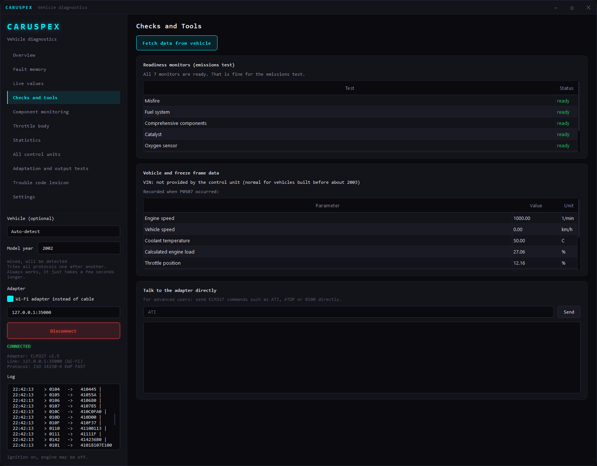
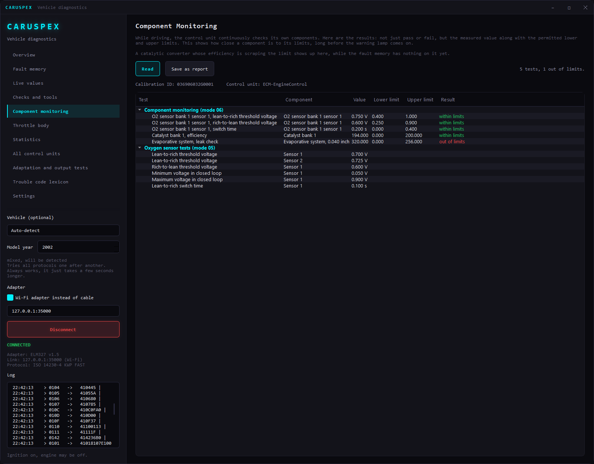
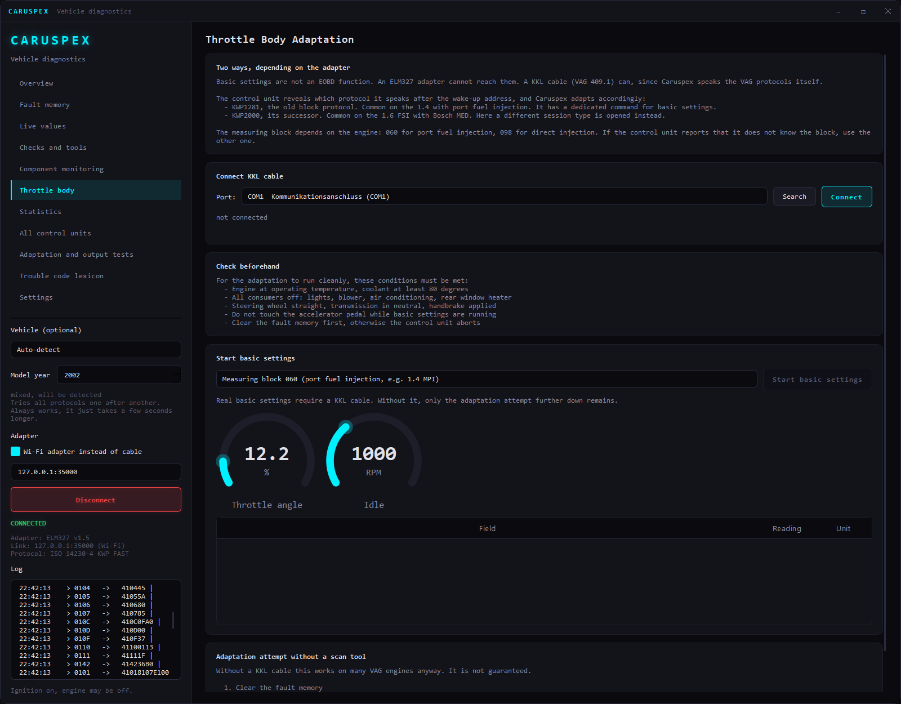
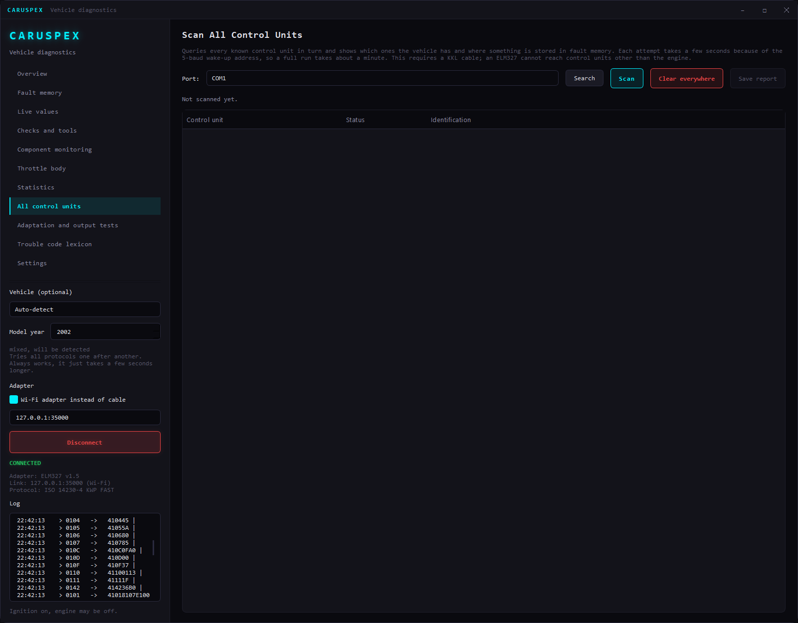
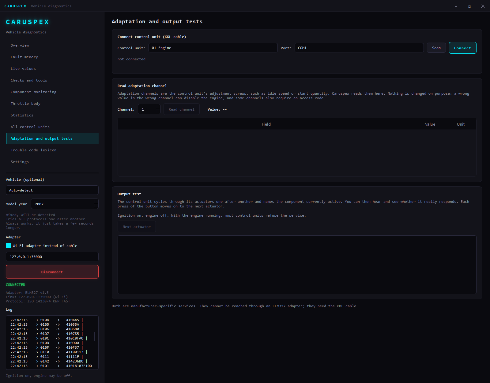
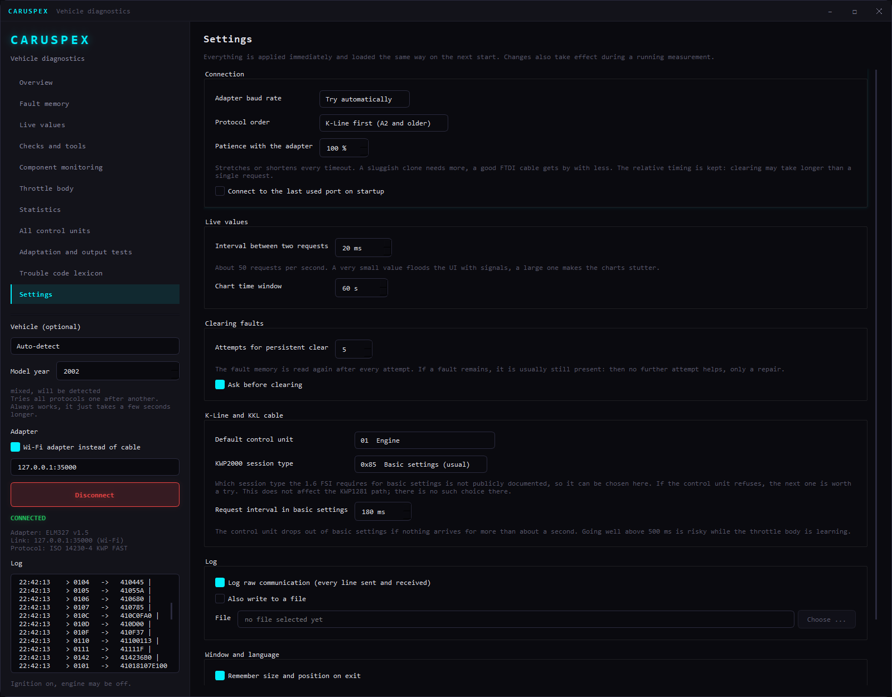
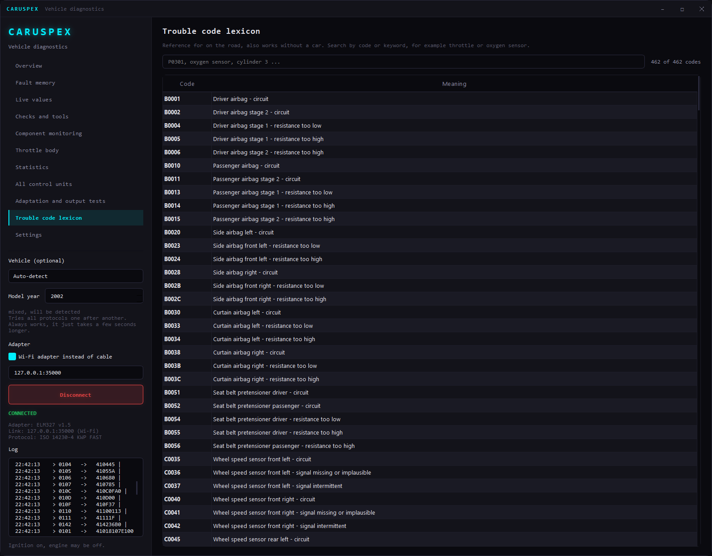

# Caruspex

[](https://github.com/SenseiIssei/Caruspex/actions/workflows/build.yml)


[](LICENSE)

Open-source vehicle diagnostics for Windows, Linux and macOS, written in C++20 with Qt 6.
One cable or dongle, one application: read and clear trouble codes, watch live sensor data,
check emission readiness, and talk to VW/Audi control units at the byte level over a K-Line cable.

The name comes from the *haruspex*, the Roman seer who read omens from the entrails. Caruspex reads the car's.

The application is available in English and German: it follows the system language, can be switched in
the settings, or forced per run with `--language en` / `--language de`. [Deutsche Fassung dieser Seite](README.de.md)


## Highlights

- **Two complete diagnostic stacks**: standard OBD-II/EOBD through any ELM327 adapter, and VW/Audi
  manufacturer diagnostics (KWP1281 and KWP2000) over a raw KKL K-Line cable.
- **Protocols implemented from scratch**: KWP1281 acknowledges every single byte with its one's complement,
  something ELM327 firmware cannot do. Caruspex drives the K-Line itself, including the 5-baud wake-up
  address that is bit-banged by toggling the serial break signal with deadline-based timing, so OS
  scheduling jitter does not accumulate across the ten bits.
- **Automatic protocol detection**: after the wake-up, the ECU's two key bytes tell whether it speaks
  KWP1281 or KWP2000 (ISO 14230); Caruspex switches accordingly.
- **Portable, Qt-free core**: transport, adapter drivers, protocols and data live in a plain C++20 library
  using `std::chrono`. Only the serial port is OS-specific (`Serial_win.cpp` / `Serial_posix.cpp`).
- **Tested without a car**: a simulated ECU (`tests/FakeEcu.cpp`, `tests/FakeEcu2000.cpp`) reproduces the
  byte-by-byte handshake, plus a Python ELM327 simulator for end-to-end runs of the GUI.
- **Bilingual without Qt in the core**: the GUI uses Qt Linguist (`translations/caruspex_en.ts`), while the
  Qt-free core resolves its texts (trouble codes, PID names, protocol messages) through a tiny `L(de, en)` helper.
- **Generated data, not hand-typed**: 462 trouble codes, many of them computed from regular code families
  (per cylinder, per bank, per oxygen sensor) by `tools/gen_dtc.py`.

## Features

### Fault memory
- Stored, pending and permanent trouble codes (OBD modes 03, 07, 0A)
- 462 codes with plain-language descriptions in English and German: generic EOBD codes plus VAG-specific P1xxx
- Unknown codes fall back to the meaning of their code group instead of showing nothing
- Clearing with an explicit warning, automatic re-read and an optional "persistent clear" with retries
- CSV export
- A schematic vehicle that highlights the affected assembly for each code, with a hint where to look


### Live data
- Around 80 OBD parameters (PIDs) converted to readable units
- Rolling multi-series chart and animated gauges for RPM, speed, coolant, load, throttle and battery voltage
- CSV recording for later analysis


- Statistics per signal (min / mean / max / current), session duration, peak RPM and speed,
  fuel consumption estimated from mass air flow, distance from the speed signal



### Inspection
- Readiness monitors, with a plain answer whether the car is ready for an emissions test
- Freeze frame: the conditions at the moment a fault was recorded
- On-board monitoring results (modes 06 and 05): each internal self-test with its measured value and
  allowed limits, showing how close a component is to failing long before the warning light comes on
- Vehicle information (mode 09): VIN, calibration IDs, checksums and ECU name
- Raw ELM327 terminal for direct adapter commands




### VW/Audi manufacturer diagnostics (KKL cable)
- Throttle body adaptation (basic settings, measuring block 060 or 098)
- Connects to every control unit, not just the engine: ABS, airbag, instrument cluster, comfort
- Full scan of all known control units: which are present, which are missing, which have faults,
  with a printable report
- Manufacturer fault codes decoded per control unit, and measuring blocks
- Adaptation channels (read-only on purpose: a wrong value in the wrong channel can disable the engine)
  and output test diagnostics that step through the actuators





### Settings
- Baud rate, protocol order and a global timeout factor for slow adapters
- Polling rate and chart window, retry count for persistent clearing
- Raw communication log, optionally written to a file
- Language: system default, English or German
- All settings persist and apply immediately, even during a running measurement



### Offline lookup
- Searchable trouble-code lexicon that works without a car



## Supported vehicles

Any vehicle with OBD-II/EOBD: in Europe petrol cars from 2001 and diesels from 2004, in the US from 1996.
71 vehicle profiles across 45 brands make sure the most likely protocol is tried first
instead of cycling through all nine.

| Era | Bus | Examples |
|---|---|---|
| 1996 to about 2003 | K-Line (ISO 9141-2, KWP2000) | Audi A2, older VW Golf, Toyota, Renault |
| from about 2004 | CAN (ISO 15765-4) | Audi A4 B7, VW Golf 5, modern Japanese cars |
| US until about 2005 | SAE J1850 PWM and VPW | Ford, Chevrolet |

## Supported adapters

- Any **ELM327**-compatible adapter (USB, Bluetooth as a COM port, or Wi-Fi via TCP)
- Any **KKL cable (VAG 409.1)**. FTDI or CP2102 based cables are far more reliable on the K-Line than the
  cheapest clones; for KWP1281 a genuine FTDI FT232RL is recommended.

Proprietary interfaces such as Delphi DS150E, Autocom or VAS 5054A are not supported, they do not speak ELM327.

| Function | ELM327 | KKL 409.1 |
|---|---|---|
| Read and clear engine faults | yes | yes |
| Live data, freeze frame, readiness | yes | yes |
| ABS, airbag, instrument cluster, comfort | **no** | yes |
| Manufacturer measuring blocks | **no** | yes |
| **Throttle body adaptation** | **no** | yes |

This is a hardware limit, not a software one: KWP1281 is a block protocol in which every byte is
acknowledged by the other side. The ELM327 firmware only handles whole request/response pairs.
A KKL cable passes the K-Line through raw, so Caruspex can speak the protocol itself.

### Two VAG protocols, detected automatically

| Protocol | Typical for | Basic settings |
|---|---|---|
| KWP1281 (block protocol) | 1.4 MPI engines | dedicated command (block 0x28) |
| KWP2000 (ISO 14230) | 1.6 FSI with Bosch MED | dedicated diagnostic session, then read block |

Adaptation channels and output tests are currently implemented on the KWP1281 path; on KWP2000 the
application says so instead of failing silently.

Not yet implemented: manufacturer diagnostics over CAN with VW TP 2.0 (vehicles from about 2004).

## Tech stack

| Area | Technology |
|---|---|
| Language | C++20 |
| GUI | Qt 6 Widgets and Qt Charts, frameless window with custom title bar |
| Localization | Qt Linguist for the GUI, `L(de, en)` text pairs in the core |
| Build | CMake 3.21+, Conan 2 |
| Tests | Catch2 3, simulated ECUs, CTest |
| Tooling | Python 3 (code generator, ELM327 simulator) |
| Platforms | Windows (MSVC 2022), Linux (GCC 12+), macOS (Clang 15+) |

## Building

Requirements: a C++20 compiler (MSVC 2022, GCC 12 or Clang 15 and newer), CMake 3.21+, Python 3,
and Qt 6.5+ with the Charts module.

The quickest way to get Qt is `aqtinstall` (building Qt through Conan compiles it from source and takes hours):

```bash
pip install aqtinstall conan
```

### 1. Install Qt

Windows:

```bash
python -m aqt install-qt windows desktop 6.8.3 win64_msvc2022_64 -m qtcharts -O C:/Qt
```

Linux:

```bash
python -m aqt install-qt linux desktop 6.8.3 linux_gcc_64 -m qtcharts -O ~/Qt
```

macOS:

```bash
python -m aqt install-qt mac desktop 6.8.3 clang_64 -m qtcharts -O ~/Qt
```

On Linux, Qt also needs the usual OpenGL and XCB system packages, for example on Ubuntu:

```bash
sudo apt-get install libgl1-mesa-dev libxkbcommon-x11-0 libxcb-cursor0 libxcb-icccm4 libxcb-image0 libxcb-keysyms1 libxcb-randr0 libxcb-render-util0 libxcb-shape0 libxcb-xinerama0 libxcb-xkb1
```

### 2. Dependencies and build (same on every platform)

```bash
conan profile detect --force
```

```bash
conan install . --output-folder=build/conan --build=missing -s compiler.cppstd=20
```

Point `CMAKE_PREFIX_PATH` at your Qt installation:
`C:/Qt/6.8.3/msvc2022_64` on Windows, `~/Qt/6.8.3/gcc_64` on Linux, `~/Qt/6.8.3/macos` on macOS.

```bash
cmake -S . -B build -DCMAKE_BUILD_TYPE=Release -DCMAKE_TOOLCHAIN_FILE=build/conan/conan_toolchain.cmake -DCMAKE_PREFIX_PATH=C:/Qt/6.8.3/msvc2022_64
```

```bash
cmake --build build --config Release
```

`cmake` must be on the `PATH`, otherwise Conan cannot build its packages.

To run the application outside the build tree, deploy the Qt libraries next to it with `windeployqt`
(Windows) or `macdeployqt` (macOS).

CMake options:

| Option | Default | Meaning |
|---|---|---|
| `CARUSPEX_GUI` | `ON` | Build the Qt application (`OFF` builds only the core and the CLI, no Qt needed) |
| `CARUSPEX_TESTS` | `OFF` | Build the Catch2 test suite |

### Serial port permissions on Linux

To access the adapter without `sudo`:

```bash
sudo usermod -aG dialout $USER
```

Then log out and back in.

## Build outputs

| Output | Description |
|---|---|
| `caruspex` / `caruspex.exe` / `caruspex.app` | GUI application |
| `caruspex_cli` / `caruspex_cli.exe` | Scriptable command-line tool on the same core (`ports`, `read`, `clear`, `live`, `info`, `kklcheck`) |

## Tests

```bash
cmake -S . -B build -DCARUSPEX_TESTS=ON -DCMAKE_BUILD_TYPE=Release -DCMAKE_TOOLCHAIN_FILE=build/conan/conan_toolchain.cmake -DCMAKE_PREFIX_PATH=C:/Qt/6.8.3/msvc2022_64
```

```bash
cmake --build build --config Release
```

```bash
ctest --test-dir build -C Release --output-on-failure
```

The suite covers the ELM327 response parser, trouble-code decoding, PID conversion, vehicle profiles,
settings, and full KWP1281/KWP2000 sessions against simulated control units. No car required.

## Try it without a car

The bundled simulator emulates an ELM327 on a K-Line engine control unit with throttle-body faults,
live data, freeze frame, readiness monitors, on-board monitoring results (modes 05 and 06) and ECU identification:

```bash
python tools/mock_elm327.py
```

Then connect the GUI (Windows path shown; on Linux and macOS the binary is in `build/bin/`):

```bash
build/bin/Release/caruspex.exe --tcp 127.0.0.1:35000 --language en
```

The command-line tool works against the simulator as well:

```bash
build/bin/Release/caruspex_cli.exe read --tcp 127.0.0.1:35000
```

The screenshots on this page were taken exactly this way.

## Project structure

```
src/core/         Transport, ELM327 driver, OBD services, KWP1281, KWP2000. No Qt, unit-testable.
                  Serial_win.cpp and Serial_posix.cpp; CMake picks the right one.
src/data/         Trouble codes, PIDs, vehicle profiles, code-to-component mapping, monitor tests
src/app/          Qt 6 user interface (Widgets and Charts)
src/cli_main.cpp  Command-line tool on the same core
translations/     Qt Linguist translation of the GUI (German source, English target)
tools/            Trouble-code generator and ELM327 simulator
tests/            Catch2 tests and simulated ECUs
```

The trouble-code database is generated: `tools/gen_dtc.py` expands the regular EOBD code families and a
curated list into `src/data/DtcDatabase.gen.cpp`. Re-run it after changing the generator:

```bash
python tools/gen_dtc.py
```

After changing GUI strings, refresh the translation file and fill in the new entries (e.g. with Qt Linguist):

```bash
cmake --build build --target update_translations
```

## A note on clearing codes

OBD mode 04 clears the fault memory, the freeze frame and the readiness monitors. Right afterwards the
car will fail an emissions test until it has completed several full drive cycles, and a code whose cause
is still present will come back after a short drive. Clearing is not a repair.

## Disclaimer

Caruspex is a hobby project and is provided without warranty. Use it at your own risk, only on vehicles
you are allowed to work on, and never while driving. All product and brand names are trademarks of their
respective owners; Caruspex is not affiliated with or endorsed by any vehicle manufacturer.

## License

MIT, see [LICENSE](LICENSE). The bundled JetBrains Mono fonts are licensed under the SIL Open Font License 1.1
([OFL.txt](resources/fonts/OFL.txt)).
