# Caruspex

<!-- languages -->
[English](README.md) · [Deutsch](README.de.md) · [Español](README.es.md) · [Français](README.fr.md) · [Português](README.pt.md) · [Italiano](README.it.md) · [Nederlands](README.nl.md) · **Polski** · [Čeština](README.cs.md) · [Русский](README.ru.md) · [Українська](README.uk.md) · [Türkçe](README.tr.md) · [العربية](README.ar.md) · [中文](README.zh.md) · [日本語](README.ja.md) · [한국어](README.ko.md) · [हिन्दी](README.hi.md) · [Bahasa Indonesia](README.id.md)
<!-- /languages -->

<!-- docs -->
**Dokumentacja:** [instalacja, pierwsze kroki, każdy adapter i interfejs, prywatność, najczęstsze pytania](https://senseiissei.github.io/Caruspex/pl/index.html), we wszystkich 18 językach.
<!-- /docs -->

<!-- contrib -->
**Współtworzenie:** kod, tłumaczenia i raporty z testów są mile widziane, zobacz [CONTRIBUTING.md](CONTRIBUTING.md) (po angielsku).
<!-- /contrib -->

[](https://github.com/SenseiIssei/Caruspex/actions/workflows/build.yml)


[](LICENSE)

Otwarta diagnostyka pojazdów dla Windows, Linuksa i macOS, napisana w Ruście, z interfejsem opartym na Tauri 2.
Jeden kabel lub adapter, jedna aplikacja: odczyt i kasowanie kodów usterek, podgląd danych z czujników na żywo,
sprawdzanie gotowości do badania emisji spalin i rozmowa ze sterownikami VW/Audi na poziomie pojedynczych bajtów przez kabel K-Line.

Nazwa pochodzi od *haruspika*, rzymskiego wróża, który odczytywał znaki z wnętrzności. Caruspex odczytuje je z samochodu.

Aplikacja mówi w 18 językach, zarówno w interfejsie, jak i w każdym tekście kodu usterki: angielskim, niemieckim, hiszpańskim,
francuskim, portugalskim, włoskim, niderlandzkim, polskim, czeskim, rosyjskim, ukraińskim, tureckim, arabskim (od prawej do lewej), chińskim,
japońskim, koreańskim, hindi i indonezyjskim. Podąża za językiem systemu, można go zmienić w ustawieniach albo
wymusić dla jednego uruchomienia przez `--language fr` i tak dalej. Jak powstają i są sprawdzane tłumaczenia, opisano w
[translations/TRANSLATING.md](translations/TRANSLATING.md).

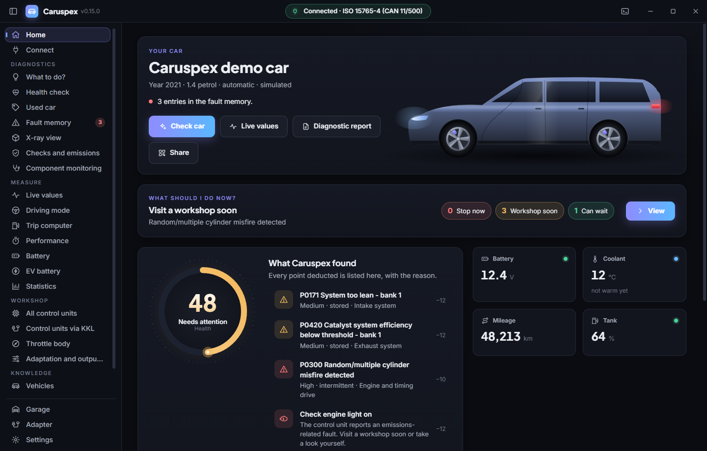

## Najważniejsze cechy

- **Dwa kompletne stosy diagnostyczne**: standardowy OBD-II/EOBD przez dowolny adapter ELM327 oraz diagnostyka
  producenta VW/Audi (KWP1281 i KWP2000) przez surowy kabel KKL K-Line.
- **Protokoły napisane od zera**: KWP1281 potwierdza każdy pojedynczy bajt jego dopełnieniem do jedności,
  czego firmware ELM327 nie potrafi. Caruspex steruje K-Line samodzielnie, łącznie z adresem wybudzenia 5 bodów,
  wysyłanym bit po bicie przez przełączanie sygnału break portu szeregowego, z czasem opartym na terminach, dzięki czemu
  drgania harmonogramu systemu operacyjnego nie sumują się w ciągu dziesięciu bitów.
- **Automatyczne rozpoznawanie protokołu**: po wybudzeniu dwa bajty klucza sterownika pokazują, czy mówi on
  KWP1281, czy KWP2000 (ISO 14230); Caruspex odpowiednio się przełącza.
- **Modularny workspace w Ruście**: jeden crate na obszar (łącza adapterów, protokoły, sieć i CAN, pojazdy, dane,
  nagrania, analiza, samochód demo, narzędzie wiersza poleceń) oraz aplikacja Tauri na wierzchu. Rdzeń nic nie wie
  o interfejsie, więc aplikacja i narzędzie wiersza poleceń działają na dokładnie tym samym kodzie.
- **Testy bez samochodu**: symulowane sterowniki (`crates/caruspex-protocols/tests/common/`) odtwarzają
  uzgadnianie bajt po bajcie, fałszywe bramy zastępują ENET i DoIP, fałszywy sterownik J2534 obejmuje ścieżkę PassThru,
  a symulator ELM327 w Pythonie pozwala na uruchomienia aplikacji od końca do końca.
- **Jeden zestaw tłumaczeń**: rdzeń i interfejs korzystają z tych samych plików tłumaczeń w
  `translations/<code>/`, w 18 językach. Rdzeń wyszukuje teksty po tekście angielskim, interfejs buduje
  swoje katalogi z tych samych plików.
- **Rozpoznaje każdy samochód**: dekoder VIN z 365 kodami producentów i katalog ponad 2100
  generacji modeli od 1980 roku pokazują, który samochód jest podłączony i co z nim działa.
- **Wbudowany samochód demo**: ELM327 w tym samym procesie z silnikiem i skrzynią biegów na CAN, dzięki czemu wszystko
  można wypróbować bez sprzętu.
- **Dane generowane, nie pisane ręcznie**: około 9700 kodów usterek, wiele z nich wyliczanych z regularnych rodzin kodów
  (na cylinder, na rząd cylindrów, na sondę lambda) przez `tools/gen_dtc.py`.

## Funkcje

### Zna samochód
- Po połączeniu Caruspex odczytuje VIN i mówi, jaki to samochód: marka, model, generacja, rok produkcji.
- Katalog ponad 2100 generacji modeli z 94 marek, od 1980 roku do dziś, także marek, które już nie istnieją.
- Dla każdej generacji: które złącze diagnostyczne, gdzie się znajduje, jaki protokół i czy zadziała OBD-II, kabel KKL, czy tylko własne narzędzia producenta.
- Sprawdzanie VIN dla dowolnego numeru: producent, kraj, rok produkcji, cyfra kontrolna, kod modelu.
- Garaż, który rozpoznaje każdy samochód po VIN i przechowuje historię jego kontroli i odczytów przebiegu.

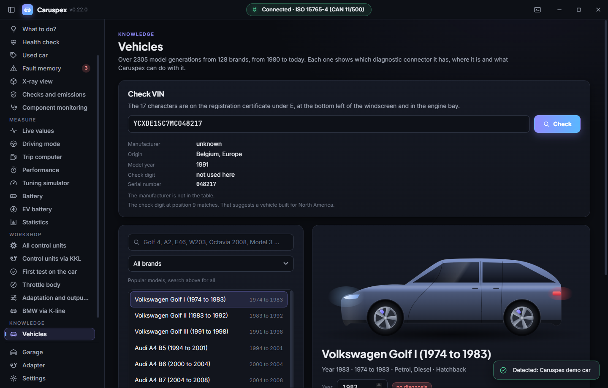

### Kontrola kondycji jednym przyciskiem
- Odczytuje pamięć usterek, monitory gotowości i testy komponentów, a potem przez pół minuty obserwuje mieszankę, temperatury, sondy lambda i napięcie ładowania.
- Ocena od 0 do 100, w której każdy utracony punkt jest wyjaśniony prostymi słowami, razem z kolejnym krokiem.
- Gotowy do badania emisji spalin? Który monitor jest jeszcze otwarty i jak jechać, żeby go zakończyć.
- Raport z kontroli jako PDF, do wydruku lub dla warsztatu.

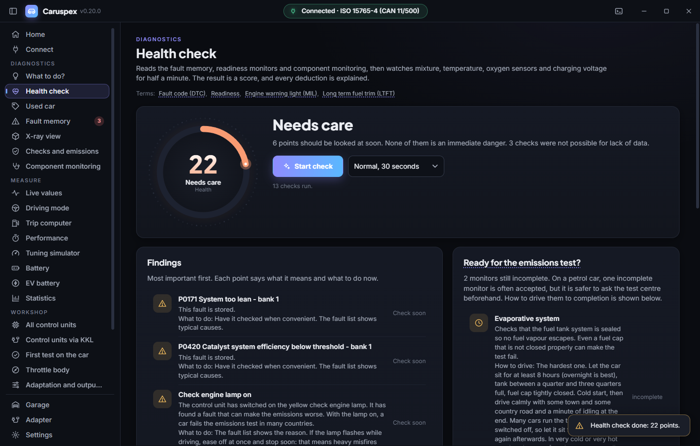

### Pamięć usterek
- Kody zapisane, oczekujące i trwałe; przy kilku sterownikach każdy kod pokazuje, kto go zgłosił (silnik, skrzynia biegów).
- Około 9400 kodów standardowych (P, C, B, U) oraz kody producentów dla VAG, Forda, GM, Toyoty, Hondy, Nissana, Hyundaia/Kii, Subaru i innych. Kod P1 jest czytany tak, jak rozumie go rozpoznana marka.
- Sygnalizacja świetlna przy każdym kodzie i pytanie, które każdy zadaje najpierw: czy mogę jechać dalej?
- Typowe przyczyny, rzeczy, które możesz sprawdzić sam, oraz orientacyjna klasa kosztów.
- Samochód w widoku przezroczystym pokazuje, gdzie znajduje się dana część.
- Kasowanie z wyraźnym ostrzeżeniem i automatycznym ponownym odczytem; eksport do CSV.

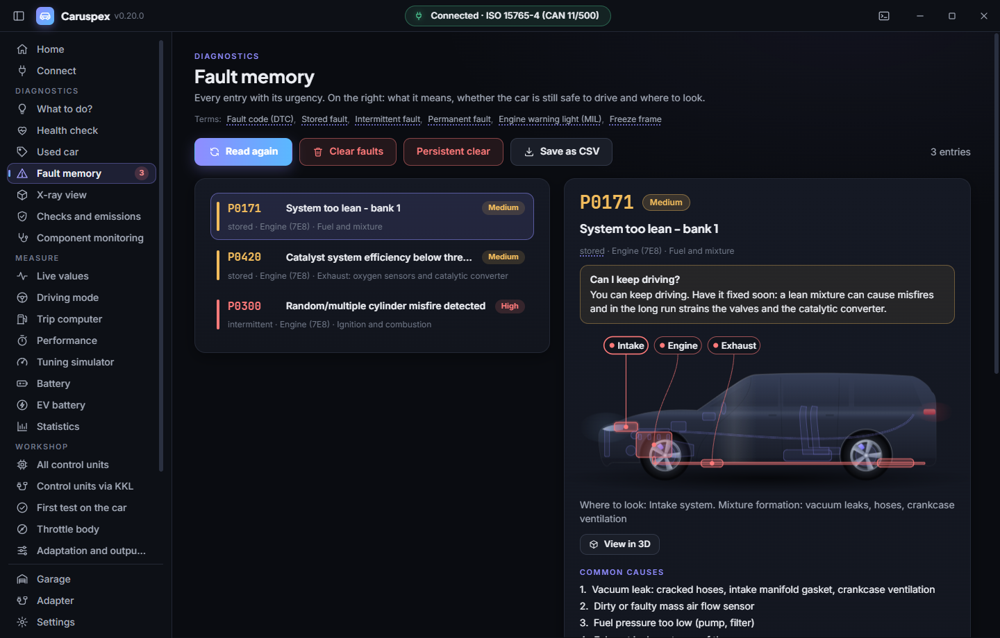

### Co mam teraz zrobić?
- Jedna strona, która porządkuje wszystko, co znalazł Caruspex, w trzech krokach: zatrzymać się od razu, wkrótce do warsztatu, może poczekać.
- Przy każdym punkcie jedno proste zdanie wyjaśniające dlaczego, orientacyjny przedział kosztów i notatka do pokazania w warsztacie (kod, sterownik, obszar, typowe przyczyny).
- OBD nie widzi, czy kontrolka silnika miga ani czy świeci czerwona kontrolka: pytają o to dwa pola wyboru, a migająca kontrolka z wypadaniem zapłonów przenosi punkt do "zatrzymać się od razu".

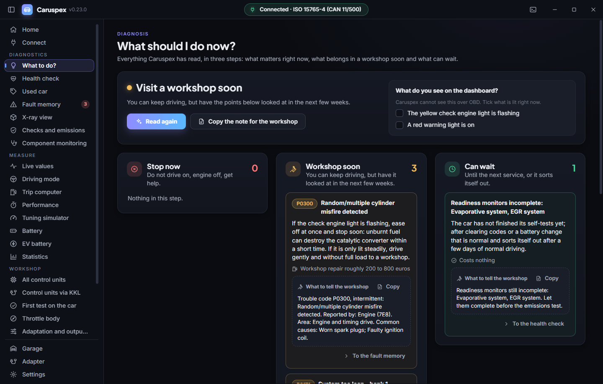

### Sprawdź używany samochód
- Na oględziny przed zakupem: czy numer VIN w samochodzie zgadza się z dokumentami i katalogiem, czy przebieg zgadza się między sterownikami, czy usterki skasowano tuż przed (odległość i czas od skasowania)?
- Monitory gotowości, zapisane usterki, kontrola kondycji, a w samochodach elektrycznych stan baterii.
- Sygnalizator świetlny, pytania do sprzedawcy i plik PDF do zakupu.

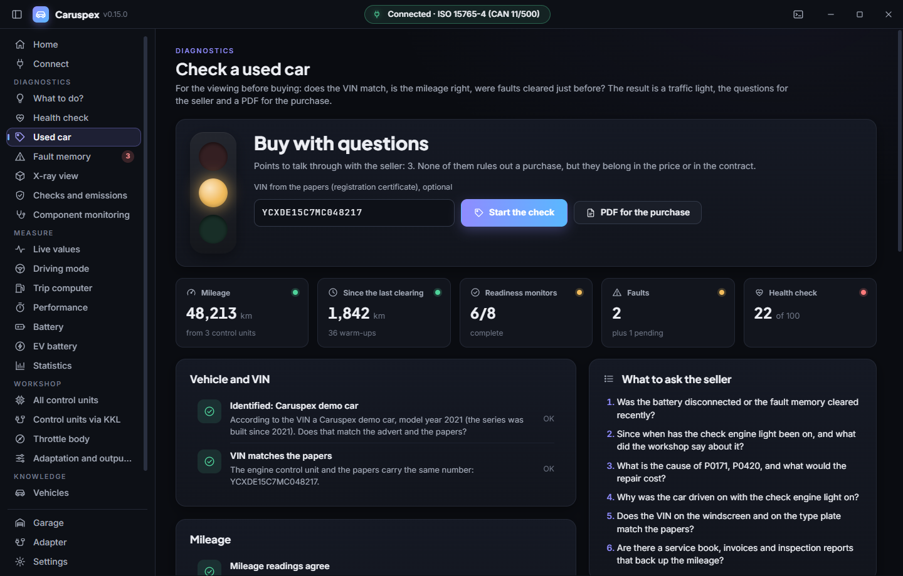

### Widok rentgenowski w 3D
- Podłączony samochód jako szklany model, który można obracać: silnik lub silniki, skrzynia biegów, zbiornik lub bateria wysokiego napięcia, wydech, chłodnica, akumulator 12 V i gniazdo OBD, rozmieszczone według nadwozia i napędu rozpoznanego samochodu.
- Każdy sterownik znaleziony podczas skanowania leży tam, gdzie zwykle się znajduje, połączony swoimi liniami danych (CAN układu napędowego i komfortu); gdy Caruspex odczytuje dane, małe pakiety wędrują do pytanego sterownika.
- Usterki podświetlają swój obszar i zaczerwieniają odpowiedzialny sterownik, wartości na żywo leżą na części, do której należą, a "Sprawdź auto" kieruje kamerę na każdy wynik. Warstwy można wyłączać po kolei.
- Typowe wymiary dla nadwozia i epoki, nie replika dokładnego modelu: dane konstrukcyjne i schematy elektryczne producentów nie są swobodnie dostępne.

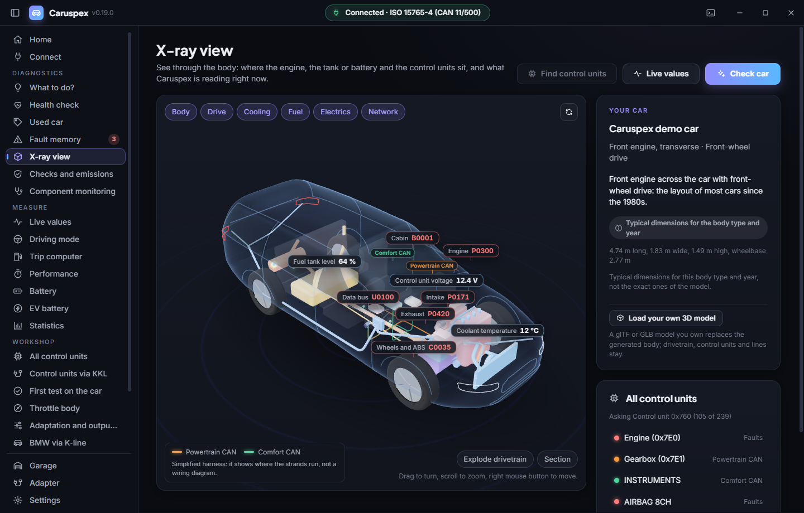

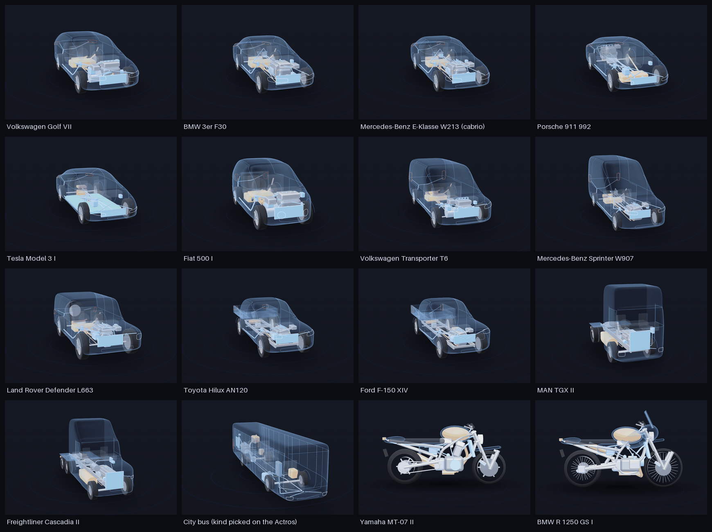

### Wartości na żywo
- Każda wartość trybu 01 z SAE J1979 aż do PID C4: 145 PID-ów z ponad 300 odczytami, pogrupowanych i z wyszukiwarką.
- Przebieg, bieg, temperatura oleju, zużycie paliwa, moment obrotowy, doładowanie, temperatury spalin, filtr cząstek stałych, AdBlue, NOx i akumulator hybrydy, o ile samochód je zgłasza.
- Ciągły wykres i nagrywanie do CSV.

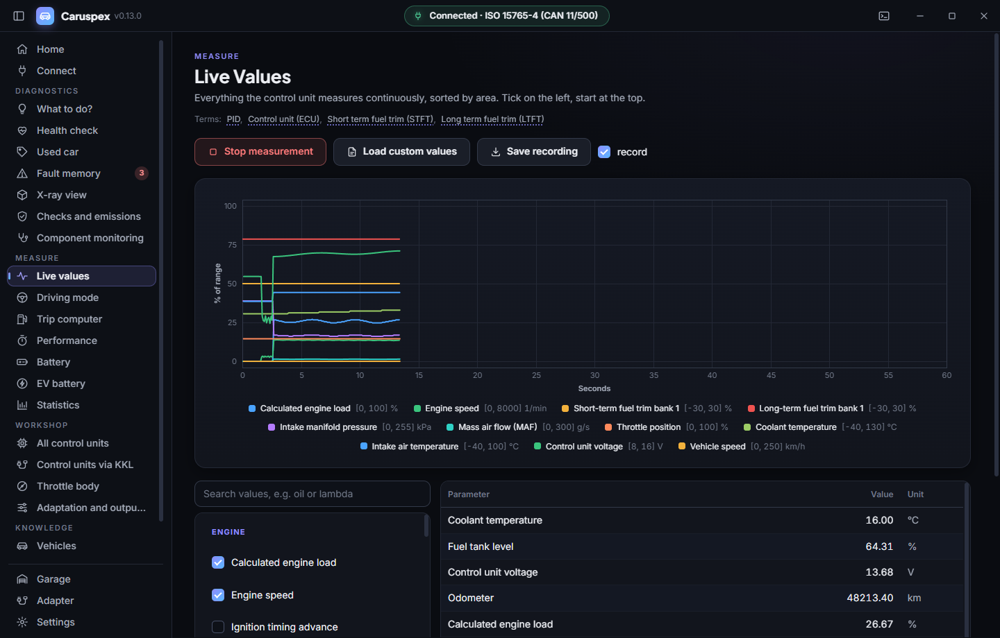

### Pomiary
- Komputer pokładowy: zużycie na żywo i średnie, koszt, CO2, dystans oraz ocena spokojnego stylu jazdy, także dla samochodów bez własnego komputera pokładowego.
- Osiągi: 0 do 100 km/h, 80 do 120, ćwierć mili i droga hamowania na podstawie sygnału prędkości (tylko na zamkniętych drogach).
- Akumulator i alternator: napięcie spoczynkowe, spadek przy rozruchu, napięcie ładowania z obciążeniem i bez, w czterech krokach z przewodnikiem.

### Kontrola
- Monitory gotowości prostymi słowami, zamrożona ramka, VIN.
- Monitorowanie komponentów w trybie 06 z wartością i limitami, liczniki wypadnięć zapłonu na cylinder.
- Nazwy sterowników, identyfikatory kalibracji i sumy kontrolne z trybu 09, dla każdego sterownika.
- Surowy terminal ELM327.

### Test adaptera
- Oryginalny ELM327 czy klon? Pyta o polecenia każdej wersji, mierzy czas odpowiedzi i uczciwie mówi, co z tego wynika.
- Rozpoznaje OBDLink i inne adaptery STN.
- Nigdy nic nie zapisuje do adaptera.

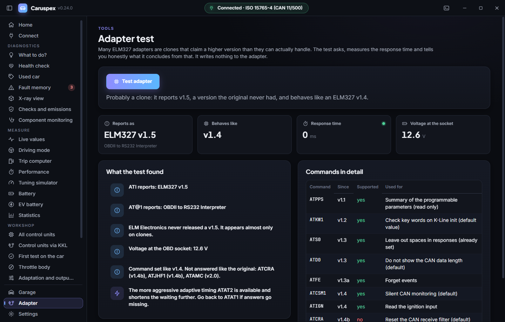

### Każdy kabel, każda droga do samochodu
Caruspex sam sprawdza, co jest podłączone i w jakim języku mówi samochód.

| Interfejs | Przykłady | Jak |
|---|---|---|
| ELM327 przez USB, Bluetooth, Bluetooth LE, Wi-Fi | tani ELM327, Vgate, vLinker, Veepeak | port szeregowy, sparowany lub bezpośrednio BLE, TCP |
| Układy STN | OBDLink SX, EX, MX+, CX | jak ELM327, z szybszym taktowaniem |
| SAE J2534 PassThru | Tactrix OpenPort 2.0, Mongoose, VCX Nano, Scanmatik, Godiag, VAS 5054A w trybie J2534 | 64-bitowy sterownik producenta, CAN z ISO-TP obsługuje Caruspex |
| SLCAN / Lawicel | CANable, USBtin, CANUSB | port szeregowy, znajdowany przez automatyczne przeszukiwanie portów |
| SocketCAN (Linux) | PEAK PCAN-USB, Kvaser, CANable z candleLight, nakładki CAN do Raspberry Pi | can0 i podobne |
| Kabel KKL (VAG 409.1) | kable FTDI lub CP2102 | K-Line, KWP1281 i KWP2000 |
| Kabel ENET | BMW i Mini od serii F | HSFZ przez Ethernet |
| Kabel DoIP | wiele samochodów od około 2016 | ISO 13400 przez Ethernet |

Na każdym z nich działają te same funkcje: OBD-II i OBD na UDS, każdy sterownik przez UDS, adresowanie
BMW, nasłuch wartości rozgłaszanych (Tesla), nagrywanie i odtwarzanie.

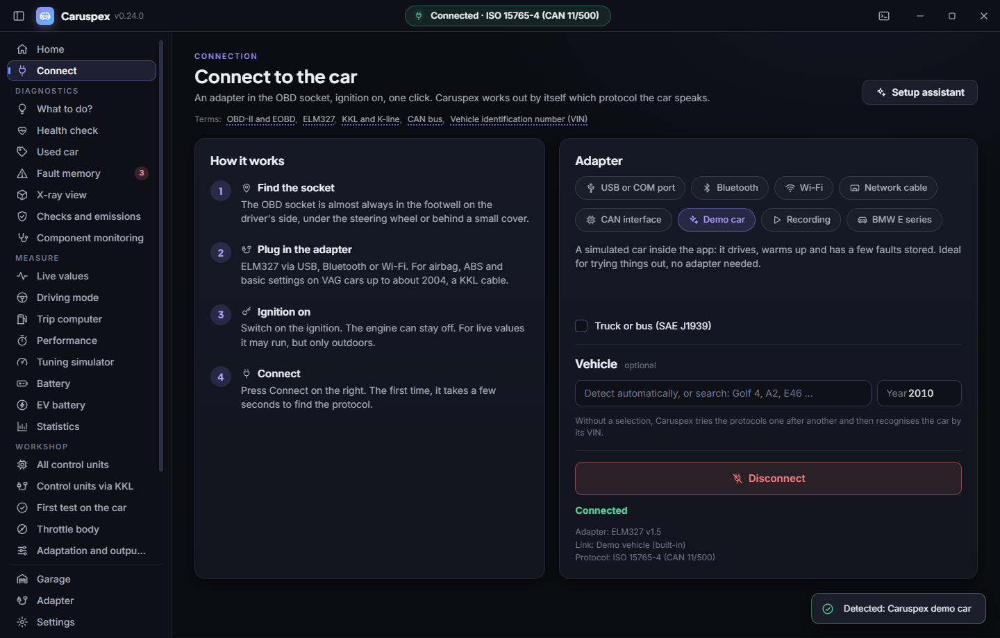

### Wszystkie sterowniki przez CAN (UDS)
- Ze zwykłym ELM327 Caruspex odpytuje po kolei każdy sterownik: silnik, skrzynię biegów, ABS, poduszki powietrzne, zegary, klimatyzację i inne, w większości samochodów od około 2008.
- Pamięć usterek dla każdego sterownika z rodzajem awarii (zwarcie, przerwa w obwodzie, wartość niewiarygodna ...), numerem części, wersją oprogramowania i sprzętu.
- Listy adresów dla VAG, BMW i Mini, Forda, Mazdy, GM, Toyoty, Nissana, Hyundaia/Kii, Renault i PSA; dla wszystkiego innego przeszukanie zwykłych adresów.
- BMW i Mini od serii F ze specjalnym rozszerzonym adresowaniem BMW przez 6F1, plus przeszukanie wszystkich 128 adresów diagnostycznych; kody usterek w formacie BMW, tak jak pokazuje je ISTA (np. 480A10).
- Kasowanie osobno dla każdego sterownika, z ostrzeżeniem.

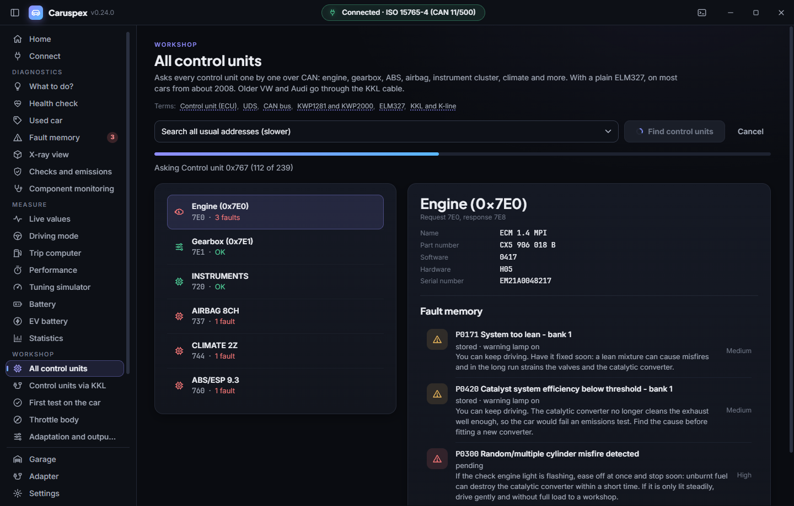

### VW i Audi przez kabel KKL (KWP1281 i KWP2000)
- Adaptacja przepustnicy: prawdziwe ustawienie podstawowe w bloku pomiarowym 060 lub 098.
- Skanowanie wszystkich sterowników, także ABS, poduszek powietrznych, zegarów i komfortu, z raportem do wydruku.
- Kanały adaptacji i testy wyjść, celowo tylko do odczytu.

### Wartości producenta i własne
- Akumulatory samochodów elektrycznych: stan zdrowia, naładowanie, napięcia ogniw z rozrzutem, temperatury, dla Hyundaia Kona i Ioniq, Kii e-Niro, Renault Zoe, Nissana Leaf oraz Tesli Model 3 i Y (przez nasłuch na magistrali CAN); każda wartość z udokumentowanym źródłem.
- Wartości producenta dla około 550 kolejnych pojazdów z projektu [OBDb](https://github.com/OBDb) (bateria, ciśnienie w oponach, olej, licznik przebiegu i więcej), oferowane automatycznie dla rozpoznanego samochodu; każde równanie jest sprawdzane dekoderem samego OBDb.
- Wczytaj własne wartości w powszechnie używanym formacie Torque CSV, z kompletnym interpreterem równań Torque.

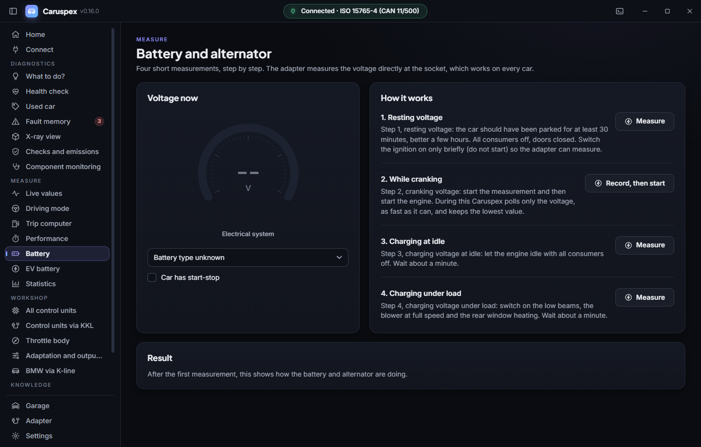

### Nagrywanie i odtwarzanie
- Nagraj sesję z samochodem do pliku i odtwórz ją później bez samochodu, przydatne przy szukaniu usterek.

### Bez samochodu i adaptera
- Wbudowany samochód demo: jeździ, rozgrzewa się, ma zapisanych kilka usterek i rozmawia jak prawdziwy ELM327 przez CAN.
- Leksykon wszystkich kodów offline, z filtrem według marki.

### Wygląd i obsługa
- Nowy interfejs w stylu Odysync: spokojny, ciemny, z płynnymi przejściami.
- Łączenie krok po kroku z automatycznym przeszukiwaniem wszystkich portów, a gdy się nie uda, krótka lista kontrolna dla danego rodzaju połączenia (sterownik, parowanie, zapłon, prędkość transmisji, klony adapterów) z tym, co Caruspex już ustalił.
- Tryb początkującego i profesjonalny: początkujący widzą strony na co dzień, narzędzia warsztatowe (KKL, adaptacja, surowe polecenia, adresy) pojawiają się w trybie profesjonalnym.
- 18 języków; ustawienia działają od razu.
- Informuje, gdy jest nowa wersja: przy starcie pyta GitHub o najnowsze wydanie i o nic więcej (żadnych danych
  o Tobie ani o samochodzie); można to wyłączyć w ustawieniach.

## Obsługiwane pojazdy

Każdy pojazd z OBD-II lub EOBD: w Europie samochody benzynowe od 2001 roku i diesle od 2004, w USA od 1996. Starsze VW, Audi, Seat i Skoda od około 1990 działają przez kabel KKL. Strona Pojazdy podpowiada, która droga działa dla danego samochodu.

| Epoka | Magistrala | Przykłady |
|---|---|---|
| do około 1995 | specyficzna dla producenta | VAG z KKL przez wtyki 2x2, w pozostałych tylko narzędzia warsztatowe |
| 1996 do około 2003 | K-Line (ISO 9141-2, KWP2000) | Audi A2, VW Golf IV, Toyota, Renault |
| od około 2004 | CAN (ISO 15765-4) | Audi A4 B7, VW Golf V, nowoczesne samochody japońskie |
| USA do około 2005 | SAE J1850 PWM i VPW | Ford, Chevrolet |
| najnowsze samochody | OBD na UDS (SAE J1979-2) | w USA wymagane od roku modelowego 2027, już w niektórych nowszych samochodach; rozpoznawane i tłumaczone automatycznie |
| BMW i Mini od serii F | ENET (HSFZ przez Ethernet) lub D-CAN z adresowaniem 6F1 | każdy sterownik |
| wiele samochodów od około 2016 | DoIP (ISO 13400) z kablem DoIP | OBD przez Ethernet, znajdowany automatycznie |
| Tesla Model 3 i Y | bez OBD: ramki CAN rozgłaszane | akumulator, ogniwa, temperatury, prędkość, przebieg przez nasłuch (kabel adaptera do złącza diagnostycznego) |

Samochody czysto elektryczne nie muszą udostępniać danych emisyjnych OBD-II. Niektóre mimo to odpowiadają częściowo; dla samochodów bez żadnej odpowiedzi, ale z ruchem na magistrali, Caruspex łączy się w trybie nasłuchu i odczytuje to, co znają wbudowane pakiety (jak dotąd Tesla Model 3 i Y).

## Obsługiwane adaptery

- Dowolny adapter zgodny z **ELM327**: USB, klasyczny Bluetooth (bezpośrednio przez RFCOMM w Windows i Linuksie po sparowaniu lub przez jego port COM), **Bluetooth LE**
  (Vgate iCar Pro BLE, vLinker, OBDLink CX, Veepeak BLE i inne adaptery ze zwykłymi usługami GATT; znajdowane przez
  skanowanie, bez parowania) lub Wi-Fi przez TCP
- **Kabel ENET** (OBD na RJ45) dla BMW i Mini od serii F: Caruspex znajduje samochód w sieci
  (HSFZ, porty 6811 i 6801) i odczytuje każdy sterownik przez Ethernet, bez układu adaptera po drodze. Komputer
  potrzebuje adresu automatycznego (169.254.x.x), który Windows, macOS i Linux przydzielają same, gdy nie odpowiada żaden DHCP.
  Tutaj Caruspex też tylko czyta; kodowanie i flashowanie zostają przy E-Sys, ISTA lub narzędziach do tuningu.
- Dowolny **kabel KKL (VAG 409.1)**. Kable oparte na FTDI lub CP2102 są znacznie pewniejsze na K-Line niż
  najtańsze klony; dla KWP1281 zaleca się oryginalny FTDI FT232RL.

Interfejsy własnościowe, takie jak Delphi DS150E, Autocom czy VAS 5054A, nie są obsługiwane, bo nie mówią ELM327.

| Funkcja | ELM327 | KKL 409.1 |
|---|---|---|
| Odczyt i kasowanie usterek silnika | tak | tak |
| Wartości na żywo, zamrożona ramka, gotowość | tak | tak |
| ABS, poduszki powietrzne, zegary, komfort | **nie** | tak |
| Bloki pomiarowe producenta | **nie** | tak |
| **Adaptacja przepustnicy** | **nie** | tak |

To ograniczenie sprzętowe, nie programowe: KWP1281 to protokół blokowy, w którym każdy bajt jest
potwierdzany przez drugą stronę. Firmware ELM327 obsługuje tylko całe pary żądanie/odpowiedź.
Kabel KKL przepuszcza K-Line w postaci surowej, więc Caruspex może sam mówić tym protokołem.

### Dwa protokoły VAG, rozpoznawane automatycznie

| Protokół | Typowy dla | Ustawienia podstawowe |
|---|---|---|
| KWP1281 (protokół blokowy) | silniki 1.4 MPI | osobne polecenie (blok 0x28) |
| KWP2000 (ISO 14230) | 1.6 FSI z Bosch MED | osobna sesja diagnostyczna, potem odczyt bloku |

Kanały adaptacji i testy wyjść są obecnie zaimplementowane na ścieżce KWP1281; przy KWP2000
aplikacja mówi o tym, zamiast zawieść po cichu.

Jeszcze niezaimplementowane: diagnostyka producenta przez CAN z VW TP 2.0 (pojazdy od około 2004).

## Technologie

| Obszar | Technologia |
|---|---|
| Język | Rust (edycja 2024) |
| Interfejs | Tauri 2 z React 19 i TypeScript, budowany przez Vite |
| Biblioteki | `serialport` (porty szeregowe), `btleplug` (Bluetooth LE), `libloading` (sterowniki J2534) |
| Lokalizacja | Jeden zestaw plików JSON w `translations/` dla rdzenia i interfejsu, 18 języków |
| Budowanie | Workspace Cargo, npm dla interfejsu |
| Testy | `cargo test` na symulowanych sterownikach, fałszywych bramach i fałszywym sterowniku J2534 |
| Narzędzia | Python 3 (generatory kodu i tabel, kontrola tłumaczeń, symulator ELM327) |
| Platformy | Windows 10 i 11, Linux, macOS |

<!-- tested -->
## Sprawdzone z

To, co naprawdę wypróbowano dotąd z Caruspex, uczciwie wypisane. Wszystko inne jest zbudowane według norm i przetestowane z symulowanymi sterownikami, fałszywymi bramkami i fałszywymi sterownikami urządzeń, ale jeszcze nie w prawdziwym samochodzie.

| Interfejs | Samochód | Wynik |
|---|---|---|
| OBDLink z układem STN2232 | brak, test adaptera bez samochodu | układ, firmware i polecenia rozpoznane |
| wszystkie inne adaptery i interfejsy | | jeszcze nie testowane w prawdziwym samochodzie |

Wypróbowałeś Caruspex w swoim samochodzie? Wyślij [raport z testu](https://github.com/SenseiIssei/Caruspex/issues/new?template=test-report.yml): każdy raport trafia na tę listę, według marki i interfejsu.
<!-- /tested -->

<!-- help -->
## Jak możesz pomóc

Caruspex to hobbystyczny projekt, nad którym pracuję w wolnym czasie. Niektórych rzeczy nie dam rady zrobić sam, a każda z nich pomaga wszystkim użytkownikom:

- **Wypróbuj go w swoim samochodzie.** Poza samochodem demonstracyjnym prawie wszystko było dotąd testowane tylko z symulowanymi sterownikami. Krótki [raport z testu](https://github.com/SenseiIssei/Caruspex/issues/new?template=test-report.yml) z informacją o samochodzie, adapterze i o tym, co zadziałało, a co nie, to najcenniejsza pomoc ze wszystkich. Szczególnie potrzebuję:
  - samochodów z K-Line, na przykład z koncernu VW do około 2005 roku lub BMW serii E, z kablem KKL lub OBDLink;
  - diesli z koncernu VW: czy sterownik silnika pozwala na rozszerzoną sesję diagnostyczną dla wartości sadzy, na biegu jałowym i podczas jazdy;
  - nowszych samochodów z DoIP (VW MEB, Volvo, Mercedes z MBUX): listy sterowników, które znajduje skanowanie;
  - samochodów elektrycznych, przede wszystkim Tesli Model S i X, BYD, Xpeng i NIO.
- **Udostępnij nagranie.** Nagraj sesję w aplikacji i użyj **Udostępnij nagranie**: usuwa to dane osobowe i pokazuje, co zostanie, zanim cokolwiek opuści twój komputer. Nagrania pokazują dokładnie, jak samochód odpowiada, i dzięki nim mogę dodać jego obsługę, choć nie mam go u siebie.
- **Wskaż mi wolne źródła.** Kody usterek producentów (na przykład BMW, Opel, Renault, PSA i Volvo), dokładne położenie gniazda OBD i sygnały dla kolejnych samochodów trafiają do projektu tylko ze źródeł, z których wolno swobodnie korzystać (CC0, CC BY, CC BY-SA, MIT lub domena publiczna). Jeśli znasz takie źródło, otwórz issue z linkiem. Pomaga też informacja, gdzie znajduje się gniazdo w twoim samochodzie.
- **Popraw tłumaczenie.** Caruspex mówi w 18 językach, a większości z nich nie sprawdził jeszcze żaden rodzimy użytkownik języka. Jeśli coś brzmi dziwnie w twoim języku, [translations/TRANSLATING.md](translations/TRANSLATING.md) pokazuje, jak to poprawić.
- **Kod.** Pull requesty są mile widziane, zobacz [CONTRIBUTING.md](CONTRIBUTING.md).
<!-- /help -->

## Pobieranie

Gotowe pakiety są na [stronie wydań](https://github.com/SenseiIssei/Caruspex/releases):

| System | Plik | Uwagi |
|---|---|---|
| Windows 10 i 11, 64-bit | `Caruspex-<version>-windows-x64-setup.exe` | Instaluje się bez uprawnień administratora i może dodać `caruspex_cli` do ścieżki wyszukiwania. Aktualizuje zainstalowaną wersję 0.8 w miejscu i instaluje środowisko WebView2 tylko wtedy, gdy go brakuje |
| Windows 10 i 11, 64-bit | `Caruspex-<version>-windows-x64.zip` | Wersja przenośna, rozpakuj i uruchom. Wymaga środowiska WebView2, które Windows 10 i 11 już mają |
| macOS 13 i nowszy, Apple Silicon | `Caruspex-<version>-macos.dmg` | Przeciągnij aplikację do Programów |
| Linux, x86_64 | `Caruspex-<version>-linux-x86_64.AppImage` | `chmod +x` i uruchom |
| Debian i Ubuntu, 64-bit | `Caruspex-<version>-linux-amd64.deb` | Instalacja przez `sudo apt install ./Caruspex-<version>-linux-amd64.deb` |
| Tylko narzędzie wiersza poleceń | `caruspex_cli-<version>-windows-x64.zip`, `caruspex_cli-<version>-linux-x86_64.tar.gz`, `caruspex_cli-<version>-macos.tar.gz` | Do skryptów i serwerów, bez interfejsu |

Pakiety nie są jeszcze podpisane. Windows SmartScreen pyta przy pierwszym uruchomieniu ("Więcej informacji", "Uruchom mimo to"); w macOS
otwórz aplikację za pierwszym razem prawym przyciskiem myszy i "Otwórz".

## Budowanie

Wymagania: stabilny toolchain Rusta (edycja 2024, Rust 1.90 lub nowszy), Node 24 z npm oraz Python 3 dla
generatorów i kontroli tłumaczeń. W Linuksie pakiety systemowe potrzebne interfejsowi i łączom adapterów
(nazwy dla Debiana i Ubuntu):

```bash
sudo apt-get install libwebkit2gtk-4.1-dev librsvg2-dev libdbus-1-dev libudev-dev pkg-config
```

Windows potrzebuje środowiska WebView2 (część Windows 10 i 11), macOS nie potrzebuje niczego dodatkowo.

Zainstaluj zależności interfejsu jednorazowo, a potem zbuduj narzędzie wiersza poleceń i aplikację:

```bash
npm --prefix app ci
```

```bash
cargo build --release -p caruspex-cli
```

```bash
npm --prefix app run tauri -- build
```

`npm --prefix app run dev:app` uruchamia aplikację z przeładowaniem na żywo podczas pracy nad nią. Sam
interfejs, bez okna Tauri, działa w zwykłej przeglądarce z wbudowanym samochodem demo:

```bash
npm --prefix app run dev
```

Otwórz `http://localhost:5287/?demo`, aby od razu połączyć się z samochodem demo. `?lang=de` wybiera język, a
`?theme=light` jasny motyw, na przykład `?demo&lang=de&theme=light`. Bez powłoki Tauri nie ma
dostępu do adapterów, więc wersja przeglądarkowa zna tylko samochód demo.

### Uprawnienia do portu szeregowego w Linuksie

Aby korzystać z adaptera bez `sudo`:

```bash
sudo usermod -aG dialout $USER
```

Potem wyloguj się i zaloguj ponownie.

## Wyniki budowania

| Wynik | Opis |
|---|---|
| `target/release/caruspex` / `caruspex.exe` | Aplikacja z interfejsem Tauri (`tauri build` zapisuje też instalatory i pakiety w `target/release/bundle/`) |
| `target/release/caruspex_cli` / `caruspex_cli.exe` | Skryptowalne narzędzie wiersza poleceń na tym samym rdzeniu, zobacz [Narzędzie wiersza poleceń](#narzędzie-wiersza-poleceń) |

### Pakiety i wydania

`bash tools/package.sh` buduje pakiety bieżącego systemu w `dist/`: instalator i dwa archiwa zip w
Windows (instalator wymaga [Inno Setup 6](https://jrsoftware.org/isinfo.php)), plik dmg i archiwum narzędzia wiersza poleceń
w macOS, AppImage, plik `.deb` i archiwum narzędzia wiersza poleceń w Linuksie. `bash tools/smoke_test.sh` następnie instaluje lub
otwiera je tak, jak zrobiłby to użytkownik, uruchamia oba programy i je usuwa. CI robi jedno i drugie przy każdym przebiegu.

Wydanie powstaje ze znacznika. `bash tools/release.sh <version>` przygotowuje je na osobnej gałęzi, nic nie wypychając:
ustawia wersję w `Cargo.toml` i `app/package.json`, tworzy `changelog/<version>.md` (niemiecki i angielski),
uruchamia kontrole, testy, pakowanie i test dymny oraz odświeża zrzuty ekranu w README (`tools/screenshots.sh de` i
`tools/screenshots.sh en`). Po scaleniu pull requesta utwórz znacznik `v<version>` i wypchnij go. CI buduje wszystkie
trzy systemy i publikuje wydanie z pakietami i listą zmian.

CI (`.github/workflows/build.yml`) najpierw uruchamia formatowanie, sprawdzenie wygenerowanych tabel, kontrolę tłumaczeń, budowanie
interfejsu i clippy w Linuksie, a potem testuje, pakuje i sprawdza testem dymnym Windows, Linux i macOS.
Drugi workflow (`.github/workflows/data-check.yml`) raz w miesiącu szuka nowych kodów VIN, pojazdów i plików DBC
w źródle i otwiera zgłoszenie z tym, co nowe.

## Testy

```bash
cargo test --workspace
```

Około 370 testów działa w kilka sekund, wszystkie bez samochodu. Obejmują parser odpowiedzi ELM327, dekodowanie kodów usterek,
konwersję PID, profile pojazdów i dekoder VIN, usługi OBD-II i UDS na samochodzie demo,
pełne sesje KWP1281 i KWP2000 na symulowanych sterownikach, ENET (HSFZ) i DoIP na fałszywych bramach,
SLCAN i ścieżkę J2534 na fałszywym sterowniku, nagrania i odtwarzanie oraz analizę (kontrola kondycji, test akumulatora,
komputer pokładowy, stoper osiągów). Testy narzędzia wiersza poleceń uruchamiają zbudowane `caruspex_cli` i porównują jego wynik z
plikami wzorcowymi w `crates/caruspex-cli/tests/golden/`, które zawierają to, co wcześniejsza wersja w C++ drukowała dla tych samych
poleceń, więc każda różnica względem starego narzędzia wychodzi na jaw.

Kontrole, które CI uruchamia poza testami:

```bash
cargo fmt --all --check
```

```bash
cargo clippy --workspace --all-targets -- -D warnings
```

```bash
python tools/i18n_rust.py --strict
```

```bash
npm --prefix app run build
```

Pierwsze dwie to formatowanie i lint. `tools/i18n_rust.py --strict` kończy się błędem, gdy tekstu z rdzenia brakuje w
plikach tłumaczeń albo brakuje tłumaczenia w jednym z 18 języków; budowanie interfejsu sprawdza własne
teksty w ten sam sposób, gdy ustawiono `I18N_STRICT=1`. Uruchom `python tools/gen_dtc.py`, `gen_vehicles.py`, `gen_ecus.py` i
`gen_pids.py`, aby odświeżyć wygenerowane tabele; CI kończy się błędem, jeśli różnią się od tego, co jest w repozytorium.

## Wypróbuj bez samochodu

Najszybciej przez wbudowany samochód demo: wybierz "Samochód demo" na stronie Połącz albo uruchom z

```bash
target/release/caruspex --demo --language en
```

`caruspex --help` wypisuje wszystkie opcje aplikacji: `--tcp`, `--port`, `--bluetooth`, `--enet`, `--can`,
`--replay`, `--report`, `--language`, `--theme`, `--page`, `--shot` i `--size`.

Symulator w Pythonie gra silnik Audi A2 na K-Line albo, z `--can`, samochód z CAN z silnikiem
i skrzynią biegów (nagłówki, ISO-TP, tryby 06 i 09 dla każdego sterownika):

```bash
python tools/mock_elm327.py --can
```

Potem połącz aplikację (w Windows plik to `target/release/caruspex.exe`):

```bash
target/release/caruspex --tcp 127.0.0.1:35000 --language en
```

Narzędzie wiersza poleceń działa też z symulatorem:

```bash
target/release/caruspex_cli read --tcp 127.0.0.1:35000
```

### Narzędzie wiersza poleceń

`caruspex_cli <command>` z `--demo`, `--tcp HOST[:PORT]`, `--port NAME [--baud N]`, `--enet HOST|auto`,
`--can SPEC` lub `--replay FILE`:

| Polecenie | Co robi |
|---|---|
| `read` | Kontrolka ostrzegawcza, gotowość i kody usterek, z objaśnieniem dla marki, jeśli zdradza ją VIN |
| `vin` | VIN, co mówi (producent, kraj, rok produkcji, cyfra kontrolna) i pasujący samochód z katalogu |
| `freeze` | Każda zamrożona ramka, po jednej na zapisaną usterkę |
| `health` | Kontrola kondycji: usterki, gotowość, tryb 06 i seria pomiarów na żywo (`--seconds N`, domyślnie 15) |
| `probe` | Test adaptera: czym naprawdę jest ELM327, jakie polecenia zna, czasy odpowiedzi |
| `uds` | UDS na CAN: identyfikacja i pamięć usterek każdego sterownika (`--ids A,B,...` dla własnych adresów) |
| `custom` | Wartości producenta i własne z wbudowanego pakietu (`--pack NAME`) lub z Torque CSV (`--csv FILE`), jednorazowo |
| `live`, `info`, `clear`, `ecus`, `ports`, `kklcheck` | Wartości na żywo, VIN i pierwsza zamrożona ramka, kasowanie, wszystko dla każdego sterownika, porty szeregowe, autotest kabla KKL |
| `enet`, `interfaces` | Szuka w sieci samochodów BMW i Mini oraz samochodów z DoIP; wypisuje interfejsy CAN tego komputera (sterowniki J2534, SocketCAN) |
| `version`, `help` | Wersja programu, pełna lista poleceń i opcji |

`--json` wypisuje `read`, `vin`, `health`, `probe`, `freeze`, `uds` i `custom` jako JSON dla skryptów, `--record FILE`
zapisuje całą sesję z adapterem na potrzeby `--replay`, `--fast-timing` przełącza adapter na agresywne adaptacyjne
taktowanie, `-v` zapisuje w logu każde polecenie do adaptera (razem z `--json` na stderr). `caruspex_cli help` wypisuje wszystko.

```bash
target/release/caruspex_cli health --demo --json > health.json
```

Zrzuty ekranu na tej stronie pochodzą z samochodu demo, zrobione przez samą aplikację:
`--demo --page faults --shot shot.png --size 1440x920` otwiera stronę, po kilku sekundach zapisuje obraz okna
i kończy działanie (`tools/screenshots.sh` robi cały zestaw).

## Struktura projektu

```
crates/caruspex-i18n/       Języki: niemiecki i angielski w kodzie, pozostałe 16 z translations/
crates/caruspex-vehicles/   Dekoder VIN i katalog pojazdów (marki, modele, generacje, złącza, magistrale)
crates/caruspex-data/       Kody usterek, PID-y, adresy sterowników, przyporządkowanie kodu do komponentu
crates/caruspex-link/       Drogi do adaptera (szeregowa, TCP, Bluetooth LE), sterownik ELM327, test adaptera
crates/caruspex-protocols/  OBD-II, UDS, KWP2000 i KWP1281 (K-Line, bajt po bajcie)
crates/caruspex-net/        BMW ENET (HSFZ), DoIP, SLCAN, SocketCAN, J2534 PassThru
crates/caruspex-record/     Nagrania i odtwarzanie, wartości własne (Torque CSV, pakiety PID), zapis JSON
crates/caruspex-analysis/   Kontrola kondycji, przewodnik po cyklu jazdy, komputer pokładowy, stoper osiągów, test akumulatora
crates/caruspex-demo/       Wbudowany samochód demo: ELM327 z symulowanymi sterownikami
crates/caruspex-cli/        Narzędzie wiersza poleceń, z testami na plikach wzorcowych
app/src/                    Interfejs: React 19 i TypeScript (strony, powłoka, stan, raport, i18n)
app/src-tauri/              Aplikacja Tauri: okno, polecenia, sprawdzanie aktualizacji, opcje wiersza poleceń
translations/               Wspólne pliki tłumaczeń dla rdzenia i interfejsu, 18 języków
data/                       Katalog pojazdów jako ręcznie utrzymywany CSV, źródła sterowników i PID-ów
tools/                      Generatory, kontrola tłumaczeń, skrypty pakowania, wydań i zrzutów ekranu, symulator ELM327
docs/                       Zrzuty ekranu do README
packaging/                  Skrypt instalatora Windows, plik pulpitu Linuksa, Info.plist dla macOS
changelog/                  Uwagi do wydań dla każdej wersji, niemiecki i angielski
```

Baza kodów usterek jest generowana: `tools/gen_dtc.py` rozwija regularne rodziny kodów EOBD i
wyselekcjonowane listy w `tools/dtc/` do `crates/caruspex-data/src/generated/*.rs`. Uruchom go ponownie po zmianie danych:

```bash
python tools/gen_dtc.py
```

Katalog pojazdów działa tak samo: edytuj pliki CSV w `data/vehicles/`, a potem uruchom

```bash
python tools/gen_vehicles.py
```

Adresy sterowników i pakiety PID mają `tools/gen_ecus.py` i `tools/gen_pids.py`. Tłumaczenia opisano
w [translations/TRANSLATING.md](translations/TRANSLATING.md); po dodaniu tekstu w kodzie
`python tools/i18n_rust.py` wypisuje, co jeszcze trzeba przetłumaczyć.

## Uwaga o kasowaniu kodów

Tryb OBD 04 kasuje pamięć usterek, zamrożoną ramkę i monitory gotowości. Zaraz potem
samochód nie przejdzie badania emisji spalin, dopóki nie zakończy kilku pełnych cykli jazdy, a kod, którego przyczyna
nadal istnieje, wróci po krótkiej jeździe. Kasowanie to nie naprawa.

<!-- legal -->
## Bezpieczeństwo i odpowiedzialność

Caruspex to wolny projekt hobbystyczny dostarczany bez żadnej gwarancji, jak mówi [licencja MIT](LICENSE). Używasz go na własne ryzyko.

- Nigdy nie obsługuj go podczas jazdy. Konfiguruj go na postoju; pasażer może śledzić wartości na żywo.
- Kasowanie błędów, testy elementów wykonawczych i ustawienia podstawowe sprawiają, że samochód coś robi. Caruspex pyta przed każdym z nich; wykonuj je tylko na postoju w zabezpieczonym samochodzie i tylko w pojazdach, przy których wolno ci pracować.
- Caruspex nie zastępuje warsztatu. Kod błędu wskazuje objaw, nie zawsze przyczynę. Hamulce, poduszki powietrzne, układ kierowniczy i wszystko, co ważne dla bezpieczeństwa, należy powierzyć fachowcom.
- Kasowanie to nie naprawa. Skasowane błędy i wyzerowane testy gotowości mogą sprawić, że badanie spalin lub przegląd techniczny nie zostaną zaliczone.
- Caruspex nie zmienia przebiegu, immobilizera, kluczyków, układu oczyszczania spalin ani tachografu, a projekt nie przyjmuje zmian, które by to robiły. Manipulowanie licznikami przebiegu, układem oczyszczania spalin lub tachografami jest w wielu krajach zabronione.

## Znaki towarowe

Nazwy producentów pojazdów, modeli, adapterów, programów i norm (na przykład Volkswagen, Audi, BMW, Mercedes-Benz, Tesla, OBDLink, ELM327, VCDS czy ISTA) są znakami towarowymi ich właścicieli. Pojawiają się tylko po to, by powiedzieć, z jakimi samochodami, adapterami i interfejsami działa Caruspex. Caruspex jest niezależnym projektem i nie jest powiązany, polecany ani sponsorowany przez żadnego producenta pojazdów, producenta adapterów ani dostawcę oprogramowania. Aplikacja i to repozytorium nie używają logo tych firm.

## Licencja i źródła

Kod jest na licencji MIT, zobacz [LICENSE](LICENSE). Biblioteki zawarte w programach i ich licencje są wymienione w [THIRD_PARTY_NOTICES.md](THIRD_PARTY_NOTICES.md); aplikacja pokazuje je w ustawieniach. Dane wbudowane w programy:

- Wartości producentów dla około 550 pojazdów, przekształcone z [OBDb](https://github.com/OBDb), jak OBDb na licencji CC BY-SA 4.0: oddzielone od kodu w [data/obdb](data/obdb) z licencją i listą źródeł ([ATTRIBUTION.md](data/obdb/ATTRIBUTION.md)).
- Definicje sygnałów CAN z [opendbc](https://github.com/commaai/opendbc) (comma.ai) i [model3dbc](https://github.com/joshwardell/model3dbc), licencja MIT ([data/opendbc](data/opendbc), [data/tesla](data/tesla)).
- Wartości akumulatora dla Hyundaia Ioniq i Kona, Kii e-Niro, Nissana Leaf i Renault Zoe według OBDb (CC BY-SA 4.0, jak te pakiety), [Open Vehicle Monitoring System](https://github.com/openvehicles/Open-Vehicle-Monitoring-System-3) i [evDash](https://github.com/nickn17/evDash) (oba na licencji MIT): [data/pids](data/pids) ([ATTRIBUTION.md](data/pids/ATTRIBUTION.md)).
- Kody silników z artykułów Wikipedii, CC BY-SA 4.0 ([data/engines](data/engines), z artykułem i wersją w każdym wierszu).
- Kody producenta z numeru VIN sprawdzone w [NHTSA vPIC](https://vpic.nhtsa.dot.gov) (domena publiczna) i [Wikidata](https://www.wikidata.org) (CC0); kody, które ma tylko [lista WMI w Wikibooks](https://en.wikibooks.org/wiki/Vehicle_Identification_Numbers_%28VIN_codes%29/World_Manufacturer_Identifier_%28WMI%29), są na licencji CC BY-SA 4.0 i leżą osobno w [data/wmi](data/wmi).
- Wymiary pojazdów z [Wikidanych](https://www.wikidata.org), CC0.
- Czcionki na licencji SIL Open Font License 1.1: JetBrains Mono ([OFL.txt](resources/fonts/OFL.txt)), Inter ([OFL-Inter.txt](resources/fonts/OFL-Inter.txt)), Plus Jakarta Sans ([OFL-PlusJakartaSans.txt](resources/fonts/OFL-PlusJakartaSans.txt)).
<!-- /legal -->
