# Caruspex

<!-- languages -->
[English](README.md) · [Deutsch](README.de.md) · [Español](README.es.md) · [Français](README.fr.md) · [Português](README.pt.md) · [Italiano](README.it.md) · [Nederlands](README.nl.md) · [Polski](README.pl.md) · [Čeština](README.cs.md) · [Русский](README.ru.md) · **Українська** · [Türkçe](README.tr.md) · [العربية](README.ar.md) · [中文](README.zh.md) · [日本語](README.ja.md) · [한국어](README.ko.md) · [हिन्दी](README.hi.md) · [Bahasa Indonesia](README.id.md)
<!-- /languages -->

<!-- docs -->
**Документація:** [встановлення, перші кроки, кожен адаптер та інтерфейс, приватність, часті запитання](https://senseiissei.github.io/Caruspex/uk/index.html), усіма 18 мовами.
<!-- /docs -->

<!-- contrib -->
**Участь:** код, переклади та звіти про тести вітаються, див. [CONTRIBUTING.md](CONTRIBUTING.md) (англійською).
<!-- /contrib -->

[](https://github.com/SenseiIssei/Caruspex/actions/workflows/build.yml)


[](LICENSE)

Діагностика автомобілів з відкритим кодом для Windows, Linux і macOS, написана на Rust з інтерфейсом на Tauri 2.
Один кабель або адаптер, один застосунок: читання й стирання кодів несправностей, поточні значення датчиків,
перевірка готовності до техогляду та спілкування з блоками керування VW/Audi на рівні окремих байтів через кабель K-Line.

Назва походить від слова *гаруспік*: так звали римського віщуна, який читав знаки за нутрощами. Caruspex читає їх в автомобіля.

Застосунок розмовляє 18 мовами, і інтерфейс, і тексти всіх кодів несправностей: англійська, німецька, іспанська,
французька, португальська, італійська, нідерландська, польська, чеська, російська, українська, турецька, арабська (справа наліво), китайська,
японська, корейська, гінді та індонезійська. Він слідує мові системи, мову можна змінити в налаштуваннях
або задати для одного запуску, наприклад `--language fr`. Про те, як створюються й перевіряються переклади, розказано в
[translations/TRANSLATING.md](translations/TRANSLATING.md).

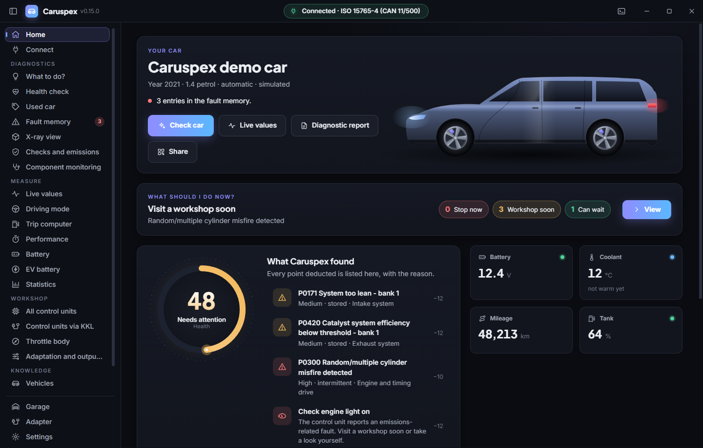

## Головне

- **Два повні діагностичні стеки**: стандартна OBD-II/EOBD через будь-який адаптер ELM327 і фірмова
  діагностика VW/Audi (KWP1281 і KWP2000) через звичайний кабель KKL із K-Line.
- **Протоколи написано з нуля**: KWP1281 підтверджує кожен байт його доповненням до одиниці,
  а прошивка ELM327 так не вміє. Caruspex сам керує K-Line, зокрема адресою пробудження на 5 бод,
  яка передається вручну перемиканням сигналу break послідовного порту з відліком за дедлайнами, щоб
  розкид планувальника ОС не накопичувався за десять бітів.
- **Автоматичне визначення протоколу**: після пробудження два ключові байти блока керування показують,
  чи він говорить на KWP1281, чи на KWP2000 (ISO 14230); Caruspex перемикається сам.
- **Модульний робочий простір Rust**: один крейт на кожну ділянку (зв'язок з адаптерами, протоколи, мережа й CAN, автомобілі, дані,
  записи, аналіз, демо-автомобіль, консольна утиліта) і застосунок Tauri згори. Ядро нічого не знає
  про інтерфейс, тому застосунок і консольна утиліта працюють на тому самому коді.
- **Перевірено без автомобіля**: імітовані блоки керування (`crates/caruspex-protocols/tests/common/`) відтворюють
  побайтове рукостискання, підроблені шлюзи замінюють ENET і DoIP, підроблений драйвер J2534 перевіряє шлях PassThru,
  а симулятор ELM327 на Python дозволяє прогонювати застосунок цілком.
- **Один набір перекладів**: ядро та інтерфейс використовують ті самі файли перекладів
  у `translations/<code>/`, 18 мовами. Ядро шукає тексти за англійським текстом, інтерфейс збирає
  свої каталоги з тих самих файлів.
- **Впізнає будь-який автомобіль**: декодер VIN із 365 кодами виробників і каталог із понад 2100
  поколінь моделей з 1980 року показують, який автомобіль підключено і що з ним працює.
- **Вбудований демо-автомобіль**: ELM327 усередині процесу з двигуном і коробкою передач на CAN, тож усе можна спробувати
  без обладнання.
- **Дані згенеровано, а не набрано вручну**: близько 9700 кодів несправностей, багато з них обчислено з регулярних родин кодів
  (за циліндрами, за рядами, за кисневими датчиками) скриптом `tools/gen_dtc.py`.

## Можливості

### Знає автомобіль
- Після підключення Caruspex читає VIN і повідомляє, що це за автомобіль: марка, модель, покоління, модельний рік.
- Каталог із понад 2100 поколінь моделей 94 марок, з 1980 року до сьогодні, зокрема марок, яких уже немає.
- Для кожного покоління: який діагностичний роз'єм, де він розташований, який протокол і що підійде: OBD-II, кабель KKL чи лише фірмові інструменти виробника.
- Перевірка VIN для будь-якого VIN: виробник, країна, модельний рік, контрольна цифра, код моделі.
- Гараж, який впізнає кожен автомобіль за VIN і зберігає історію його перевірок та показань пробігу.

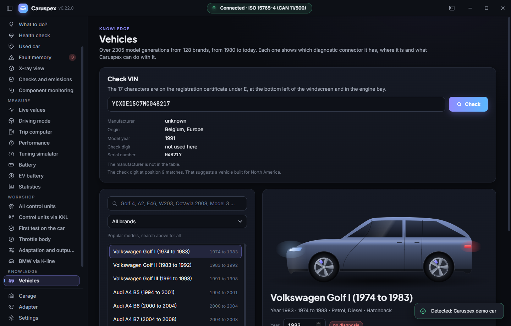

### Перевірка стану однією кнопкою
- Читає пам'ять несправностей, монітори готовності й тести компонентів, потім пів хвилини стежить за сумішшю, температурами, кисневими датчиками та напругою заряджання.
- Оцінка від 0 до 100, де кожен втрачений бал пояснено простими словами й наступним кроком.
- Готовий до перевірки викидів? Який монітор ще відкритий і як їхати, щоб його закрити.
- Звіт про перевірку у форматі PDF, для друку або для майстерні.

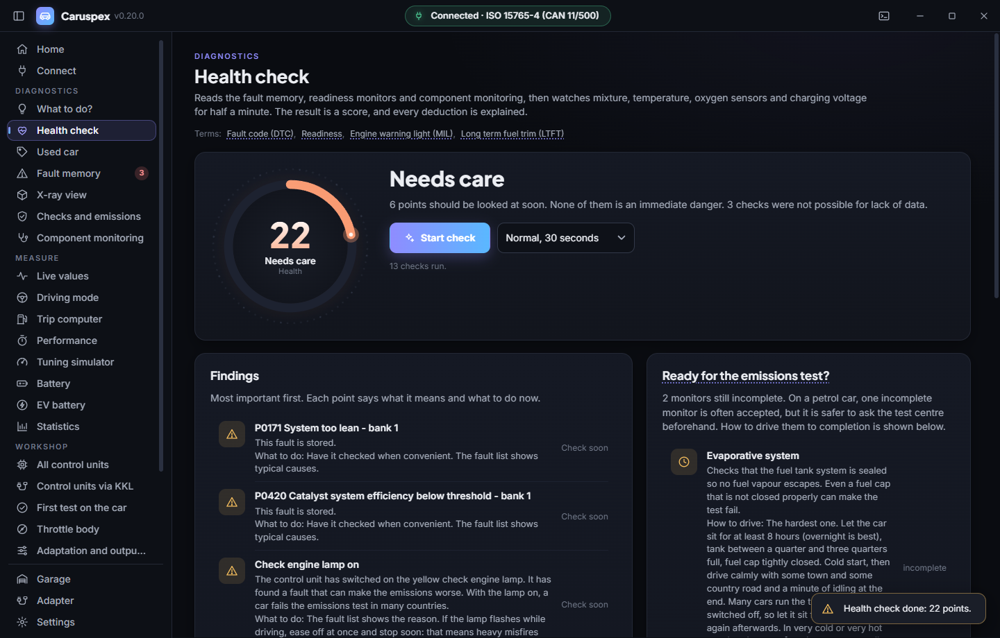

### Пам'ять несправностей
- Збережені, очікувані та постійні коди; якщо блоків керування кілька, біля кожного коду зазначено, хто його повідомив (двигун, коробка передач).
- Близько 9400 стандартних кодів (P, C, B, U) і коди виробників для VAG, Ford, GM, Toyota, Honda, Nissan, Hyundai/Kia, Subaru та інших. Код P1 читається так, як його розуміє розпізнана марка.
- Світлофор для кожного коду і запитання, яке всі ставлять першим: чи можна їхати далі?
- Звичайні причини, що можна перевірити самому, і приблизний клас вартості.
- Автомобіль у прозорому вигляді показує, де розташована уражена деталь.
- Стирання з чітким попередженням і автоматичним повторним читанням; експорт у CSV.

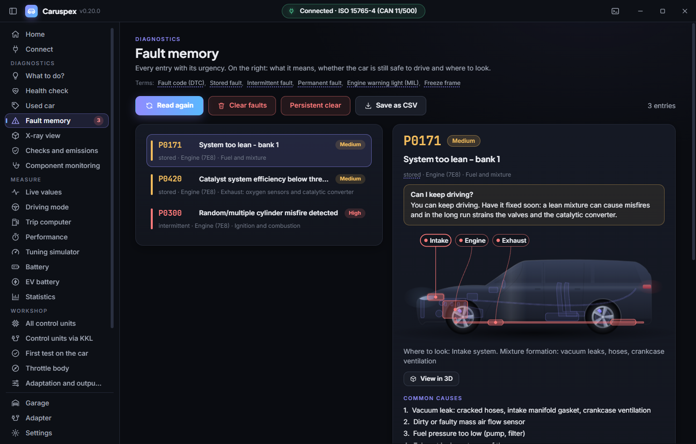

### Що мені зараз робити?
- Одна сторінка, що розподіляє все, що знайшов Caruspex, на три кроки: зупинитися зараз, незабаром до майстерні, може зачекати.
- До кожного пункту: одне просте речення, чому так, приблизний діапазон вартості та примітка для майстерні (код, блок керування, ділянка, звичайні причини).
- OBD не бачить, чи блимає контрольна лампа двигуна і чи світиться червона попереджувальна лампа: про це питають два поля для позначки, а лампа, що блимає разом із пропусками запалювання, переносить пункт у «Зупинитися зараз».

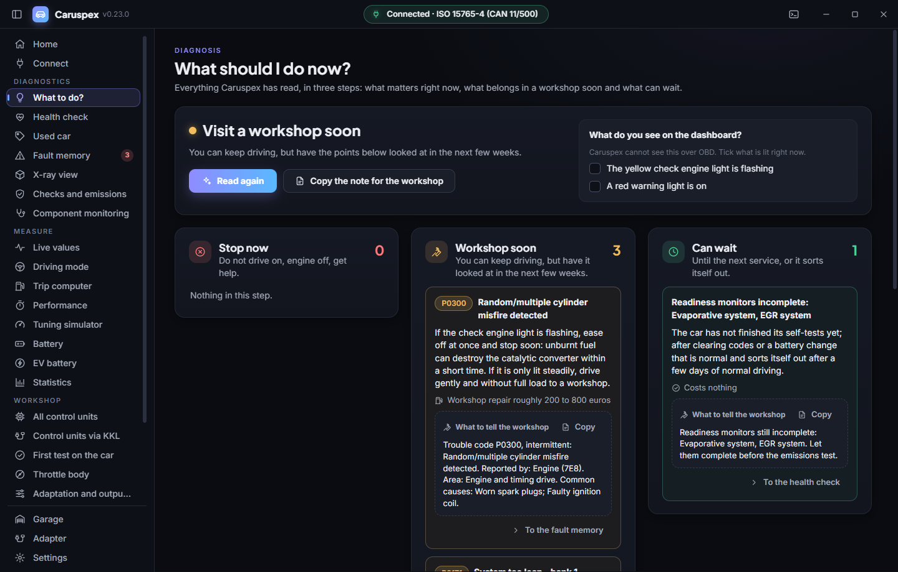

### Перевірити вживане авто
- Для огляду перед купівлею: чи збігається VIN в автомобілі з документами та каталогом, чи узгоджується пробіг між блоками керування, чи не стирали несправності незадовго до того (відстань і час після стирання).
- Готовність моніторів, збережені несправності, перевірка стану та, в електромобілів, стан батареї.
- Світлофор, запитання до продавця та PDF для купівлі.

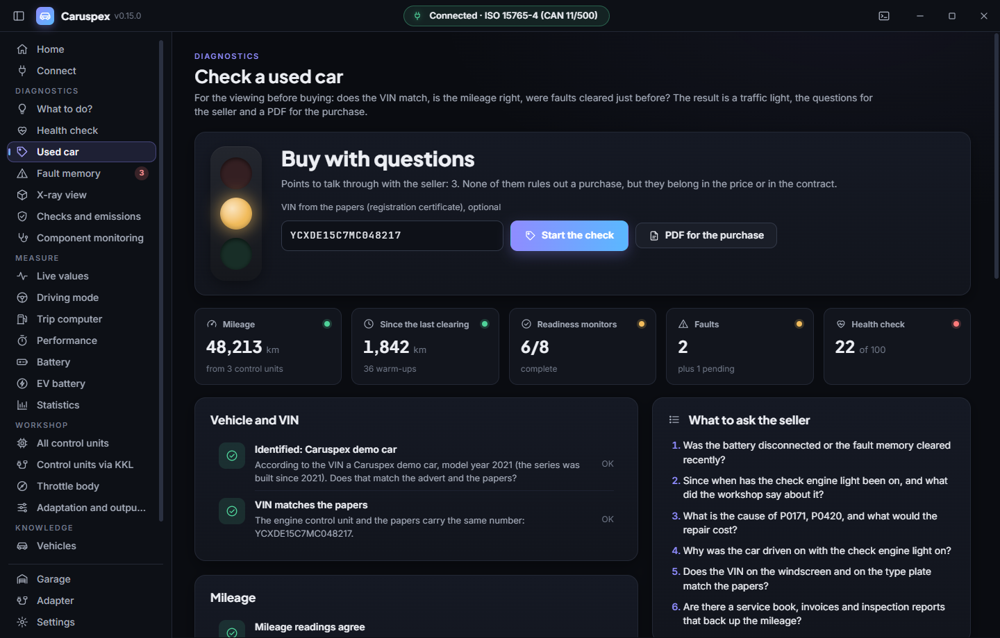

### Рентген-вигляд у 3D
- Підключений автомобіль як скляна модель, яку можна обертати: двигун або електромотори, коробка передач, бак або високовольтна батарея, вихлоп, радіатор, 12-вольтова батарея та роз'єм OBD, розташовані відповідно до типу кузова й привода визначеного автомобіля.
- Кожен блок керування, знайдений скануванням, стоїть там, де зазвичай, і з'єднаний своїми лініями даних (CAN силового агрегату та комфорту); поки Caruspex читає, до опитуваного блоку рухаються маленькі пакети.
- Несправності підсвічують свою ділянку й фарбують відповідальний блок керування в червоний, поточні значення стоять на своїй деталі, а «Перевірити автомобіль» наводить камеру на кожну знахідку. Шари можна вимикати по одному.
- Типові розміри для типу кузова й епохи, а не копія точної моделі: проєктні дані виробників і схеми проводки у вільному доступі відсутні.

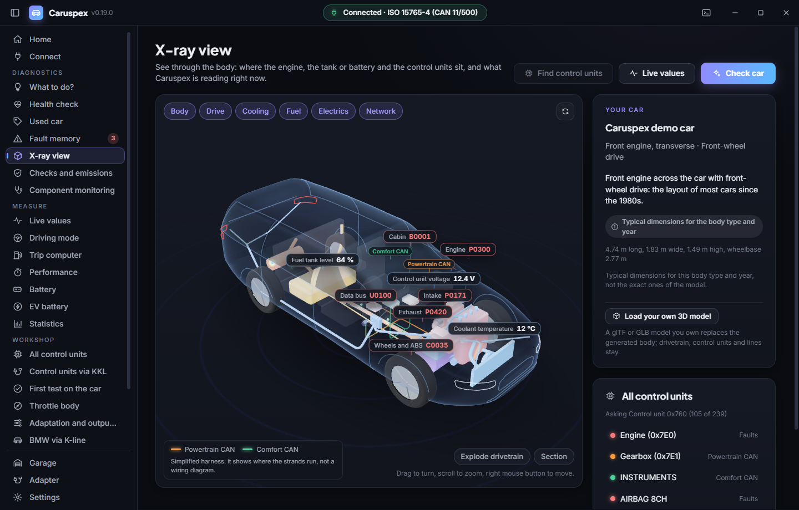

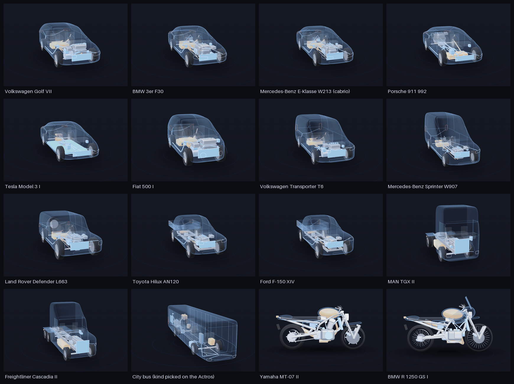

### Поточні значення
- Кожне значення режиму 01 за SAE J1979 аж до PID C4: 145 PID і понад 300 показників, згрупованих і з пошуком.
- Пробіг, передача, температура оливи, витрата палива, крутний момент, наддув, температури вихлопу, сажовий фільтр, AdBlue, NOx і гібридна батарея, наскільки автомобіль їх повідомляє.
- Графік, що прокручується, і запис у CSV.

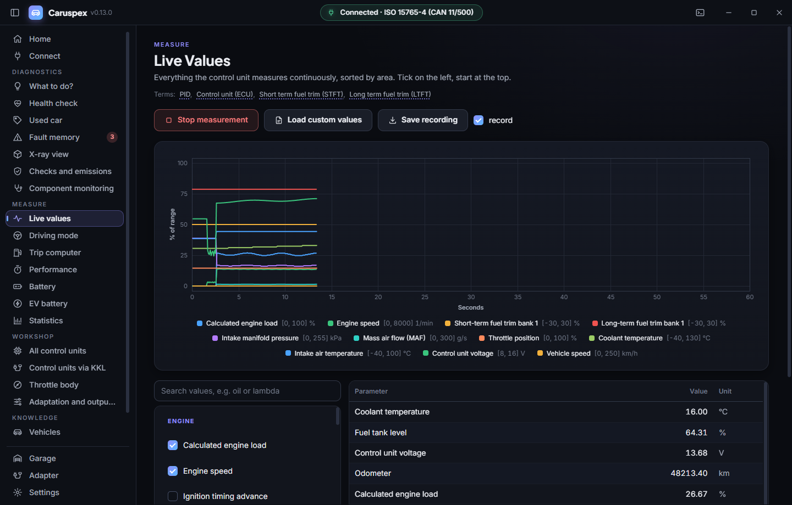

### Вимірювання
- Бортовий комп'ютер: витрата зараз і в середньому, вартість, CO2, відстань і м'яка оцінка стилю водіння, навіть для автомобілів без власного бортового комп'ютера.
- Динаміка: 0 до 100 км/год, 80 до 120, чверть милі та гальмівний шлях за сигналом швидкості (лише на закритих дорогах).
- Батарея й генератор: напруга спокою, просідання під час запуску стартером, напруга заряджання з навантаженням і без нього, у чотири кроки з підказками.

### Перевірка
- Монітори готовності простими словами, дані стоп-кадру, VIN.
- Контроль компонентів у режимі 06 зі значенням і межами, лічильники пропусків запалювання за циліндрами.
- Назви блоків, ідентифікатори калібрування та контрольні суми з режиму 09, для кожного блока керування.
- Прямий термінал ELM327.

### Тест адаптера
- Справжній ELM327 чи клон? Застосунок запитує команди кожної версії, вимірює час відповіді й чесно каже, що з цього випливає.
- Впізнає OBDLink та інші адаптери STN.
- Нічого не записує в адаптер.

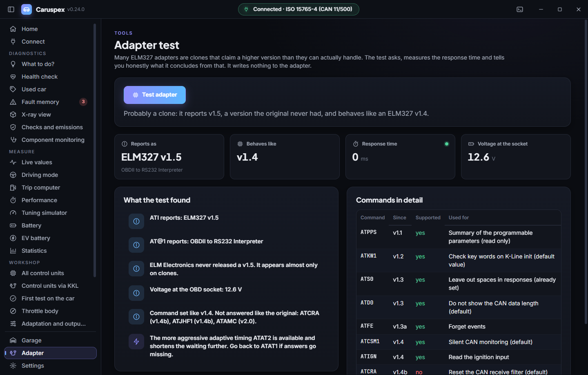

### Будь-який кабель, будь-який шлях в автомобіль
Caruspex сам визначає, що підключено і якою мовою говорить автомобіль.

| Інтерфейс | Приклади | Як |
|---|---|---|
| ELM327 через USB, Bluetooth, Bluetooth LE, Wi-Fi | дешеві ELM327, Vgate, vLinker, Veepeak | послідовний порт, спарене або пряме підключення BLE, TCP |
| Чипи STN | OBDLink SX, EX, MX+, CX | як ELM327, але зі швидшими таймінгами |
| SAE J2534 PassThru | Tactrix OpenPort 2.0, Mongoose, VCX Nano, Scanmatik, Godiag, VAS 5054A у режимі J2534 | 64-бітний драйвер виробника, CAN з ISO-TP виконує Caruspex |
| SLCAN / Lawicel | CANable, USBtin, CANUSB | послідовний порт, знаходиться автоматичним пошуком портів |
| SocketCAN (Linux) | PEAK PCAN-USB, Kvaser, CANable з candleLight, плати CAN для Raspberry Pi | can0 і подібні |
| Кабель KKL (VAG 409.1) | кабелі на FTDI або CP2102 | K-Line, KWP1281 і KWP2000 |
| Кабель ENET | BMW і Mini починаючи з серії F | HSFZ через Ethernet |
| Кабель DoIP | багато автомобілів приблизно з 2016 року | ISO 13400 через Ethernet |

На кожному з них працюють ті самі функції: OBD-II і OBD на UDS, усі блоки керування через UDS, адресація BMW,
прослуховування широкомовних значень (Tesla), запис і відтворення.

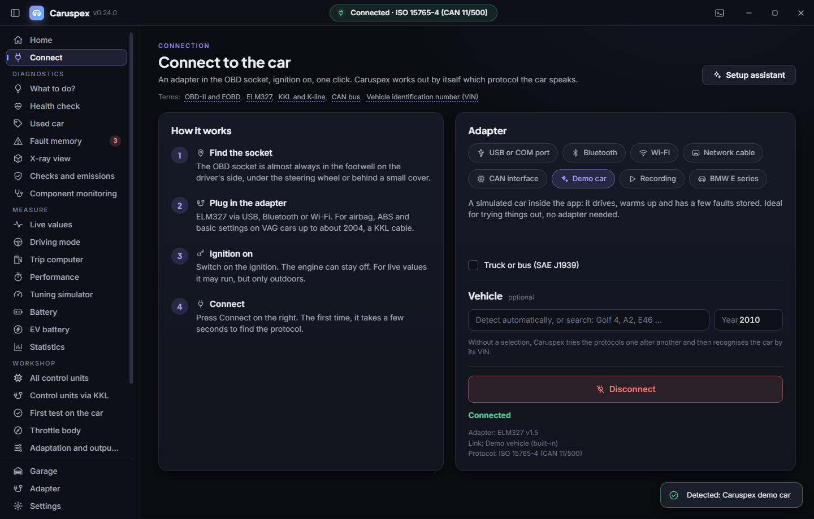

### Усі блоки керування через CAN (UDS)
- Зі звичайним ELM327 Caruspex опитує блоки керування по одному: двигун, коробка передач, ABS, подушки безпеки, панель приладів, клімат та інші, на більшості автомобілів приблизно з 2008 року.
- Пам'ять несправностей по кожному блоку з типом відмови (коротке замикання, обрив кола, недостовірний сигнал ...), номером деталі, версіями ПЗ та обладнання.
- Списки адрес для VAG, BMW і Mini, Ford, Mazda, GM, Toyota, Nissan, Hyundai/Kia, Renault і PSA; для всього іншого перебір звичайних адрес.
- BMW і Mini починаючи з серії F із власною розширеною адресацією BMW через 6F1, плюс перебір усіх 128 діагностичних адрес; коди несправностей у форматі BMW, як їх показує ISTA (наприклад 480A10).
- Стирання по кожному блоку, з попередженням.

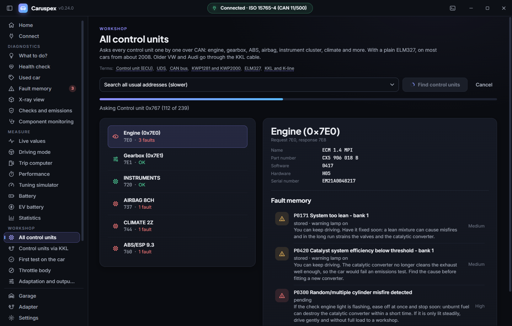

### VW і Audi через кабель KKL (KWP1281 і KWP2000)
- Адаптація дросельної заслінки: справжнє базове налаштування у блоці вимірювань 060 або 098.
- Опитування всіх блоків керування, зокрема ABS, подушок безпеки, панелі приладів і комфорту, зі звітом для друку.
- Канали адаптації та тест виконавчих механізмів, свідомо лише для читання.

### Фірмові та власні значення
- Батареї електромобілів: стан здоров'я, заряд, напруги комірок із розкидом, температури, для Hyundai Kona та Ioniq, Kia e-Niro, Renault Zoe, Nissan Leaf і Tesla Model 3 та Y (прослуховуванням шини CAN); кожне значення має задокументоване джерело.
- Фірмові значення ще для близько 550 автомобілів із проєкту [OBDb](https://github.com/OBDb) (батарея, тиск у шинах, олива, пробіг та інше) пропонуються автоматично для визначеного автомобіля; кожне рівняння перевірене власним декодером OBDb.
- Завантаження власних значень у поширеному форматі Torque CSV, з повним обчислювачем рівнянь Torque.

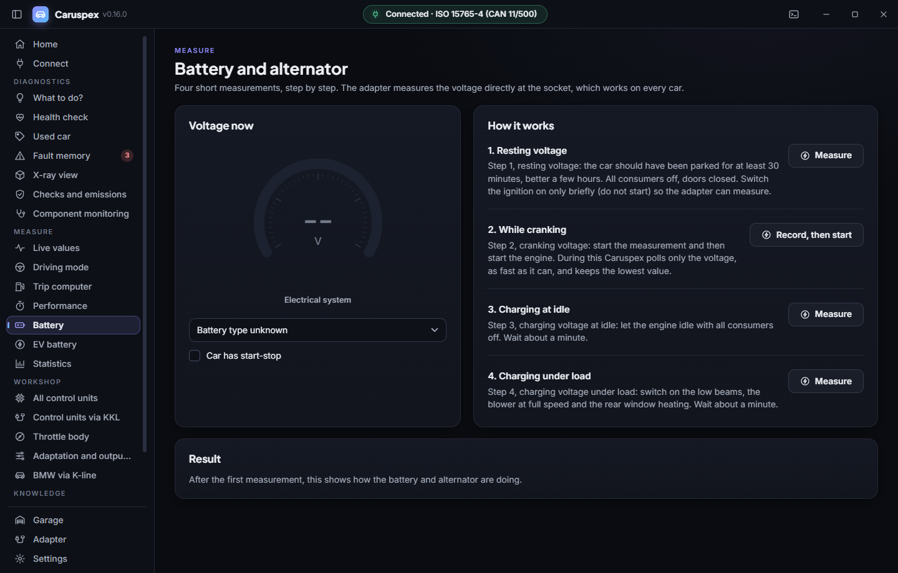

### Запис і відтворення
- Запишіть сеанс з автомобілем у файл і відтворіть його пізніше без автомобіля, зручно для пошуку несправностей.

### Без автомобіля й адаптера
- Вбудований демо-автомобіль: він їде, прогрівається, має кілька збережених несправностей і спілкується як справжній ELM327 через CAN.
- Офлайн-довідник усіх кодів з фільтром за марками.

### Вигляд і відчуття
- Новий інтерфейс у стилі Odysync: спокійний, темний, з плавними переходами.
- Покрокове підключення з автоматичним пошуком за всіма портами, а в разі невдачі короткий контрольний список для цього типу підключення (драйвер, спарювання, запалювання, швидкість передачі, клони адаптерів) з тим, що Caruspex уже з'ясував.
- Режими «Початківець» і «Профі»: початківці бачать повсякденні сторінки, а інструменти для майстерні (KKL, адаптація, сирі команди, адреси) з'являються в режимі «Профі».
- 18 мов; налаштування застосовуються одразу.
- Повідомляє, коли вийшла нова версія: під час запуску запитує в GitHub найновіший реліз і більше нічого (жодних
  даних про вас чи автомобіль); можна вимкнути в налаштуваннях.

## Підтримувані автомобілі

Будь-який автомобіль з OBD-II або EOBD: у Європі бензинові з 2001 року та дизельні з 2004, у США з 1996. Старіші VW, Audi, Seat і Skoda приблизно з 1990 року працюють через кабель KKL. Сторінка «Автомобілі» підкаже, який шлях підходить для конкретного автомобіля.

| Епоха | Шина | Приклади |
|---|---|---|
| приблизно до 1995 | фірмова | VAG з KKL через роз'єми 2x2, інакше лише інструменти майстерень |
| з 1996 приблизно до 2003 | K-Line (ISO 9141-2, KWP2000) | Audi A2, VW Golf IV, Toyota, Renault |
| приблизно з 2004 | CAN (ISO 15765-4) | Audi A4 B7, VW Golf V, сучасні японські автомобілі |
| США приблизно до 2005 | SAE J1850 PWM і VPW | Ford, Chevrolet |
| найновіші автомобілі | OBD на UDS (SAE J1979-2) | обов'язково в США з модельного року 2027, уже є в деяких нових автомобілях; визначається й перекладається автоматично |
| BMW і Mini починаючи з серії F | ENET (HSFZ через Ethernet) або D-CAN з адресацією 6F1 | кожен блок керування |
| багато автомобілів приблизно з 2016 року | DoIP (ISO 13400) з кабелем DoIP | OBD через Ethernet, знаходиться автоматично |
| Tesla Model 3 та Y | без OBD: широкомовні кадри CAN | батарея, комірки, температури, швидкість, пробіг прослуховуванням (перехідний кабель до діагностичного роз'єму) |

Суто електричні автомобілі не зобов'язані надавати дані про викиди OBD-II. Деякі все ж відповідають частково; для автомобілів без відповіді, але з трафіком на шині, Caruspex підключається для прослуховування й читає те, що знають вбудовані пакети (поки це Tesla Model 3 та Y).

## Підтримувані адаптери

- Будь-який сумісний з **ELM327** адаптер: USB, класичний Bluetooth (напряму через RFCOMM у Windows і Linux після спарювання або через його COM-порт), **Bluetooth LE**
  (Vgate iCar Pro BLE, vLinker, OBDLink CX, Veepeak BLE та інші адаптери зі звичайними службами GATT; знаходяться
  скануванням, без спарювання) або Wi-Fi через TCP
- **Кабель ENET** (OBD у RJ45) для BMW і Mini починаючи з серії F: Caruspex знаходить автомобіль у мережі
  (HSFZ, порти 6811 і 6801) і читає кожен блок керування через Ethernet, без адаптерного чипа посередині. Комп'ютеру
  потрібна автоматична адреса (169.254.x.x), яку Windows, macOS і Linux призначають самі, якщо DHCP не відповідає.
  І тут Caruspex лише читає; кодування та прошивання залишаються за E-Sys, ISTA або інструментами для тюнінгу.
- Будь-який **кабель KKL (VAG 409.1)**. Кабелі на FTDI або CP2102 значно надійніші на K-Line, ніж
  найдешевші клони; для KWP1281 рекомендується справжній FTDI FT232RL.

Фірмові інтерфейси на кшталт Delphi DS150E, Autocom або VAS 5054A не підтримуються, вони не говорять на ELM327.

| Функція | ELM327 | KKL 409.1 |
|---|---|---|
| Читання й стирання несправностей двигуна | так | так |
| Поточні значення, стоп-кадр, готовність | так | так |
| ABS, подушки безпеки, панель приладів, комфорт | **ні** | так |
| Фірмові блоки вимірювань | **ні** | так |
| **Адаптація дросельної заслінки** | **ні** | так |

Це обмеження обладнання, а не програми: KWP1281 це блоковий протокол, у якому кожен байт
підтверджується другою стороною. Прошивка ELM327 уміє обробляти лише цілі пари запит/відповідь.
Кабель KKL пропускає K-Line без змін, тому Caruspex може сам говорити цим протоколом.

### Два протоколи VAG, визначаються автоматично

| Протокол | Типовий для | Базові налаштування |
|---|---|---|
| KWP1281 (блоковий протокол) | двигуни 1.4 MPI | окрема команда (блок 0x28) |
| KWP2000 (ISO 14230) | 1.6 FSI з Bosch MED | окремий діагностичний сеанс, потім читання блока |

Канали адаптації та тест виконавчих механізмів поки реалізовано на шляху KWP1281; на KWP2000
застосунок прямо про це повідомляє, а не мовчки дає збій.

Поки не реалізовано: фірмова діагностика через CAN з VW TP 2.0 (автомобілі приблизно з 2004 року).

## Технології

| Ділянка | Технологія |
|---|---|
| Мова | Rust (edition 2024) |
| Інтерфейс | Tauri 2 з React 19 і TypeScript, збірка через Vite |
| Бібліотеки | `serialport` (послідовні порти), `btleplug` (Bluetooth LE), `libloading` (драйвери J2534) |
| Локалізація | Один набір файлів JSON у `translations/` для ядра та інтерфейсу, 18 мов |
| Збірка | Робочий простір Cargo, npm для інтерфейсу |
| Тести | `cargo test` на імітованих блоках керування, підроблених шлюзах і підробленому драйвері J2534 |
| Інструменти | Python 3 (генератори коду й таблиць, перевірки перекладів, симулятор ELM327) |
| Платформи | Windows 10 і 11, Linux, macOS |

<!-- tested -->
## Перевірено з

Що насправді вже випробувано з Caruspex, чесно перелічено. Усе інше зроблено за стандартами й перевірено на імітованих блоках керування, підроблених шлюзах і підроблених драйверах, але ще не на справжньому автомобілі.

| Інтерфейс | Автомобіль | Результат |
|---|---|---|
| OBDLink з чипом STN2232 | немає, тест адаптера без автомобіля | чип, прошивку й команди розпізнано |
| усі інші адаптери та інтерфейси | | ще не перевірено на справжньому автомобілі |

Спробували Caruspex на своєму автомобілі? Надішліть, будь ласка, [звіт про перевірку](https://github.com/SenseiIssei/Caruspex/issues/new?template=test-report.yml): кожен звіт потрапляє до цього списку, за маркою та інтерфейсом.
<!-- /tested -->

<!-- help -->
## Як ви можете допомогти

Caruspex створюється як хобі-проєкт: я працюю над ним у вільний час. Деякі речі я не можу зробити сам, а кожна з них допомагає всім користувачам:

- **Спробуйте його на своєму автомобілі.** Окрім демо-автомобіля, майже все поки перевірено лише на імітованих блоках керування. Короткий [звіт про перевірку](https://github.com/SenseiIssei/Caruspex/issues/new?template=test-report.yml) із зазначенням автомобіля, адаптера й того, що спрацювало чи ні, буде найкориснішою допомогою. Особливо потрібні:
  - автомобілі з K-Line, наприклад концерну VW приблизно до 2005 року або BMW серії E, з кабелем KKL чи OBDLink;
  - дизелі концерну VW: чи дозволяє блок керування двигуном розширений діагностичний сеанс для значень сажі, на холостому ходу та під час руху;
  - новіші автомобілі з DoIP (VW MEB, Volvo, Mercedes з MBUX): список блоків керування, який знаходить опитування;
  - електромобілі, передусім Tesla Model S і X, BYD, Xpeng і NIO.
- **Поділіться записом.** Запишіть сеанс у застосунку й натисніть **Поділитися записом**: функція видаляє особисті дані й показує, що залишиться, перш ніж щось покине ваш комп'ютер. Записи точно показують, як відповідає автомобіль, і завдяки ним я можу додати його підтримку, навіть не маючи його в себе.
- **Підкажіть вільні джерела.** Фірмові коди несправностей (наприклад, BMW, Opel, Renault, PSA і Volvo), точне розташування роз'єму OBD і сигнали для інших автомобілів потрапляють у проєкт лише з джерел, які можна вільно використовувати (CC0, CC BY, CC BY-SA, MIT або суспільне надбання). Якщо знаєте таке, відкрийте issue з посиланням. Допомагає й підказка, де розташований роз'єм у вашому власному автомобілі.
- **Покращте переклад.** Caruspex розмовляє 18 мовами, і більшість із них ще не перевірив жоден носій мови. Якщо щось звучить дивно вашою мовою, у [translations/TRANSLATING.md](translations/TRANSLATING.md) описано, як це виправити.
- **Код.** Пул-реквести вітаються, див. [CONTRIBUTING.md](CONTRIBUTING.md).
<!-- /help -->

## Завантажити

Готові пакети лежать на [сторінці релізів](https://github.com/SenseiIssei/Caruspex/releases):

| Система | Файл | Примітки |
|---|---|---|
| Windows 10 і 11, 64-біт | `Caruspex-<version>-windows-x64-setup.exe` | Встановлюється без прав адміністратора і може додати `caruspex_cli` до шляху пошуку. Оновлює встановлену 0.8 на місці й ставить середовище WebView2 лише якщо його немає |
| Windows 10 і 11, 64-біт | `Caruspex-<version>-windows-x64.zip` | Переносна версія: розпакувати й запустити. Потрібне середовище WebView2, яке в Windows 10 і 11 уже є |
| macOS 13 і новіші, Apple Silicon | `Caruspex-<version>-macos.dmg` | Перетягніть застосунок у «Програми» |
| Linux, x86_64 | `Caruspex-<version>-linux-x86_64.AppImage` | `chmod +x` і запустити |
| Debian і Ubuntu, 64-біт | `Caruspex-<version>-linux-amd64.deb` | Встановлення: `sudo apt install ./Caruspex-<version>-linux-amd64.deb` |
| Лише консольна утиліта | `caruspex_cli-<version>-windows-x64.zip`, `caruspex_cli-<version>-linux-x86_64.tar.gz`, `caruspex_cli-<version>-macos.tar.gz` | Для скриптів і серверів, без інтерфейсу |

Пакети поки не підписано. Windows SmartScreen запитає під час першого запуску («Докладніше», «Усе одно виконати»); у macOS
під час першого запуску відкрийте застосунок правим клацанням і пунктом «Відкрити».

## Збірка

Вимоги: стабільний набір інструментів Rust (edition 2024, Rust 1.90 або новіший), Node 24 з npm і Python 3 для
генераторів і перевірок перекладів. У Linux потрібні системні пакети для інтерфейсу та зв'язку з адаптерами
(назви для Debian і Ubuntu):

```bash
sudo apt-get install libwebkit2gtk-4.1-dev librsvg2-dev libdbus-1-dev libudev-dev pkg-config
```

У Windows потрібне середовище WebView2 (входить до Windows 10 і 11), у macOS нічого додаткового не потрібно.

Один раз встановіть залежності інтерфейсу, потім зберіть консольну утиліту й застосунок:

```bash
npm --prefix app ci
```

```bash
cargo build --release -p caruspex-cli
```

```bash
npm --prefix app run tauri -- build
```

`npm --prefix app run dev:app` запускає застосунок із гарячим перезавантаженням, поки ви над ним працюєте. Сам
інтерфейс, без вікна Tauri, працює у звичайному браузері зі вбудованим демо-автомобілем:

```bash
npm --prefix app run dev
```

Відкрийте `http://localhost:5287/?demo`, щоб одразу підключитися до демо-автомобіля. `?lang=de` вибирає мову, а
`?theme=light` світлу тему, наприклад `?demo&lang=de&theme=light`. Без оболонки Tauri доступу до
адаптера немає, тому версія для браузера знає лише демо-автомобіль.

### Права на послідовний порт у Linux

Щоб працювати з адаптером без `sudo`:

```bash
sudo usermod -aG dialout $USER
```

Потім вийдіть із системи й увійдіть знову.

## Результати збірки

| Результат | Опис |
|---|---|
| `target/release/caruspex` / `caruspex.exe` | Застосунок з інтерфейсом Tauri (`tauri build` також записує інсталятори та пакети в `target/release/bundle/`) |
| `target/release/caruspex_cli` / `caruspex_cli.exe` | Консольна утиліта для скриптів на тому самому ядрі, див. [Консольна утиліта](#консольна-утиліта) |

### Пакети та релізи

`bash tools/package.sh` збирає пакети для поточної системи в `dist/`: інсталятор і два zip-архіви у
Windows (для інсталятора потрібен [Inno Setup 6](https://jrsoftware.org/isinfo.php)), dmg і архів консольної утиліти
у macOS, AppImage, `.deb` і архів консольної утиліти в Linux. Потім `bash tools/smoke_test.sh` встановлює або
відкриває їх так, як це робив би користувач, запускає обидві програми й знову їх видаляє. CI робить і те й те під час кожного запуску.

Реліз створюється з тега. `bash tools/release.sh <version>` готує його в окремій гілці, нічого не надсилаючи:
він задає версію в `Cargo.toml` та `app/package.json`, створює `changelog/<version>.md` (німецькою та англійською),
запускає перевірки, тести, пакування й димовий тест і оновлює скриншоти в README (`tools/screenshots.sh de` та
`tools/screenshots.sh en`). Після злиття запиту на злиття поставте тег `v<version>` і надішліть тег. CI збирає всі
три системи та публікує реліз із пакетами й переліком змін.

CI (`.github/workflows/build.yml`) спочатку запускає в Linux форматування, перевірку згенерованих таблиць, перевірку перекладів,
збірку інтерфейсу та clippy, потім тестує, пакує й перевіряє димовим тестом Windows, Linux і macOS.
Другий робочий процес (`.github/workflows/data-check.yml`) раз на місяць шукає у вихідних проєктах нові коди VIN, автомобілі та файли DBC
і відкриває задачу з тим, що нового.

## Тести

```bash
cargo test --workspace
```

Близько 370 тестів виконуються за кілька секунд, усі без автомобіля. Вони охоплюють розбирач відповідей ELM327, розшифрування
кодів несправностей, перетворення PID, профілі автомобілів і декодер VIN, служби OBD-II та UDS на демо-автомобілі,
повні сеанси KWP1281 і KWP2000 з імітованими блоками керування, ENET (HSFZ) і DoIP на підроблених шлюзах,
SLCAN і шлях J2534 на підробленому драйвері, записи й відтворення, а також аналіз (перевірка стану, перевірка батареї,
бортовий комп'ютер, таймер динаміки). Тести консольної утиліти запускають зібраний `caruspex_cli` і порівнюють його вивід
з еталонними файлами в `crates/caruspex-cli/tests/golden/`, де зберігається те, що попередня версія на C++ виводила для тих самих
команд, тож будь-яка відмінність від старої утиліти буде помітна.

Перевірки, які CI запускає, крім тестів:

```bash
cargo fmt --all --check
```

```bash
cargo clippy --workspace --all-targets -- -D warnings
```

```bash
python tools/i18n_rust.py --strict
```

```bash
npm --prefix app run build
```

Перші дві це форматування та лінтер. `tools/i18n_rust.py --strict` завершується помилкою, якщо текст із ядра відсутній у
файлах перекладів або переклад відсутній однією з 18 мов; збірка інтерфейсу так само перевіряє свої
тексти за встановленого `I18N_STRICT=1`. Запустіть `python tools/gen_dtc.py`, `gen_vehicles.py`, `gen_ecus.py` і
`gen_pids.py`, щоб оновити згенеровані таблиці; CI завершується помилкою, якщо вони відрізняються від закомічених.

## Спробувати без автомобіля

Найшвидше це зробити на вбудованому демо-автомобілі: виберіть «Демо-автомобіль» на сторінці підключення або запустіть

```bash
target/release/caruspex --demo --language en
```

`caruspex --help` показує всі параметри застосунку: `--tcp`, `--port`, `--bluetooth`, `--enet`, `--can`,
`--replay`, `--report`, `--language`, `--theme`, `--page`, `--shot` і `--size`.

Симулятор на Python зображує або двигун Audi A2 на K-Line, або, з `--can`, автомобіль на CAN з двигуном
і коробкою передач (заголовки, ISO-TP, режими 06 і 09 по кожному блоку керування):

```bash
python tools/mock_elm327.py --can
```

Потім підключіть застосунок (у Windows виконуваний файл це `target/release/caruspex.exe`):

```bash
target/release/caruspex --tcp 127.0.0.1:35000 --language en
```

Консольна утиліта теж працює із симулятором:

```bash
target/release/caruspex_cli read --tcp 127.0.0.1:35000
```

### Консольна утиліта

`caruspex_cli <command>` з `--demo`, `--tcp HOST[:PORT]`, `--port NAME [--baud N]`, `--enet HOST|auto`,
`--can SPEC` або `--replay FILE`:

| Команда | Що робить |
|---|---|
| `read` | Контрольна лампа, готовність і коди несправностей, зі значенням для марки, якщо VIN її видає |
| `vin` | VIN, що він говорить (виробник, країна, модельний рік, контрольна цифра) і відповідний автомобіль із каталогу |
| `freeze` | Усі стоп-кадри, по одному на кожну збережену несправність |
| `health` | Перевірка стану: несправності, готовність, режим 06 і серія поточних значень (`--seconds N`, за замовчуванням 15) |
| `probe` | Тест адаптера: чим насправді є ELM327, які команди він знає, час кругового обміну |
| `uds` | UDS на CAN: ідентифікація та пам'ять несправностей кожного блока керування (`--ids A,B,...` для власних адрес) |
| `custom` | Фірмові та власні значення вбудованого пакета (`--pack NAME`) або Torque CSV (`--csv FILE`), один раз |
| `live`, `info`, `clear`, `ecus`, `ports`, `kklcheck` | Поточні значення, VIN і перший стоп-кадр, стирання, усе по блоках керування, послідовні порти, самотест кабелю KKL |
| `enet`, `interfaces` | Шукає в мережі автомобілі BMW і Mini та автомобілі з DoIP; перелічує інтерфейси CAN цього комп'ютера (драйвери J2534, SocketCAN) |
| `version`, `help` | Версія програми, повний перелік команд і параметрів |

`--json` виводить `read`, `vin`, `health`, `probe`, `freeze`, `uds` і `custom` у вигляді JSON для скриптів, `--record FILE`
зберігає весь сеанс з адаптером для `--replay`, `--fast-timing` перемикає адаптер на агресивні адаптивні
таймінги, `-v` записує в журнал кожну команду адаптера (разом із `--json` у stderr). `caruspex_cli help` показує все.

```bash
target/release/caruspex_cli health --demo --json > health.json
```

Скриншоти на цій сторінці зроблено на демо-автомобілі самим застосунком:
`--demo --page faults --shot shot.png --size 1440x920` відкриває сторінку, за кілька секунд зберігає зображення вікна
і завершує роботу (`tools/screenshots.sh` робить увесь набір).

## Структура проєкту

```
crates/caruspex-i18n/       Мови: німецька та англійська в коді, решта 16 з translations/
crates/caruspex-vehicles/   Декодер VIN і каталог автомобілів (марки, моделі, покоління, роз'єми, шини)
crates/caruspex-data/       Коди несправностей, PID, адреси блоків керування, прив'язка коду до компонента
crates/caruspex-link/       Шляхи до адаптера (послідовний порт, TCP, Bluetooth LE), драйвер ELM327, тест адаптера
crates/caruspex-protocols/  OBD-II, UDS, KWP2000 і KWP1281 (K-Line, байт за байтом)
crates/caruspex-net/        BMW ENET (HSFZ), DoIP, SLCAN, SocketCAN, J2534 PassThru
crates/caruspex-record/     Записи та відтворення, власні значення (Torque CSV, пакети PID), запис JSON
crates/caruspex-analysis/   Перевірка стану, підказка щодо циклу руху, бортовий комп'ютер, таймер динаміки, перевірка батареї
crates/caruspex-demo/       Вбудований демо-автомобіль: ELM327 з імітованими блоками керування
crates/caruspex-cli/        Консольна утиліта з тестами за еталонними файлами
app/src/                    Інтерфейс: React 19 і TypeScript (сторінки, оболонка, стан, звіт, i18n)
app/src-tauri/              Застосунок Tauri: вікно, команди, перевірка оновлень, параметри командного рядка
translations/               Спільні файли перекладів для ядра та інтерфейсу, 18 мов
data/                       Каталог автомобілів у вигляді CSV, що підтримується вручну, джерела блоків керування та PID
tools/                      Генератори, перевірки перекладів, скрипти пакування, релізу та скриншотів, симулятор ELM327
docs/                       Скриншоти для README
packaging/                  Скрипт інсталятора Windows, файл стільниці Linux, Info.plist для macOS
changelog/                  Нотатки про випуск за версіями, німецькою та англійською
```

База кодів несправностей згенерована: `tools/gen_dtc.py` розгортає регулярні родини кодів EOBD і
складені вручну списки з `tools/dtc/` у `crates/caruspex-data/src/generated/*.rs`. Запустіть його знову після зміни даних:

```bash
python tools/gen_dtc.py
```

Каталог автомобілів улаштований так само: правте файли CSV у `data/vehicles/`, потім запустіть

```bash
python tools/gen_vehicles.py
```

Для адрес блоків керування та пакетів PID є `tools/gen_ecus.py` і `tools/gen_pids.py`. Переклади описано
в [translations/TRANSLATING.md](translations/TRANSLATING.md); після додавання тексту в код
`python tools/i18n_rust.py` покаже, що ще потрібно перекласти.

## Про стирання кодів

Режим OBD 04 стирає пам'ять несправностей, стоп-кадр і монітори готовності. Одразу після цього
автомобіль не пройде перевірку викидів, доки не виконає кілька повних циклів руху, а код, причина якого
досі є, повернеться після короткої поїздки. Стирання не є ремонтом.

<!-- legal -->
## Безпека та відповідальність

Caruspex є вільним аматорським проєктом і постачається без жодних гарантій, як зазначено в [ліцензії MIT](LICENSE). Ви користуєтеся ним на власний ризик.

- Ніколи не користуйтеся ним під час руху. Налаштовуйте його на нерухомому авто; за значеннями в реальному часі може стежити пасажир.
- Стирання помилок, тести виконавчих механізмів і базові налаштування змушують авто щось робити. Caruspex питає перед кожним із них; виконуйте їх лише на нерухомому й зафіксованому авто і лише на тих машинах, з якими вам дозволено працювати.
- Caruspex не замінює автосервіс. Код помилки вказує на симптом, а не завжди на причину. Гальма, подушки безпеки, кермо і все, що важливо для безпеки, довіряйте фахівцям.
- Стирання не є ремонтом. Стерті помилки та скинуті тести готовності можуть призвести до того, що авто не пройде перевірку викидів або техогляд.
- Caruspex не змінює пробіг, іммобілайзер, ключі, систему очищення вихлопу чи тахограф, і проєкт не приймає змін, які це роблять. Втручання в одометри, систему очищення вихлопу чи тахографи в багатьох країнах заборонене законом.

## Торговельні марки

Назви виробників автомобілів, моделей, адаптерів, програм і стандартів (наприклад Volkswagen, Audi, BMW, Mercedes-Benz, Tesla, OBDLink, ELM327, VCDS чи ISTA) є торговельними марками їхніх власників. Вони наведені лише для того, щоб сказати, з якими автомобілями, адаптерами та інтерфейсами працює Caruspex. Caruspex є незалежним проєктом і не пов'язаний з жодним виробником автомобілів, виробником адаптерів чи постачальником програм, не схвалений і не спонсорований ними. Застосунок і цей репозиторій не використовують логотипів цих компаній.

## Ліцензія та джерела

Код поширюється за ліцензією MIT, див. [LICENSE](LICENSE). Бібліотеки в програмах та їхні ліцензії перелічено в [THIRD_PARTY_NOTICES.md](THIRD_PARTY_NOTICES.md); застосунок показує їх у налаштуваннях. Дані, вбудовані в програми:

- Значення виробників приблизно для 550 автомобілів, перетворені з [OBDb](https://github.com/OBDb), як і OBDb, під CC BY-SA 4.0: зберігаються окремо від коду в [data/obdb](data/obdb) разом з ліцензією та списком джерел ([ATTRIBUTION.md](data/obdb/ATTRIBUTION.md)).
- Описи сигналів CAN з [opendbc](https://github.com/commaai/opendbc) (comma.ai) і [model3dbc](https://github.com/joshwardell/model3dbc), ліцензія MIT ([data/opendbc](data/opendbc), [data/tesla](data/tesla)).
- Значення батареї для Hyundai Ioniq і Kona, Kia e-Niro, Nissan Leaf і Renault Zoe за OBDb (CC BY-SA 4.0, як і ці пакети), [Open Vehicle Monitoring System](https://github.com/openvehicles/Open-Vehicle-Monitoring-System-3) та [evDash](https://github.com/nickn17/evDash) (обидва MIT): [data/pids](data/pids) ([ATTRIBUTION.md](data/pids/ATTRIBUTION.md)).
- Коди двигунів зі статей Вікіпедії, CC BY-SA 4.0 ([data/engines](data/engines), зі статтею та версією в кожному рядку).
- Коди виробників VIN звірено з [NHTSA vPIC](https://vpic.nhtsa.dot.gov) (суспільне надбання) і [Wikidata](https://www.wikidata.org) (CC0); коди, які є лише в [списку WMI у Вікіпідручнику](https://en.wikibooks.org/wiki/Vehicle_Identification_Numbers_%28VIN_codes%29/World_Manufacturer_Identifier_%28WMI%29), поширюються за CC BY-SA 4.0 і лежать окремо в [data/wmi](data/wmi).
- Розміри автомобілів з [Вікіданих](https://www.wikidata.org), CC0.
- Шрифти за ліцензією SIL Open Font License 1.1: JetBrains Mono ([OFL.txt](resources/fonts/OFL.txt)), Inter ([OFL-Inter.txt](resources/fonts/OFL-Inter.txt)), Plus Jakarta Sans ([OFL-PlusJakartaSans.txt](resources/fonts/OFL-PlusJakartaSans.txt)).
<!-- /legal -->
