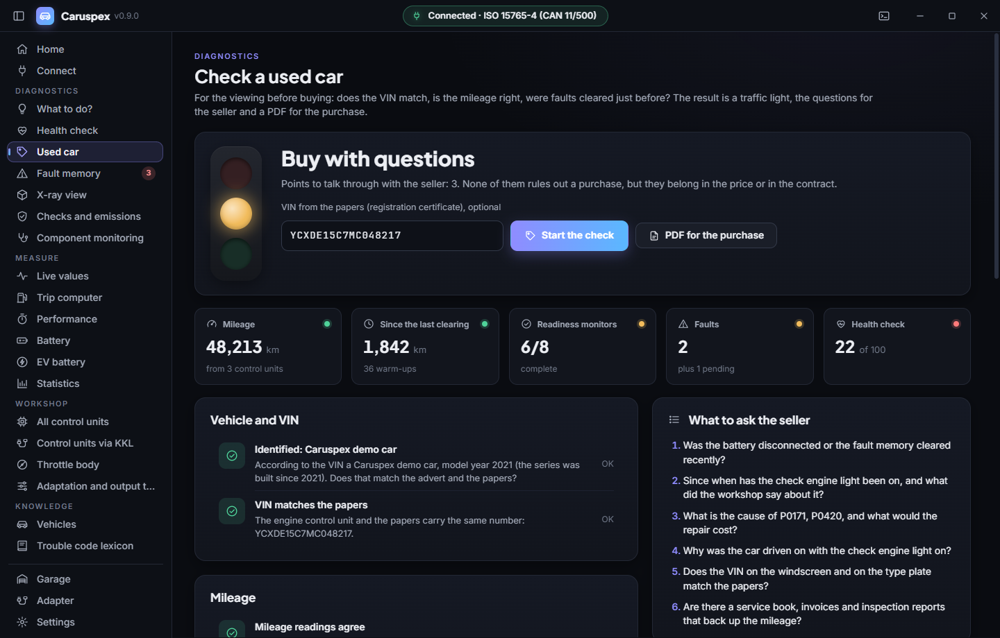
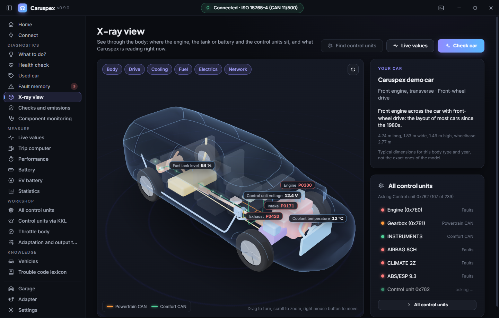

# Caruspex

<!-- languages -->
[English](README.md) · [Deutsch](README.de.md) · [Español](README.es.md) · [Français](README.fr.md) · [Português](README.pt.md) · [Italiano](README.it.md) · [Nederlands](README.nl.md) · [Polski](README.pl.md) · [Čeština](README.cs.md) · [Русский](README.ru.md) · [Українська](README.uk.md) · [Türkçe](README.tr.md) · [العربية](README.ar.md) · **中文** · [日本語](README.ja.md) · [한국어](README.ko.md) · [हिन्दी](README.hi.md) · [Bahasa Indonesia](README.id.md)
<!-- /languages -->

[](https://github.com/SenseiIssei/Caruspex/actions/workflows/build.yml)


[](LICENSE)

适用于 Windows、Linux 和 macOS 的开源车辆诊断软件，用 Rust 编写，界面基于 Tauri 2。
一根线缆或一个适配器，一个应用：读取和清除故障码，查看实时传感器数据，
检查排放就绪状态，还能通过 K-Line 线缆在字节层面与大众/奥迪的控制单元通信。

名字来自 *haruspex*，即古罗马通过动物内脏解读预兆的占卜师。Caruspex 读的是汽车的内脏。

应用支持 18 种语言，界面和每一条故障码文本都是如此：英语、德语、西班牙语、
法语、葡萄牙语、意大利语、荷兰语、波兰语、捷克语、俄语、乌克兰语、土耳其语、阿拉伯语（从右到左）、中文、
日语、韩语、印地语和印度尼西亚语。应用会跟随系统语言，也可以在设置中切换，
或者用 `--language fr` 之类的参数在单次运行时指定。翻译如何制作和检查，请看
[translations/TRANSLATING.md](translations/TRANSLATING.md)。


## 亮点

- **两套完整的诊断体系**：通过任意 ELM327 适配器进行标准 OBD-II/EOBD 诊断，以及通过原始 KKL K-Line 线缆进行大众/奥迪
  厂家诊断（KWP1281 和 KWP2000）。
- **协议全部从零实现**：KWP1281 要用每个字节的反码来应答每一个字节，
  这是 ELM327 固件做不到的。Caruspex 自己驱动 K-Line，包括 5 波特的唤醒
  地址：通过切换串口 break 信号来逐位发送，并采用基于截止时间的计时，这样操作系统
  的调度抖动就不会在这十个位上累积。
- **自动识别协议**：唤醒之后，ECU 的两个密钥字节会说明它使用
  KWP1281 还是 KWP2000（ISO 14230），Caruspex 随之自动切换。
- **模块化的 Rust 工作区**：每个领域一个 crate（适配器连接、协议、网络和 CAN、车辆、数据、
  记录、分析、演示车辆、命令行工具），其上是 Tauri 应用。核心对界面一无所知，
  所以应用和命令行工具运行的是完全相同的代码。
- **无需真车即可测试**：模拟的 ECU（`crates/caruspex-protocols/tests/common/`）重现
  逐字节握手，假网关替代 ENET 和 DoIP，假的 J2534 驱动覆盖 PassThru 路径，
  还有一个 Python 的 ELM327 模拟器，可以对应用做端到端运行。
- **一套翻译**：核心和界面共用 `translations/<code>/` 中的同一批翻译文件，
  共 18 种语言。核心按英文文本查找文本，界面
  用同样的文件生成自己的词库。
- **认得每一辆车**：包含 365 个厂家代码的 VIN 解码器，以及 1980 年以来
  超过 2,100 个车型世代的目录，能告诉你连接的是哪辆车、哪些功能可用。
- **内置演示车辆**：进程内的 ELM327，带有 CAN 上的发动机和变速箱，
  无需硬件就能试用所有功能。
- **数据是生成的，不是手敲的**：约 1,700 个故障码，其中很多由 `tools/gen_dtc.py` 根据规则化的代码族
  （每缸、每排、每个氧传感器）计算得出。

## 功能

### 认得你的车
- 连接后，Caruspex 读取 VIN 并告诉你这是哪辆车：品牌、车型、世代、年款。
- 目录收录 94 个品牌、超过 2,100 个车型世代，从 1980 年到今天，包括已经不存在的品牌。
- 每个世代都写明：用哪种诊断接口、在哪里、哪种协议，以及 OBD-II、KKL 线缆还是只有厂家自己的工具才能用。
- 可检查任意 VIN：厂家、国家、年款、校验位、车型代码。
- 车库用 VIN 认出每辆车，并保存它的检查历史和里程表读数。


### 一键健康检查
- 读取故障存储器、准备就绪监测项和组件测试，然后用半分钟观察混合气、温度、氧传感器和充电电压。
- 0 到 100 的评分，每一个扣分点都用通俗的话解释，并给出下一步。
- 能通过排放检测吗？哪个监测项还没完成，以及该怎么开才能完成。
- 可生成 PDF 格式的诊断报告，用于打印或交给修理厂。


### 故障存储器
- 已存储、待定和永久性故障码；有多个控制单元时，每个故障码都会显示是谁报告的（发动机、变速箱）。
- 约 1,400 个标准故障码（P、C、B、U），外加大众集团、福特、通用、丰田、本田、日产、现代/起亚、斯巴鲁等的厂家故障码。P1 故障码按识别出的品牌的含义来读取。
- 每个故障码一个红绿灯，回答大家最先想问的问题：还能继续开吗？
- 常见原因、你可以自己检查的项目，以及大致的费用等级。
- 透视视图下的汽车会显示受影响的部件在哪里。
- 清除前有明确警告，清除后自动重新读取；可导出 CSV。


### 我现在该怎么办？
- 一个页面，把 Caruspex 发现的一切分成三步：立即停车、尽快去维修厂、可以再等等。
- 每一条都有一句通俗的原因说明、大致的费用范围，以及可在维修厂出示的备注（故障码、控制单元、部位、常见原因）。
- OBD 看不到发动机故障灯是否在闪烁、红色警告灯是否亮起：所以用两个勾选框来询问，灯在闪烁且伴有失火时，这一条会移到“立即停车”。


### 检查二手车
- 用于买车前的看车：车上的 VIN 与证件和数据库是否一致，各控制单元的里程是否相符，故障是否在不久前被清除过（清除后的行驶距离和时间）？
- 就绪监测器、已存储的故障、健康检查，电动车还有电池状态。
- 一个红绿灯式的结论、可以问卖家的问题，以及用于购车的 PDF。



### 3D 透视视图
- 已连接的车辆以可旋转的玻璃模型呈现：发动机或电机、变速箱、油箱或高压电池、排气、散热器、12 V 电池和 OBD 接口，按识别出的车辆的车身类型和驱动方式布置。
- 扫描发现的每个控制单元都位于通常的位置，并用各自的数据线相连（动力 CAN 和舒适 CAN）；Caruspex 读取时，小数据包会流向被询问的控制单元。
- 故障会点亮所在部位并把相关控制单元变红，实时数值显示在所属部件上，点“检查车辆”镜头会飞向每个发现。图层可以逐个关闭。
- 这是按车身类型和年代给出的典型尺寸，不是具体车型的复刻：厂家的设计数据和电路图并未公开。



### 实时数据
- SAE J1979 的所有模式 01 数值，直到 PID C4：145 个 PID，超过 300 种读数，可分组、可搜索。
- 里程表、档位、机油温度、油耗率、扭矩、增压、排气温度、颗粒捕集器、AdBlue、NOx 和混合动力电池，只要车辆会报告。
- 滚动图表和 CSV 记录。


### 测量
- 行车电脑：实时和平均油耗、费用、CO2、里程和温和的驾驶风格评分，没有自带行车电脑的车也能用。
- 性能：根据车速信号测量 0 到 100 km/h、80 到 120、四分之一英里和制动距离（仅限封闭道路）。
- 蓄电池和发电机：静态电压、启动压降、带负载和不带负载的充电电压，分四步引导完成。

### 检查
- 用通俗的话说明准备就绪监测项、冻结帧、VIN。
- 模式 06 组件监测，带数值和限值，以及每个气缸的失火次数。
- 来自模式 09 的 ECU 名称、标定 ID 和校验和，按控制单元分别显示。
- 原始 ELM327 终端。

### 适配器测试
- 是正品 ELM327 还是克隆？它会询问各版本的指令，测量响应时间，并如实说明由此能得出什么结论。
- 能识别 OBDLink 和其他 STN 适配器。
- 绝不向适配器写入任何内容。


### 每种线缆，每条进入汽车的途径
Caruspex 会自己判断插的是什么、车说的是什么协议。

| 接口 | 示例 | 方式 |
|---|---|---|
| 通过 USB、蓝牙、蓝牙 LE、Wi-Fi 的 ELM327 | 便宜的 ELM327、Vgate、vLinker、Veepeak | 串口、已配对或直连的 BLE、TCP |
| STN 芯片 | OBDLink SX、EX、MX+、CX | 与 ELM327 相同，计时更快 |
| SAE J2534 PassThru | Tactrix OpenPort 2.0、Mongoose、VCX Nano、Scanmatik、Godiag、J2534 模式下的 VAS 5054A | 厂家的 64 位驱动，带 ISO-TP 的 CAN 由 Caruspex 完成 |
| SLCAN / Lawicel | CANable、USBtin、CANUSB | 串口，由自动端口搜索找到 |
| SocketCAN（Linux） | PEAK PCAN-USB、Kvaser、带 candleLight 的 CANable、树莓派 CAN 扩展板 | can0 等 |
| KKL 线缆（VAG 409.1） | FTDI 或 CP2102 线缆 | K-Line、KWP1281 和 KWP2000 |
| ENET 线缆 | F 系列起的宝马和 Mini | 以太网上的 HSFZ |
| DoIP 线缆 | 2016 年前后起的许多车 | 以太网上的 ISO 13400 |

在其中任何一种上，相同的功能都能使用：OBD-II 和基于 UDS 的 OBD、通过 UDS 访问每个控制单元、宝马
寻址、监听广播数值（特斯拉）、记录和回放。


### 通过 CAN 访问所有控制单元（UDS）
- 即使只有普通的 ELM327，Caruspex 也会逐个询问每个控制单元：发动机、变速箱、ABS、安全气囊、组合仪表、空调等，大多数 2008 年前后起的车都可以。
- 每个单元各自的故障存储器，带故障类型（短路、断路、不合理……）、零件号、软件和硬件版本。
- 有大众集团、宝马和 Mini、福特、马自达、通用、丰田、日产、现代/起亚、雷诺和 PSA 的地址表；其他品牌则扫描常用地址。
- F 系列起的宝马和 Mini 通过 6F1 使用宝马自己的扩展寻址，并可扫描全部 128 个诊断地址；故障码采用 ISTA 显示的宝马格式（例如 480A10）。
- 按单元清除，并有警告。


### 通过 KKL 线缆诊断大众和奥迪（KWP1281 和 KWP2000）
- 节气门体适配：在测量数据块 060 或 098 中进行真正的基本设定。
- 扫描每个控制单元，包括 ABS、安全气囊、组合仪表和舒适系统，并生成可打印的报告。
- 适配通道和输出测试，有意设计为只读。

### 厂家数值和自定义数值
- 电动车电池：健康状态、电量、带离散度的单体电压、温度，支持现代 Kona 和 Ioniq、起亚 e-Niro、雷诺 Zoe、日产 Leaf 以及特斯拉 Model 3 和 Y（通过监听 CAN 总线）；每个数值都有文档可查的来源。
- 来自 [OBDb](https://github.com/OBDb) 项目的约 550 款车型的厂家数值（电池、胎压、机油、里程等），会针对识别出的车辆自动提供；每个公式都用 OBDb 自己的解码器核对过。
- 加载你自己的数值，使用广泛的 Torque CSV 格式，并有完整的 Torque 公式求值器。


### 记录和回放
- 把与车的一次会话记录到文件里，之后无需车辆就能回放，排查问题很方便。

### 没有车或适配器也能用
- 内置演示车辆：会行驶、会升温、存有几个故障，并且像真正的 ELM327 一样通过 CAN 通信。
- 所有故障码的离线词典，可按品牌筛选。

### 外观与手感
- 采用 Odysync 风格的全新界面：平静、深色、过渡流畅。
- 分步连接，并自动搜索所有端口；失败时会给出针对该连接类型的简短清单（驱动、配对、点火、比特率、仿制适配器），并附上 Caruspex 已查明的情况。
- 新手模式和专业模式：新手只看到日常页面，维修厂工具（KKL、匹配、原始命令、地址）在专业模式中出现。
- 18 种语言；设置立即生效。
- 有新版本时会提醒你：启动时向 GitHub 询问最新发布版本，仅此而已（不发送任何关于你
  或车辆的数据）；可以在设置中关闭。

## 支持的车辆

任何带 OBD-II 或 EOBD 的车辆：在欧洲是 2001 年起的汽油车和 2004 年起的柴油车，在美国是 1996 年起。1990 年前后起的较老款大众、奥迪、西雅特和斯柯达可以通过 KKL 线缆使用。车辆页面会告诉你某辆车该走哪条路。

| 年代 | 总线 | 示例 |
|---|---|---|
| 约 1995 年之前 | 厂家专用 | VAG 通过 2x2 插头用 KKL，其他车只有修理厂工具 |
| 1996 年至约 2003 年 | K-Line（ISO 9141-2、KWP2000） | 奥迪 A2、大众高尔夫 IV、丰田、雷诺 |
| 约 2004 年起 | CAN（ISO 15765-4） | 奥迪 A4 B7、大众高尔夫 V、现代日系车 |
| 美国约 2005 年之前 | SAE J1850 PWM 和 VPW | 福特、雪佛兰 |
| 最新的车 | 基于 UDS 的 OBD（SAE J1979-2） | 美国自 2027 款起强制要求，部分较新的车已经采用；自动识别并转换 |
| F 系列起的宝马和 Mini | ENET（以太网上的 HSFZ）或带 6F1 寻址的 D-CAN | 每个控制单元 |
| 2016 年前后起的许多车 | 使用 DoIP 线缆的 DoIP（ISO 13400） | 以太网上的 OBD，自动发现 |
| 特斯拉 Model 3 和 Y | 没有 OBD：广播 CAN 帧 | 通过监听获得电池、单体、温度、车速、里程表（需要接到诊断接口的转接线） |

纯电动车不必提供 OBD-II 排放数据。有些车仍会部分应答；对于完全没有应答、但总线上有数据流量的车，Caruspex 会以监听方式连接，并读取内置数据包所了解的内容（目前是特斯拉 Model 3 和 Y）。

## 支持的适配器

- 任何兼容 **ELM327** 的适配器：USB、经典蓝牙（配对后在 Windows 和 Linux 上直接通过 RFCOMM，或通过它的 COM 端口）、**蓝牙 LE**
  （Vgate iCar Pro BLE、vLinker、OBDLink CX、Veepeak BLE，以及其他带常见 GATT 服务的适配器；通过
  扫描找到，无需配对）或通过 TCP 的 Wi-Fi
- 适用于 F 系列起宝马和 Mini 的 **ENET 线缆**（OBD 转 RJ45）：Caruspex 在网络上找到这辆车
  （HSFZ，端口 6811 和 6801），并通过以太网读取每个控制单元，中间没有适配器芯片。电脑
  需要自动获取的地址（169.254.x.x），在没有 DHCP 应答时，Windows、macOS 和 Linux 会自己分配。
  这里 Caruspex 同样只读取；编码和刷写仍交给 E-Sys、ISTA 或调校工具。
- 任何 **KKL 线缆（VAG 409.1）**。基于 FTDI 或 CP2102 的线缆在 K-Line 上比最便宜的
  克隆品可靠得多；对于 KWP1281，推荐正品 FTDI FT232RL。

Delphi DS150E、Autocom 或 VAS 5054A 等专有接口不受支持，它们不说 ELM327。

| 功能 | ELM327 | KKL 409.1 |
|---|---|---|
| 读取和清除发动机故障 | 是 | 是 |
| 实时数据、冻结帧、就绪状态 | 是 | 是 |
| ABS、安全气囊、组合仪表、舒适系统 | **否** | 是 |
| 厂家测量数据块 | **否** | 是 |
| **节气门体适配** | **否** | 是 |

这是硬件限制，不是软件限制：KWP1281 是一种数据块协议，每个字节都要
由对方应答。ELM327 固件只能处理完整的请求/响应对。
KKL 线缆把 K-Line 原样透传，所以 Caruspex 可以自己说这个协议。

### 两种 VAG 协议，自动识别

| 协议 | 典型用于 | 基本设定 |
|---|---|---|
| KWP1281（数据块协议） | 1.4 MPI 发动机 | 专用指令（数据块 0x28） |
| KWP2000（ISO 14230） | 带博世 MED 的 1.6 FSI | 专用诊断会话，然后读取数据块 |

适配通道和输出测试目前在 KWP1281 路径上实现；在 KWP2000 上，
应用会明说这一点，而不是悄悄失败。

尚未实现：通过 CAN 使用 VW TP 2.0 的厂家诊断（2004 年前后起的车辆）。

## 技术栈

| 领域 | 技术 |
|---|---|
| 语言 | Rust（edition 2024） |
| 界面 | Tauri 2，搭配 React 19 和 TypeScript，用 Vite 构建 |
| 库 | `serialport`（串口）、`btleplug`（蓝牙 LE）、`libloading`（J2534 驱动） |
| 本地化 | `translations/` 中一套 JSON 文件，核心和界面共用，18 种语言 |
| 构建 | Cargo 工作区，界面用 npm |
| 测试 | 针对模拟 ECU、假网关和假 J2534 驱动的 `cargo test` |
| 工具 | Python 3（代码和表格生成器、翻译检查、ELM327 模拟器） |
| 平台 | Windows 10 和 11、Linux、macOS |

## 下载

现成的安装包在 [发布页面](https://github.com/SenseiIssei/Caruspex/releases)：

| 系统 | 文件 | 说明 |
|---|---|---|
| Windows 10 和 11，64 位 | `Caruspex-<version>-windows-x64-setup.exe` | 无需管理员权限即可安装，并可把 `caruspex_cli` 加入搜索路径。它会原地更新已安装的 0.8，并且仅在缺少时才安装 WebView2 运行时 |
| Windows 10 和 11，64 位 | `Caruspex-<version>-windows-x64.zip` | 便携版，解压即用。需要 WebView2 运行时，Windows 10 和 11 已自带 |
| macOS 13 及更新，Apple Silicon | `Caruspex-<version>-macos.dmg` | 把应用拖到“应用程序” |
| Linux，x86_64 | `Caruspex-<version>-linux-x86_64.AppImage` | `chmod +x` 后启动 |
| Debian 和 Ubuntu，64 位 | `Caruspex-<version>-linux-amd64.deb` | 用 `sudo apt install ./Caruspex-<version>-linux-amd64.deb` 安装 |
| 仅命令行工具 | `caruspex_cli-<version>-windows-x64.zip`、`caruspex_cli-<version>-linux-x86_64.tar.gz`、`caruspex_cli-<version>-macos.tar.gz` | 用于脚本和服务器，没有界面 |

这些安装包还没有签名。Windows SmartScreen 在第一次启动时会询问（“更多信息”，“仍要运行”）；在 macOS 上
第一次请右键点击应用并选择“打开”。

## 构建

要求：稳定版 Rust 工具链（edition 2024，Rust 1.85 或更新）、带 npm 的 Node 24，以及用于
生成器和翻译检查的 Python 3。在 Linux 上还需要界面和适配器连接所需的系统软件包
（Debian 和 Ubuntu 的包名）：

```bash
sudo apt-get install libwebkit2gtk-4.1-dev librsvg2-dev libdbus-1-dev libudev-dev pkg-config
```

Windows 需要 WebView2 运行时（Windows 10 和 11 已自带），macOS 不需要额外的东西。

先安装一次界面依赖，然后构建命令行工具和应用：

```bash
npm --prefix app ci
```

```bash
cargo build --release -p caruspex-cli
```

```bash
npm --prefix app run tauri -- build
```

`npm --prefix app run tauri -- dev` 会在你开发时以实时重载方式启动应用。只运行
界面、不带 Tauri 窗口，可以在普通浏览器里配合内置演示车辆运行：

```bash
npm --prefix app run dev
```

打开 `http://localhost:5287/?demo` 即可立刻连接演示车辆。`?lang=de` 选择语言，
`?theme=light` 选择浅色主题，例如 `?demo&lang=de&theme=light`。没有 Tauri 外壳就无法
访问适配器，所以浏览器版本只认得演示车辆。

### Linux 上的串口权限

不用 `sudo` 访问适配器：

```bash
sudo usermod -aG dialout $USER
```

然后注销并重新登录。

## 构建产物

| 产物 | 说明 |
|---|---|
| `target/release/caruspex` / `caruspex.exe` | 带 Tauri 界面的应用（`tauri build` 还会把安装程序和安装包写入 `target/release/bundle/`） |
| `target/release/caruspex_cli` / `caruspex_cli.exe` | 基于同一核心、可用脚本调用的命令行工具，见 [命令行工具](#命令行工具) |

### 安装包和发布

`bash tools/package.sh` 会把当前系统的安装包构建到 `dist/`：在
Windows 上是安装程序和两个 zip（安装程序需要 [Inno Setup 6](https://jrsoftware.org/isinfo.php)），在 macOS 上是 dmg 和命令行压缩包，
在 Linux 上是 AppImage、`.deb` 和命令行压缩包。然后 `bash tools/smoke_test.sh` 会像用户那样安装或
打开它们，启动两个程序，再把它们移除。CI 每次运行都会做这两件事。

发布来自一个标签。`bash tools/release.sh <version>` 会在它自己的分支上做好准备，不推送任何东西：
它会设置 `Cargo.toml` 和 `app/package.json` 中的版本，创建 `changelog/<version>.md`（德语和英语），
运行检查、测试、打包和冒烟测试，并刷新 README 截图（`tools/screenshots.sh de` 和
`tools/screenshots.sh en`）。拉取请求合并之后，打上标签 `v<version>` 并推送标签。CI 会为全部
三个系统构建，并连同安装包和变更列表一起发布。

CI（`.github/workflows/build.yml`）先在 Linux 上运行格式检查、生成表检查、翻译检查、
界面构建和 clippy，然后对 Windows、Linux 和 macOS 做测试、打包和冒烟测试。
第二个工作流（`.github/workflows/data-check.yml`）每月检查一次上游有没有新的 VIN 代码、车辆和 DBC 文件，
并创建一个 issue 列出新内容。

## 测试

```bash
cargo test --workspace
```

大约 370 个测试在几秒钟内跑完，全都不需要车。它们覆盖 ELM327 响应解析器、故障码
解码、PID 转换、车辆档案和 VIN 解码器、针对演示车辆的 OBD-II 和 UDS 服务、
针对模拟控制单元的完整 KWP1281 和 KWP2000 会话、针对假网关的 ENET（HSFZ）和 DoIP、
针对假驱动的 SLCAN 和 J2534 路径、记录和回放，以及分析（健康检查、蓄电池测试、
行车电脑、性能计时器）。命令行测试运行构建好的 `caruspex_cli`，并把它的输出与
`crates/caruspex-cli/tests/golden/` 中的黄金文件比较，这些文件保存了早期 C++ 版本对相同
命令的输出，所以与旧工具的任何差异都会显现出来。

CI 除了测试之外还会运行这些检查：

```bash
cargo fmt --all --check
```

```bash
cargo clippy --workspace --all-targets -- -D warnings
```

```bash
python tools/i18n_rust.py --strict
```

```bash
npm --prefix app run build
```

前两个是格式和 lint。当核心里的某个文本在翻译文件中缺失，或者 18 种语言中某一种缺少翻译时，
`tools/i18n_rust.py --strict` 会失败；设置 `I18N_STRICT=1` 时，界面构建会以同样的方式检查它自己的
文本。运行 `python tools/gen_dtc.py`、`gen_vehicles.py`、`gen_ecus.py` 和
`gen_pids.py` 来刷新生成的表；如果它们与已提交的内容不同，CI 会失败。

## 没有车也能试用

最快的方式是内置演示车辆：在连接页面选择“演示车辆”，或者这样启动

```bash
target/release/caruspex --demo --language en
```

`caruspex --help` 会列出应用的所有选项：`--tcp`、`--port`、`--bluetooth`、`--enet`、`--can`、
`--replay`、`--report`、`--language`、`--theme`、`--page`、`--shot` 和 `--size`。

Python 模拟器要么模拟 K-Line 上的奥迪 A2 发动机，要么用 `--can` 模拟一辆带发动机
和变速箱的 CAN 车（报头、ISO-TP、每个控制单元的模式 06 和 09）：

```bash
python tools/mock_elm327.py --can
```

然后连接应用（在 Windows 上可执行文件是 `target/release/caruspex.exe`）：

```bash
target/release/caruspex --tcp 127.0.0.1:35000 --language en
```

命令行工具同样可以对模拟器使用：

```bash
target/release/caruspex_cli read --tcp 127.0.0.1:35000
```

### 命令行工具

`caruspex_cli <command>`，可搭配 `--demo`、`--tcp HOST[:PORT]`、`--port NAME [--baud N]`、`--enet HOST|auto`、
`--can SPEC` 或 `--replay FILE`：

| 命令 | 作用 |
|---|---|
| `read` | 故障灯、就绪状态和故障码，当 VIN 能确定品牌时附带该品牌下的含义 |
| `vin` | VIN、它所表达的信息（厂家、国家、年款、校验位）以及目录中匹配的车 |
| `freeze` | 所有冻结帧，每个已存储的故障一个 |
| `health` | 健康检查：故障、就绪状态、模式 06 和一段实时序列（`--seconds N`，默认 15） |
| `probe` | 适配器测试：ELM327 究竟是什么、它认得哪些指令、往返时间 |
| `uds` | CAN 上的 UDS：每个控制单元的标识和故障存储器（`--ids A,B,...` 用于你自己的地址） |
| `custom` | 内置数据包（`--pack NAME`）或 Torque CSV（`--csv FILE`）中的厂家和自定义数值，一次 |
| `live`、`info`、`clear`、`ecus`、`ports`、`kklcheck` | 实时数值、VIN 和第一个冻结帧、清除、全部按控制单元、串口、KKL 线缆自检 |
| `enet`、`interfaces` | 在网络上查找宝马和 Mini 车辆以及 DoIP 车辆；列出这台电脑的 CAN 接口（J2534 驱动、SocketCAN） |
| `version`、`help` | 程序版本，完整的命令和选项列表 |

`--json` 会把 `read`、`vin`、`health`、`probe`、`freeze`、`uds` 和 `custom` 以 JSON 输出，便于脚本使用，`--record FILE`
会把与适配器的整个会话保存下来供 `--replay` 使用，`--fast-timing` 会把适配器切换到激进的自适应
计时，`-v` 会记录每条适配器指令（与 `--json` 同时使用时输出到 stderr）。`caruspex_cli help` 会列出所有内容。

```bash
target/release/caruspex_cli health --demo --json > health.json
```

本页的截图来自演示车辆，由应用自己拍摄：
`--demo --page faults --shot shot.png --size 1440x920` 会打开一个页面，几秒钟后保存窗口的图片
然后退出（`tools/screenshots.sh` 会拍完整套）。

## 项目结构

```
crates/caruspex-i18n/       语言：德语和英语写在代码里，其余 16 种来自 translations/
crates/caruspex-vehicles/   VIN 解码器和车辆目录（品牌、车型、世代、接口、总线）
crates/caruspex-data/       故障码、PID、控制单元地址、故障码到部件的映射
crates/caruspex-link/       通往适配器的途径（串口、TCP、蓝牙 LE）、ELM327 驱动、适配器测试
crates/caruspex-protocols/  OBD-II、UDS、KWP2000 和 KWP1281（K-Line，逐字节）
crates/caruspex-net/        宝马 ENET（HSFZ）、DoIP、SLCAN、SocketCAN、J2534 PassThru
crates/caruspex-record/     记录和回放、自定义数值（Torque CSV、PID 数据包）、JSON 写入器
crates/caruspex-analysis/   健康检查、行驶循环指南、行车电脑、性能计时器、蓄电池测试
crates/caruspex-demo/       内置演示车辆：带模拟控制单元的 ELM327
crates/caruspex-cli/        命令行工具及其黄金文件测试
app/src/                    界面：React 19 和 TypeScript（页面、外壳、状态、报告、i18n）
app/src-tauri/              Tauri 应用：窗口、命令、更新检查、命令行选项
translations/               核心和界面共用的翻译文件，18 种语言
data/                       手工维护的 CSV 车辆目录、控制单元和 PID 数据源
tools/                      生成器、翻译检查、打包、发布和截图脚本、ELM327 模拟器
docs/                       README 的截图
packaging/                  Windows 安装脚本、Linux desktop 文件、macOS Info.plist
changelog/                  每个版本的发布说明，德语和英语
```

故障码数据库是生成的：`tools/gen_dtc.py` 会把规则化的 EOBD 代码族和
`tools/dtc/` 中精心整理的列表展开为 `crates/caruspex-data/src/generated/*.rs`。修改数据后重新运行它：

```bash
python tools/gen_dtc.py
```

车辆目录的工作方式相同：编辑 `data/vehicles/` 中的 CSV 文件，然后运行

```bash
python tools/gen_vehicles.py
```

控制单元地址和 PID 数据包有 `tools/gen_ecus.py` 和 `tools/gen_pids.py`。翻译的说明在
[translations/TRANSLATING.md](translations/TRANSLATING.md)；在代码中添加文本之后，
`python tools/i18n_rust.py` 会列出还需要翻译的内容。

## 关于清除故障码的说明

OBD 模式 04 会清除故障存储器、冻结帧和准备就绪监测项。紧接着
车辆在完成数个完整的行驶循环之前都无法通过排放检测，而且如果故障原因
仍然存在，开一小段路之后故障码还会回来。清除不等于修好。

## 免责声明

Caruspex 是一个业余项目，不提供任何保证。使用风险自负，只能用于
你有权操作的车辆，绝不能在驾驶时使用。所有产品和品牌名称均为其
各自所有者的商标；Caruspex 与任何车辆制造商均无关联，也未获其认可。

## 许可证

MIT，见 [LICENSE](LICENSE)。数百款车型的厂家数值转换自 [OBDb](https://github.com/OBDb)，并与 OBDb 一样采用 CC BY-SA 4.0 许可：它们与代码分开存放在 [data/obdb](data/obdb)，附有许可证和来源列表（[ATTRIBUTION.md](data/obdb/ATTRIBUTION.md)）。
随附的字体采用 SIL Open Font License 1.1 授权：
JetBrains Mono（[OFL.txt](resources/fonts/OFL.txt)）、Inter（[OFL-Inter.txt](resources/fonts/OFL-Inter.txt)）和
Plus Jakarta Sans（[OFL-PlusJakartaSans.txt](resources/fonts/OFL-PlusJakartaSans.txt)）。
